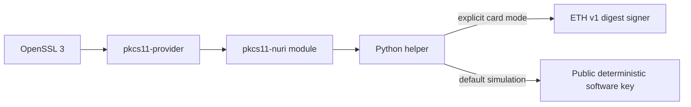

# PKCS#11 and OpenSSL secp256k1 signing



A limited signing adapter, **not a certified HSM**. It exposes one secp256k1
key, label `Nuri ETH Key`, ID `01`, and `CKM_ECDSA` on exactly 32-byte digests.
PKCS#11 returns raw `r32 || s32`; the OpenSSL provider converts that to DER.
No RSA, P-256, Ed25519, key import/generation, multipart signing or ordinary TLS
server-key integration is implemented. [Module](../scripts/pkcs11-nuri.c),
[helper](../scripts/pkcs11-helper.py), [end-to-end check](../scripts/test-pkcs11-e2e.py).

## Authorization and mode

The adapter selects **ETH v1**, not ETH2. It has no PIN authentication:
`C_Login` accepts a PIN without checking it, and ETH1 SIGN has no PIN/touch gate.
Reader/OS access is signing authority. ETH2's mandatory-default PIN is a separate
applet property; it does not protect this adapter. No screen; blind signing.

Only exact `NURI_PKCS11_MODE=card` selects hardware. Unset/other values select a
public deterministic simulator key. Never fund that key or infer hardware from a
successful signature. Both module mode and the selftest's `--card` switch are
required for explicit physical-card testing.

## Software check

Prerequisites: macOS C toolchain, OpenSSL 3 (not system LibreSSL), `pkg-config`,
OpenSC's `pkcs11-tool`, and Python 3.12+ with `ecdsa`; card mode also needs
`pyscard`. The provider build needs network access and pins its release/hash.
No new source dependency is added by this documentation change.

```sh
bash scripts/build-pkcs11.sh
export NURI_PKCS11_PYTHON=python3  # choose an environment with ecdsa installed
export NURI_OPENSSL="$(command -v openssl)"  # must be OpenSSL 3
unset NURI_PKCS11_MODE NURI_PKCS11_PROVIDER PKCS11_PROVIDER_MODULE
bash scripts/hsm-openssl-selftest.sh
```

[Selftest](../scripts/hsm-openssl-selftest.sh) builds a disposable
[pkcs11-provider](../scripts/build-pkcs11-provider.sh), unless an existing provider
is explicitly supplied. Build sources/tools/prefix and test files are cleaned on
exit. It exports the public key, tests prehashed `pkeyutl` and message-hashing
`dgst`, verifies with OpenSSL and python-ecdsa, rejects a modified digest, wrong
input length and wrong label, then exercises `pkcs11-tool`.
Require `HSM_OPENSSL_SELFTEST_OK mode=sim`, not a zero exit from a skipped tool.
The [simulator transcript](proofs/hsm-openssl-sim.txt) normalizes machine-specific
paths to `<REPO>`/`<WORKSPACE>`; it is not a hardware transcript.

## Physical-card run 2026-10-18

The launch operator reports a completed real-card OpenSSL run on the existing
ETH v1 demo key: OpenSSL 3.6.5 + pkcs11-provider v1.3.0 on macOS 15.5 arm64,
with OpenSSL and python-ecdsa verification and the PKCS#11 signing checks.
This is an operator-reported acceptance receipt, not a new run by the docs worker
or a claim about ETH2, concurrent applications, TLS services or other batches.
[Reader run records](reader-compatibility.md#hardware-runs-parent-physical-card)
separately record PKCS#11 signing on OMNIKEY 5422 and ACS ACR39U.

Recorded demo public key:
`0239a28d96002c4950a3052a9288da801085aba4a9d4907ab6d93d6b97c29006e0`.
For your own already-keyed, separately authorized test card, pin its independently
read public key and select the intended reader; never replace the expected key
merely to make a mismatch pass:

```sh
: "${EXPECTED_CARD_PUBKEY:?set independently read compressed public key}"
NURI_PKCS11_EXPECTED_PUBKEY="$EXPECTED_CARD_PUBKEY" \
NURI_PKCS11_MODE=card bash scripts/hsm-openssl-selftest.sh --card
```

Expected marker is `HSM_OPENSSL_SELFTEST_OK mode=card`. This procedure signs test
digests; it does not KEYGEN, install, reset or migrate any applet. Do not run it
as a read-only inventory command. Never use an operational sole SSH card for
installation experiments.

## Remaining limits

- Host compromise can choose any digest. No secure channel or physical-touch check.
- Module-global session/object state and helper spawning do not establish
  multi-client/concurrent or long-lived server operation.
- Linux runtime/installer acceptance is UNVERIFIED; build script uses macOS flags.
- No objects can mean failed public-key discovery; inspect transport failures,
  not reset/key generation. [Reader troubleshooting](reader-compatibility.md).
- SSH uses the separate FIDO2 `ecdsa-sk` bridge, not this ETH/secp256k1 object.
- Bearer-credential brokering uses the [credential vault](card-secrets.md), not
  PKCS#11. PIN/host-memory/recovery boundaries are path-specific.
