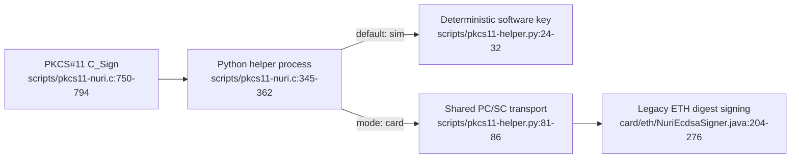

# PKCS#11 signing bridge



This is a limited PKCS#11 signing adapter, not evidence of a certified HSM. Certification, physical extraction resistance, throughput and hardware acceptance are **UNVERIFIED** here.

## What is implemented

| Interface | Source-backed scope |
|---|---|
| Objects | One slot; public/private EC objects labeled `Nuri ETH Key`, ID `01`; secp256k1 parameters and an uncompressed public point. [scripts/pkcs11-nuri.c:548-556](../scripts/pkcs11-nuri.c#L548-L556), [scripts/pkcs11-nuri.c:660-702](../scripts/pkcs11-nuri.c#L660-L702) |
| Signing | `CKM_ECDSA` only. Caller supplies exactly one 32-byte digest; output is raw 64-byte `r || s`. The card helper drops the legacy applet's recovery byte. [scripts/pkcs11-nuri.c:750-794](../scripts/pkcs11-nuri.c#L750-L794), [scripts/pkcs11-nuri.c:797-805](../scripts/pkcs11-nuri.c#L797-L805), [scripts/pkcs11-helper.py:64-72](../scripts/pkcs11-helper.py#L64-L72) |
| Unsupported operations | Multipart signing returns `CKR_FUNCTION_NOT_SUPPORTED`; hashing, verification, key generation, encryption and key wrapping are not wired in the function table. Public-key verify attributes do not implement `C_Verify`. [scripts/pkcs11-nuri.c:811-847](../scripts/pkcs11-nuri.c#L811-L847) |
| Mode | Only `NURI_PKCS11_MODE=card` selects hardware; unset or any other value selects simulation. The simulation's deterministic software key must not protect assets. [scripts/pkcs11-nuri.c:353-362](../scripts/pkcs11-nuri.c#L353-L362), [scripts/pkcs11-helper.py:24-32](../scripts/pkcs11-helper.py#L24-L32) |
| Helper configuration | `NURI_PKCS11_PYTHON` overrides `python3`; `NURI_PKCS11_HELPER` overrides the helper found relative to the module. [scripts/pkcs11-nuri.c:270-293](../scripts/pkcs11-nuri.c#L270-L293) |

## Access control: legacy bridge versus other applets

**PKCS#11 login is not authentication.** The module omits `CKF_LOGIN_REQUIRED`, advertises zero PIN lengths and accepts any PIN in `C_Login`. Legacy ETH signing checks key initialization and digest length, not PIN or physical approval. Treat access to the reader and helper as signing authority; a compromised host can choose the digest. Sources: [scripts/pkcs11-nuri.c:573-598](../scripts/pkcs11-nuri.c#L573-L598), [scripts/pkcs11-nuri.c:637-641](../scripts/pkcs11-nuri.c#L637-L641), [card/eth/NuriEcdsaSigner.java:151-160](../card/eth/NuriEcdsaSigner.java#L151-L160), [card/eth/NuriEcdsaSigner.java:204-212](../card/eth/NuriEcdsaSigner.java#L204-L212).

The bridge selects legacy ETH AID `4E55524945544801`; it does not use the separate ETH v2 signer. ETH v2 implements an **optional**, configured-PIN session gate, reset on deselection, and returns a different signing response. Do not transfer that PIN property to PKCS#11 or describe it as per-sign touch approval. Sources: [scripts/pkcs11-helper.py:64-86](../scripts/pkcs11-helper.py#L64-L86), [card/eth2/NuriEthSignerV2.java:188-218](../card/eth2/NuriEthSignerV2.java#L188-L218), [card/eth2/NuriEthSignerV2.java:322-343](../card/eth2/NuriEthSignerV2.java#L322-L343).

TOTP is separate too: its admin PIN protects secret replacement after initial provisioning, while CALC accepts an eight-byte counter and computes HMAC-SHA1 without checking that PIN. This is not a general HMAC-SHA256 API or a PKCS#11 authentication mechanism. Sources: [card/totp/NuriOathTotp.java:130-168](../card/totp/NuriOathTotp.java#L130-L168), [card/totp/NuriOathTotp.java:171-209](../card/totp/NuriOathTotp.java#L171-L209).

## Build and software checks

Run from the repository root on macOS; the build script uses `clang -dynamiclib`. Linux build/runtime acceptance is **UNVERIFIED**. Source: [scripts/build-pkcs11.sh:15-22](../scripts/build-pkcs11.sh#L15-L22).

```sh
bash scripts/build-pkcs11.sh
NURI_PKCS11_MODE=sim scripts/run-card-python.sh scripts/test-pkcs11-e2e.py
```

The Python launcher prepares pinned dependencies. The test uses `pkcs11-tool` to inspect objects, sign digests, independently verify signatures and reject a 31-byte input. A missing tool prints `SKIP` and exits successfully: **a zero exit alone is not a passing test**. Sources: [scripts/run-card-python.sh:4-30](../scripts/run-card-python.sh#L4-L30), [scripts/test-pkcs11-e2e.py:47-58](../scripts/test-pkcs11-e2e.py#L47-L58), [scripts/test-pkcs11-e2e.py:64-125](../scripts/test-pkcs11-e2e.py#L64-L125).

## Card-mode qualification

For a separately authorized hardware test, an already provisioned legacy ETH applet is required. The helper only selects it, reads its public key and signs; it does not generate a key. Sources: [scripts/pkcs11-helper.py:64-86](../scripts/pkcs11-helper.py#L64-L86), [scripts/pkcs11-helper.py:120-139](../scripts/pkcs11-helper.py#L120-L139).

```sh
NURI_PKCS11_MODE=card scripts/run-card-python.sh scripts/test-pkcs11-e2e.py
```

The test selects the launcher's interpreter for the module's helper unless `NURI_PKCS11_PYTHON` is already set. Card mode checks three signatures and low-S normalization. This command is a qualification procedure, **not a claim it was run on hardware**. Sources: [scripts/test-pkcs11-e2e.py:57-58](../scripts/test-pkcs11-e2e.py#L57-L58), [scripts/test-pkcs11-e2e.py:88-103](../scripts/test-pkcs11-e2e.py#L88-L103).

## Operational limits

- The adapter spawns helper processes; its session and object state are module-global, with one active session handle. Multi-consumer concurrency and server deployment are **UNVERIFIED**. [scripts/pkcs11-nuri.c:247-260](../scripts/pkcs11-nuri.c#L247-L260), [scripts/pkcs11-nuri.c:345-385](../scripts/pkcs11-nuri.c#L345-L385), [scripts/pkcs11-nuri.c:601-614](../scripts/pkcs11-nuri.c#L601-L614).
- No objects can mean public-key discovery failed: initialization can return success without finding a key, and enumeration then yields none. See [reader compatibility](reader-compatibility.md). [scripts/pkcs11-nuri.c:501-523](../scripts/pkcs11-nuri.c#L501-L523), [scripts/pkcs11-nuri.c:714-740](../scripts/pkcs11-nuri.c#L714-L740).
- OpenSSL-through-PKCS#11 and bearer-credential brokering are **UNVERIFIED** integrations, not supplied guarantees of this adapter. Its exported function table is the supported boundary: [scripts/pkcs11-nuri.c:830-854](../scripts/pkcs11-nuri.c#L830-L854).
