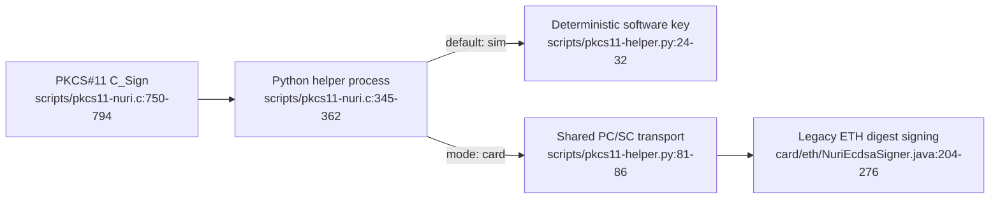

# PKCS#11 signing bridge



This is a limited PKCS#11 signing adapter, not evidence of a certified HSM. Certification, physical extraction resistance, throughput and hardware acceptance are **UNVERIFIED** here.

## What is implemented

| Interface | Source-backed scope |
|---|---|
| Objects | One slot; public/private EC objects labeled `Nuri ETH Key`, ID `01`; secp256k1 parameters and an uncompressed public point. [scripts/pkcs11-nuri.c:548-556](../scripts/pkcs11-nuri.c#L548-L556), [scripts/pkcs11-nuri.c:660-702](../scripts/pkcs11-nuri.c#L660-L702) |
| Signing | `CKM_ECDSA` only. Caller supplies exactly one 32-byte digest; output is raw 64-byte `r || s`. The card helper drops the legacy applet's recovery byte. [scripts/pkcs11-nuri.c:750-794](../scripts/pkcs11-nuri.c#L750-L794), [scripts/pkcs11-nuri.c:797-805](../scripts/pkcs11-nuri.c#L797-L805), [scripts/pkcs11-helper.py:64-72](../scripts/pkcs11-helper.py#L64-L72) |
| Unsupported operations | Multipart signing returns `CKR_FUNCTION_NOT_SUPPORTED`; hashing, verification, key generation, encryption and key wrapping are not wired in the function table. Public-key verify attributes do not implement `C_Verify`. [scripts/pkcs11-nuri.c:811-847](../scripts/pkcs11-nuri.c#L811-L847) |
| Mode | Only `NURI_PKCS11_MODE=card` selects hardware; unset or any other value selects simulation. The simulation's deterministic software key must not protect assets. [scripts/pkcs11-nuri.c:353-362](../scripts/pkcs11-nuri.c#L353-L362), [scripts/pkcs11-helper.py:24-32](../scripts/pkcs11-helper.py#L24-L32) |
| Helper configuration | `NURI_PKCS11_PYTHON` overrides `python3`; `NURI_PKCS11_HELPER` overrides the helper found relative to the module. [scripts/pkcs11-nuri.c:270-293](../scripts/pkcs11-nuri.c#L270-L293) |

## Access control: legacy bridge versus other applets

**PKCS#11 login is not authentication.** The module omits `CKF_LOGIN_REQUIRED`, advertises zero PIN lengths and accepts any PIN in `C_Login`. Legacy ETH signing checks key initialization and digest length, not PIN or physical approval. Treat access to the reader and helper as signing authority; a compromised host can choose the digest. Sources: [scripts/pkcs11-nuri.c:573-598](../scripts/pkcs11-nuri.c#L573-L598), [scripts/pkcs11-nuri.c:637-641](../scripts/pkcs11-nuri.c#L637-L641), [card/eth/NuriEcdsaSigner.java:151-160](../card/eth/NuriEcdsaSigner.java#L151-L160), [card/eth/NuriEcdsaSigner.java:204-212](../card/eth/NuriEcdsaSigner.java#L204-L212).

The bridge selects legacy ETH AID `4E55524945544801`; it does not use the separate ETH v2 signer. ETH v2 implements an **optional**, configured-PIN session gate, reset on deselection, and returns a different signing response. Do not transfer that PIN property to PKCS#11 or describe it as per-sign touch approval. Sources: [scripts/pkcs11-helper.py:64-86](../scripts/pkcs11-helper.py#L64-L86), [card/eth2/NuriEthSignerV2.java:188-218](../card/eth2/NuriEthSignerV2.java#L188-L218), [card/eth2/NuriEthSignerV2.java:322-343](../card/eth2/NuriEthSignerV2.java#L322-L343).

TOTP is separate too: its admin PIN protects secret replacement after initial provisioning, while CALC accepts an eight-byte counter and computes HMAC-SHA1 without checking that PIN. This is not a general HMAC-SHA256 API or a PKCS#11 authentication mechanism. Sources: [card/totp/NuriOathTotp.java:130-168](../card/totp/NuriOathTotp.java#L130-L168), [card/totp/NuriOathTotp.java:171-209](../card/totp/NuriOathTotp.java#L171-L209).

## Build and software checks

Run from the repository root on macOS; the build script uses `clang -dynamiclib`. Linux build/runtime acceptance is **UNVERIFIED**. Source: [scripts/build-pkcs11.sh:15-22](../scripts/build-pkcs11.sh#L15-L22).

```sh
bash scripts/build-pkcs11.sh
NURI_PKCS11_MODE=sim scripts/run-card-python.sh scripts/test-pkcs11-e2e.py
```

The Python launcher prepares pinned dependencies. The test uses `pkcs11-tool` to inspect objects, sign digests, independently verify signatures and reject a 31-byte input. A missing tool prints `SKIP` and exits successfully: **a zero exit alone is not a passing test**. Sources: [scripts/run-card-python.sh:4-30](../scripts/run-card-python.sh#L4-L30), [scripts/test-pkcs11-e2e.py:47-58](../scripts/test-pkcs11-e2e.py#L47-L58), [scripts/test-pkcs11-e2e.py:64-125](../scripts/test-pkcs11-e2e.py#L64-L125).

## OpenSSL 3: simulator-proven PKCS#11 provider route

**Working route:** OpenSSL 3.6.5 + [pkcs11-provider v1.3.0](https://github.com/openssl-projects/pkcs11-provider/releases/tag/v1.3.0) + the existing `dist/pkcs11-nuri.so`, tested on macOS 15.5 arm64. The original `latchset/pkcs11-provider` repository redirects to `openssl-projects/pkcs11-provider`. Both prehashed `pkeyutl` and message-hashing `dgst` signatures verified in OpenSSL and python-ecdsa. The complete build and sim run is recorded in [proof output](proofs/hsm-openssl-sim.txt). **No real reader or card was used for this OpenSSL proof.**

No module compatibility patch was necessary: label `Nuri ETH Key`, ID `01`, public EC parameters and raw `r || s` signing already work with this provider. `scripts/pkcs11-nuri.c`, `dist/pkcs11-nuri.so` and `dist/SHA256SUMS` are unchanged; the module rebuild check returned `PKCS11_BUILD_MATCHES_SHA256SUMS`. Sources: [scripts/pkcs11-nuri.c:680-702](../scripts/pkcs11-nuri.c#L680-L702), [scripts/pkcs11-nuri.c:750-794](../scripts/pkcs11-nuri.c#L750-L794).

The OpenSSL 3 provider is the current route; a libp11 legacy ENGINE fallback was **not needed or tested**. `/usr/bin/openssl` on this Mac is LibreSSL, not the tested OpenSSL 3 executable. Dependency justification: pkcs11-provider supplies the OpenSSL 3 STORE/key/signature integration; Meson and Ninja are build-only dependencies installed into a temporary private directory, not the selected Python environment. Meson/Ninja wheels are version- and hash-pinned in `scripts/requirements-pkcs11-provider-build.txt`; pip/ccache build caching is disabled. The builder pins provider v1.3.0 and verifies release archive SHA-256 `b8bbc30cfb7865603fff1dd0fb516cce90437d8ddb267e331cd89d6121960538`. Sources: [scripts/build-pkcs11-provider.sh:7-50](../scripts/build-pkcs11-provider.sh#L7-L50).

### One-command end-to-end proof

Prerequisites: Homebrew OpenSSL 3, `pkg-config`, OpenSC's `pkcs11-tool`, Apple command-line C tools and Python 3.12+ with `ecdsa` and `pip`. The automatic provider build also needs network access to GitHub/PyPI. Select an existing Python environment that can `import ecdsa`; `requirements-card-v1.txt` alone does not include that package. Card mode additionally needs `pyscard`. The launch-test environment used `/Users/eminmahrt/Developer/nuri-card-wt/_launch/venv/bin/python`.

```sh
# Repository root. Set this to an existing Python environment with ecdsa.
export NURI_PKCS11_PYTHON=python3
export NURI_OPENSSL=/opt/homebrew/bin/openssl
unset NURI_PKCS11_MODE NURI_PKCS11_PROVIDER PKCS11_PROVIDER_MODULE
bash scripts/hsm-openssl-selftest.sh
```

With `NURI_PKCS11_PROVIDER` unset the selftest downloads, hash-checks and builds the provider, uses a worktree-local prefix, then deletes its source, tools, prefix and test files on exit. To reuse an already built provider, set `NURI_PKCS11_PROVIDER` to its absolute `.dylib` path; that externally supplied provider is not deleted. The script rejects an inherited `NURI_PKCS11_MODE=card` unless `--card` is also supplied, and clears the provider's `PKCS11_PROVIDER_MODULE` environment override so it cannot silently replace the configured Nuri module. Sources: [scripts/hsm-openssl-selftest.sh:9-40](../scripts/hsm-openssl-selftest.sh#L9-L40).

Success ends with `HSM_OPENSSL_SELFTEST_OK mode=sim (OpenSSL + python-ecdsa + pkcs11-tool)`. It exports the public key, signs a SHA-256 digest and a message, verifies DER signatures twice, rejects a modified digest, rejects a 31-byte input and a missing key label, and runs the existing OpenSC e2e suite. Expected OpenSSL errors appear during negative controls; they are followed by explicit `PASS` lines. Sources: [scripts/hsm-openssl-selftest.sh:73-149](../scripts/hsm-openssl-selftest.sh#L73-L149).

### Exact commands for an application or manual proof

Run from the repository root with the Python/OpenSSL variables above. This keeps a provider prefix until the explicit cleanup at the end. The local install step deliberately avoids upstream's un-staged `meson install`, whose provider destination follows libcrypto's Homebrew `modulesdir`, **not** Meson's `--prefix`. Source: [scripts/build-pkcs11-provider.sh:45-51](../scripts/build-pkcs11-provider.sh#L45-L51).

```sh
unset NURI_PKCS11_MODE PKCS11_PROVIDER_MODULE
NURI_PKCS11_PROVIDER="$(bash scripts/build-pkcs11-provider.sh "$PWD/.build/pkcs11-provider")" || exit 1
export NURI_PKCS11_PROVIDER
export OPENSSL_CONF="$PWD/.build/hsm-openssl.cnf"
cat > "$OPENSSL_CONF" <<EOF
openssl_conf = openssl_init
[openssl_init]
providers = providers
[providers]
default = default_sect
pkcs11 = pkcs11_sect
[default_sect]
activate = 1
[pkcs11_sect]
module = "$NURI_PKCS11_PROVIDER"
pkcs11-module-path = "$PWD/dist/pkcs11-nuri.so"
pkcs11-module-cache-keys = false
pkcs11-module-cache-sessions = 0
pkcs11-module-login-behavior = never
pkcs11-module-quirks = no-operation-state
activate = 1
EOF

PRIVATE_URI='pkcs11:object=Nuri%20ETH%20Key;id=%01;type=private'
PUBLIC_URI='pkcs11:object=Nuri%20ETH%20Key;id=%01;type=public'
"$NURI_OPENSSL" list -providers
"$NURI_OPENSSL" pkey -pubin -in "$PUBLIC_URI" -out .build/nuri-public.pem
printf 'Nuri OpenSSL PKCS#11 signing selftest\n' > .build/message.txt
"$NURI_OPENSSL" dgst -sha256 -binary .build/message.txt > .build/hash32.bin

# ALREADY a 32-byte digest: no -rawin (which would hash the digest again).
"$NURI_OPENSSL" pkeyutl -sign -inkey "$PRIVATE_URI" \
  -in .build/hash32.bin -out .build/signature.der
"$NURI_OPENSSL" pkeyutl -verify -pubin -inkey .build/nuri-public.pem \
  -in .build/hash32.bin -sigfile .build/signature.der

# Alternatively supply a message: OpenSSL/provider hashes it before CKM_ECDSA.
"$NURI_OPENSSL" dgst -sha256 -sign "$PRIVATE_URI" \
  -out .build/message-signature.der .build/message.txt
"$NURI_OPENSSL" dgst -sha256 -verify .build/nuri-public.pem \
  -signature .build/message-signature.der .build/message.txt

"$NURI_PKCS11_PYTHON" - <<'PY'
from pathlib import Path
from ecdsa import SECP256k1, VerifyingKey
from ecdsa.util import sigdecode_der
key = VerifyingKey.from_pem(Path('.build/nuri-public.pem').read_bytes())
assert key.curve == SECP256k1
for name in ('signature.der', 'message-signature.der'):
    assert key.verify_digest(Path('.build', name).read_bytes(),
                             Path('.build/hash32.bin').read_bytes(),
                             sigdecode=sigdecode_der)
    print('PYTHON_ECDSA_VERIFIED', name)
PY

# When finished (do not retain downloaded build tools/prefix on a low-disk host):
rm -rf .build/pkcs11-provider
rm -f .build/hsm-openssl.cnf .build/nuri-public.pem .build/message.txt \
  .build/hash32.bin .build/signature.der .build/message-signature.der
unset OPENSSL_CONF NURI_PKCS11_PROVIDER
```

The provider converts PKCS#11's raw 64-byte `r || s` into OpenSSL's DER ECDSA signature; do **not** change the module to return DER. `dgst -sha256` works without adding `CKM_ECDSA_SHA256` or streaming hashing to the module. The selftest's independent `verify_digest` checks prove exactly one SHA-256, not a double-hashed digest. Sources: [scripts/hsm-openssl-selftest.sh:97-128](../scripts/hsm-openssl-selftest.sh#L97-L128), [scripts/test-pkcs11-e2e.py:88-98](../scripts/test-pkcs11-e2e.py#L88-L98).

## Card-mode qualification

For a separately authorized hardware test, an already provisioned legacy ETH applet is required. The helper only selects it, reads its public key and signs; it does not generate a key. Sources: [scripts/pkcs11-helper.py:64-86](../scripts/pkcs11-helper.py#L64-L86), [scripts/pkcs11-helper.py:120-139](../scripts/pkcs11-helper.py#L120-L139).

```sh
NURI_PKCS11_MODE=card scripts/run-card-python.sh scripts/test-pkcs11-e2e.py

# Parent-only OpenSSL qualification: both switches are mandatory; never KEYGEN.
NURI_PKCS11_MODE=card bash scripts/hsm-openssl-selftest.sh --card
```

Exact launch-parent command (uses the already prepared shared Python, builds a disposable provider and cleans it on exit):

```sh
NURI_OPENSSL=/opt/homebrew/bin/openssl \
NURI_PKCS11_PYTHON=/Users/eminmahrt/Developer/nuri-card-wt/_launch/venv/bin/python \
NURI_PKCS11_MODE=card \
NURI_PKCS11_EXPECTED_PUBKEY=0239a28d96002c4950a3052a9288da801085aba4a9d4907ab6d93d6b97c29006e0 \
bash /Users/eminmahrt/Developer/nuri-card-wt/w18-hsm-openssl/scripts/hsm-openssl-selftest.sh --card
```

Expected success is `HSM_OPENSSL_SELFTEST_OK mode=card (OpenSSL + python-ecdsa + pkcs11-tool)`, with `public_key=0239a28d96002c4950a3052a9288da801085aba4a9d4907ab6d93d6b97c29006e0`. Before signing, the selftest rejects the known simulation key in card mode and enforces `NURI_PKCS11_EXPECTED_PUBKEY` if set. The expected launch-card key is from the parent's prior physical-card read; do not change it to make a mismatch pass. **OpenSSL real-card acceptance remains UNVERIFIED until the parent runs this command**; simulator success is not hardware acceptance.

The test selects the launcher's interpreter for the module's helper unless `NURI_PKCS11_PYTHON` is already set. Card mode checks three signatures and low-S normalization. This command is a qualification procedure, **not a claim it was run on hardware**. Sources: [scripts/test-pkcs11-e2e.py:57-58](../scripts/test-pkcs11-e2e.py#L57-L58), [scripts/test-pkcs11-e2e.py:88-103](../scripts/test-pkcs11-e2e.py#L88-L103).

## Operational limits

- The adapter spawns helper processes; its session and object state are module-global, with one active session handle. Multi-consumer concurrency and server deployment are **UNVERIFIED**. [scripts/pkcs11-nuri.c:247-260](../scripts/pkcs11-nuri.c#L247-L260), [scripts/pkcs11-nuri.c:345-385](../scripts/pkcs11-nuri.c#L345-L385), [scripts/pkcs11-nuri.c:601-614](../scripts/pkcs11-nuri.c#L601-L614).
- No objects can mean public-key discovery failed: initialization can return success without finding a key, and enumeration then yields none. See [reader compatibility](reader-compatibility.md). [scripts/pkcs11-nuri.c:501-523](../scripts/pkcs11-nuri.c#L501-L523), [scripts/pkcs11-nuri.c:714-740](../scripts/pkcs11-nuri.c#L714-L740).
- secp256k1 only; no RSA, P-256, Ed25519 or key import/generation through this bridge. This does not supply ordinary TLS server authentication: TLS 1.3's named ECDSA signature schemes use P-256/P-384/P-521, not secp256k1 ([RFC 8446 §4.2.3](https://www.rfc-editor.org/rfc/rfc8446.html#section-4.2.3)). No TLS server integration was tested. Mechanism/key boundary: [scripts/pkcs11-nuri.c:105-106](../scripts/pkcs11-nuri.c#L105-L106), [scripts/pkcs11-nuri.c:797-827](../scripts/pkcs11-nuri.c#L797-L827).
- It cannot supply an SSH-RSA key. The card's working SSH path is the separate FIDO2 `ecdsa-sk` provider, not this legacy ETH/secp256k1 PKCS#11 object; see [SSH smartcard setup](ssh-smartcard.md) and [scripts/ssh-pcsc-sk-helper.py:82-99](../scripts/ssh-pcsc-sk-helper.py#L82-L99).
- OpenSSL integration is proven in sim for the commands above, not for TLS services, concurrent applications or long-lived daemons. Bearer-credential brokering is still **UNVERIFIED** and is not supplied by the exported function table: [scripts/pkcs11-nuri.c:830-854](../scripts/pkcs11-nuri.c#L830-L854).
