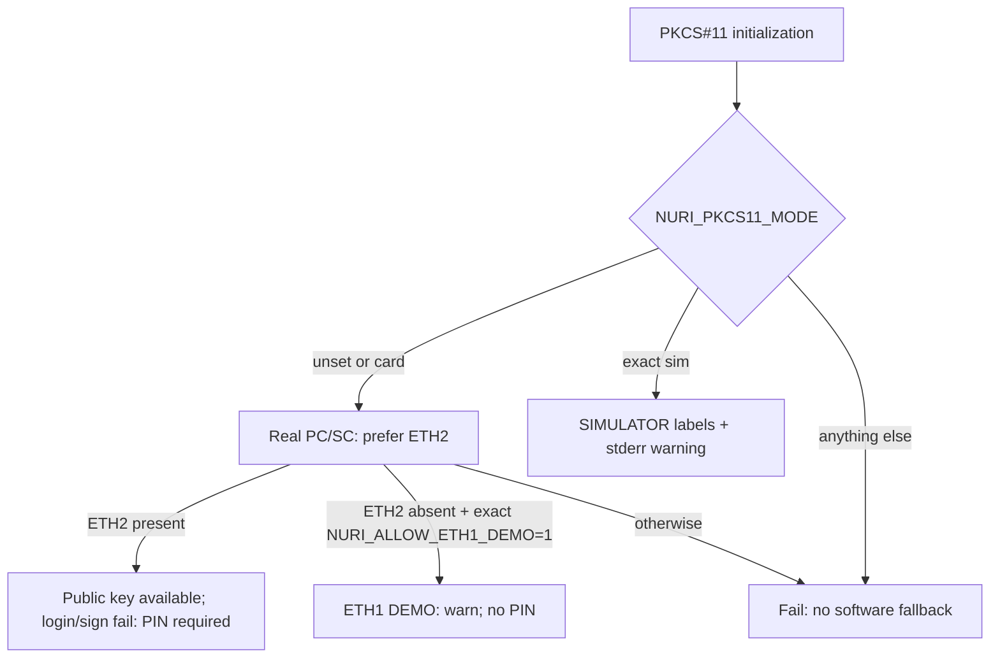

# PKCS#11 signing bridge



A limited secp256k1 signing adapter, **not a certified HSM**. Physical extraction resistance, concurrency, server deployment and hardware acceptance of this revision remain **UNVERIFIED**. No hardware was accessed for W28.

## Fail-closed mode and applet selection

- **Real card by default.** Unset `NURI_PKCS11_MODE` means `card`. Only exact `sim` selects software. Empty strings, misspellings, case changes and trailing spaces fail initialization; they never select simulation. C freezes the dispatch mode at initialization and verifies helper exit status, explicit errors, mode and applet identity. Missing or invalid public keys fail initialization, not an empty-success token. Sources: [scripts/pkcs11-nuri.c:358](../scripts/pkcs11-nuri.c#L358), [scripts/pkcs11-nuri.c:528](../scripts/pkcs11-nuri.c#L528), [scripts/pkcs11-helper.py:21](../scripts/pkcs11-helper.py#L21).
- **Unmistakable simulation.** The token label is `Nuri SIMULATOR`; both private and public object labels are `Nuri SIMULATOR ETH Key`, ID `01`. Slot/model also identify simulation, the mechanism omits `CKF_HW`, and initialization warns on stderr. The deterministic software key is public test material and must never protect assets. Sources: [scripts/pkcs11-nuri.c:262](../scripts/pkcs11-nuri.c#L262), [scripts/pkcs11-nuri.c:623](../scripts/pkcs11-nuri.c#L623), [scripts/pkcs11-nuri.c:732](../scripts/pkcs11-nuri.c#L732), [scripts/pkcs11-nuri.c:873](../scripts/pkcs11-nuri.c#L873).
- **ETH2 first.** The helper tries AID `4E5552494554483201`. An initial `NO_APPLET` result is insufficient on its own: a second strict probe must confirm `6A82` (applet absent) on every selected reader before considering ETH1 AID `4E55524945544801`. Missing readers/cards, SELECT exceptions and other status words do not downgrade. Selecting ETH1 requires exact `NURI_ALLOW_ETH1_DEMO=1` and prints an `ETH1 DEMO` warning. The opt-in does not override an available ETH2. Sources: [scripts/pkcs11-helper.py:85](../scripts/pkcs11-helper.py#L85).
- **ETH2 PIN is not bypassed.** This process-per-operation bridge does not implement a persistent, PIN-authenticated ETH2 session. ETH2 public-key discovery works, but `C_Login`, `C_SignInit` and `C_Sign` return `CKR_USER_NOT_LOGGED_IN`; the helper independently rejects ETH2 SIGN with `ETH2 PIN required` **before sending any SIGN APDU**. Token flags include `CKF_LOGIN_REQUIRED`; an arbitrary PKCS#11 PIN does not authenticate. No fallback to ETH1 follows a PIN failure, even with the demo flag set. Sources: [scripts/pkcs11-nuri.c:623](../scripts/pkcs11-nuri.c#L623), [scripts/pkcs11-nuri.c:685](../scripts/pkcs11-nuri.c#L685), [scripts/pkcs11-nuri.c:802](../scripts/pkcs11-nuri.c#L802), [scripts/pkcs11-helper.py:54](../scripts/pkcs11-helper.py#L54).

ETH1 demo and simulator login are compatibility no-ops, **not authentication**. ETH1 still has no PIN or physical approval: any process with reader access and the demo opt-in can sign. Do not use the demo opt-in as a production security setting. ETH2 signing through PKCS#11 remains intentionally unavailable until real PIN-session support exists.

## Interface and helper protocol

One slot exposes a public and private EC object. Hardware objects retain label `Nuri ETH Key`, ID `01`; simulator objects use the distinct label above. Only `CKM_ECDSA` is supported: supply one 32-byte digest; receive raw 64-byte `r || s`. The ETH1 recovery byte is stripped. Invalid signature lengths/hex fail, rather than being decoded permissively. No key generation, import, PIN provisioning, multipart signing, hashing, wrapping or encryption is exposed. Sources: [scripts/pkcs11-nuri.c:712](../scripts/pkcs11-nuri.c#L712), [scripts/pkcs11-nuri.c:811](../scripts/pkcs11-nuri.c#L811), [scripts/pkcs11-nuri.c:884](../scripts/pkcs11-nuri.c#L884), [scripts/pkcs11-helper.py:54](../scripts/pkcs11-helper.py#L54).

`NURI_PKCS11_PYTHON` selects Python (default `python3`); `NURI_PKCS11_HELPER` overrides the helper found relative to the module. These are trusted code-execution configuration, not a sandbox boundary. Sources: [scripts/pkcs11-nuri.c:283](../scripts/pkcs11-nuri.c#L283).

The helper defaults to line-based `key=value` replies, each with `mode=card` or `mode=sim`. `--json` produces one JSON object per command, **every reply including errors has a `mode` field**. INIT includes `applet` and `pin_required`. `--sim` alone is insufficient: exact `NURI_PKCS11_MODE=sim` is still required. Conflicting CLI/environment modes fail before transport access. Source: [scripts/pkcs11-helper.py:139](../scripts/pkcs11-helper.py#L139). Command-line usage errors are argparse stderr, not protocol replies.

```sh
# Software only; prints an explicit SIMULATOR warning on stderr.
printf 'INIT\nSLOTS\nFIND_KEY\nFINALIZE\n' | \
  NURI_PKCS11_MODE=sim python3 scripts/pkcs11-helper.py --json
```

## Native build and software-only regression

macOS arm64 uses `clang -dynamiclib`; Linux compatibility is **UNVERIFIED**. Rebuild the shipped module whenever C changes and update only its entry in `dist/SHA256SUMS`; `--check` compares the rebuild to that entry. Sources: [scripts/build-pkcs11.sh](../scripts/build-pkcs11.sh), [dist/SHA256SUMS](../dist/SHA256SUMS).

```sh
export NURI_PKCS11_PYTHON=/Users/eminmahrt/Developer/nuri-card-wt/_launch/venv/bin/python
bash scripts/build-pkcs11.sh
bash scripts/build-pkcs11.sh --check
"$NURI_PKCS11_PYTHON" scripts/test-pkcs11-failclosed.py
NURI_PKCS11_MODE=sim "$NURI_PKCS11_PYTHON" scripts/test-pkcs11-e2e.py
```

The dedicated regression suite uses **fake PC/SC and a fake helper**, not a reader: it exercises the rebuilt module through its exported PKCS#11 function table, checks default real-card dispatch, exact mode validation, explicit ETH1 opt-in, ETH2 preference/PIN rejection, helper failure, missing/malformed public keys, malformed signatures, mode stability and JSON metadata. The OpenSC e2e suite checks **both** simulator object labels, token identity, EC attributes, public-key export, independently verified signatures and wrong digest length. A missing `pkcs11-tool` prints SKIP: a zero exit alone is not acceptance. Sources: [scripts/test-pkcs11-failclosed.py](../scripts/test-pkcs11-failclosed.py), [scripts/test-pkcs11-e2e.py](../scripts/test-pkcs11-e2e.py).

## OpenSSL 3 software proof

Use OpenSSL 3 + pkcs11-provider v1.3.0 + the rebuilt `dist/pkcs11-nuri.so`. The provider translates PKCS#11 raw `r || s` to DER. `pkeyutl` signs an already hashed digest **without `-rawin`**; `dgst -sha256` hashes a message once. The selftest independently verifies both with python-ecdsa and rejects a modified digest, 31-byte input and wrong object label. It selects the simulator's distinct object URI automatically. Sources: [scripts/hsm-openssl-selftest.sh](../scripts/hsm-openssl-selftest.sh), [scripts/build-pkcs11-provider.sh](../scripts/build-pkcs11-provider.sh).

```sh
NURI_OPENSSL=/opt/homebrew/bin/openssl \
NURI_PKCS11_PYTHON=/Users/eminmahrt/Developer/nuri-card-wt/_launch/venv/bin/python \
NURI_PKCS11_MODE=sim \
bash scripts/hsm-openssl-selftest.sh
```

The script never silently enables simulation: without arguments it requires exact mode `sim`; hardware requires **both** mode `card` and `--card`. Unknown modes fail. An unset mode aborts rather than contacting hardware from this software-proof wrapper. This extra wrapper arming requirement does not change the module/helper's real-card default. Sources: [scripts/hsm-openssl-selftest.sh:9](../scripts/hsm-openssl-selftest.sh#L9).

With `NURI_PKCS11_PROVIDER` unset, the script hash-verifies and builds the pinned provider in task-owned `.build` scratch, then removes the provider source/tools/install/test files. Set `NURI_PKCS11_PROVIDER` to reuse an existing absolute provider dylib path (not deleted). It clears `PKCS11_PROVIDER_MODULE` so another module cannot silently replace the configured Nuri one. No global OpenSSL installation is changed. Sources: [scripts/build-pkcs11-provider.sh:9](../scripts/build-pkcs11-provider.sh#L9), [scripts/hsm-openssl-selftest.sh:25](../scripts/hsm-openssl-selftest.sh#L25).

Expected software success: `HSM_OPENSSL_SELFTEST_OK mode=sim (OpenSSL + python-ecdsa + pkcs11-tool)`. Historical [sim proof output](proofs/hsm-openssl-sim.txt) predates the fail-closed defaults and distinct simulator labels; it is **not evidence for this revision**.

### W28 software acceptance

On macOS arm64 / Apple clang 17.0.0, the native rebuild produced SHA-256
`b27a41734535d15d032ef553974643a4f97cabc1d67216fca1b1069d19b21299`;
`build-pkcs11.sh --check` returned `PKCS11_BUILD_MATCHES_SHA256SUMS`.
The final fake/native policy suite passed **18 tests on three consecutive runs**;
the explicit-simulator OpenSC e2e suite passed three consecutive runs. OpenSSL
3.6.5 + provider 1.3.0 passed the full simulator selftest three times in this
work session (the final two after the strict-absence and qualification-test edits).

Five deliberate negative controls turned the relevant tests red: defaulting to
simulation, bypassing ETH2 login, bypassing ETH2 signing, ignoring helper exit
failure, and removing the strict `6A82` absence confirmation. The last caught a
real transport-classification seam: shared PC/SC `NO_APPLET` can represent a
SELECT exception, not just an absent applet. The helper now independently
confirms absence before permitting a demo downgrade. All controls used fakes or
throwaway mutated libraries; the shipped source/artifact remained unchanged.

## Parent-only real-card qualification (not run by W28)

Run from the reviewed checkout. These commands do not generate, reset or provision keys. They read public identity and, only for the explicitly armed legacy demo, sign test digests.

```sh
export NURI_PKCS11_PYTHON=/Users/eminmahrt/Developer/nuri-card-wt/_launch/venv/bin/python
export NURI_OPENSSL=/opt/homebrew/bin/openssl
unset NURI_PKCS11_HELPER NURI_ALLOW_ETH1_DEMO

# Existing ETH1-only card: MUST fail initialization, without selecting ETH1.
NURI_PKCS11_MODE=card pkcs11-tool --module "$PWD/dist/pkcs11-nuri.so" -L

# Available provisioned ETH2: public discovery may succeed; signing MUST fail
# CKR_USER_NOT_LOGGED_IN. Do not add a PIN-bypass option to make this pass.
NURI_PKCS11_MODE=card "$NURI_PKCS11_PYTHON" scripts/test-pkcs11-e2e.py --expect-pin-required

# Existing ETH1-only launch demo: explicitly acknowledge its lack of PIN.
NURI_ALLOW_ETH1_DEMO=1 NURI_PKCS11_MODE=card \
  "$NURI_PKCS11_PYTHON" scripts/test-pkcs11-e2e.py
NURI_ALLOW_ETH1_DEMO=1 NURI_PKCS11_MODE=card \
NURI_PKCS11_EXPECTED_PUBKEY=0239a28d96002c4950a3052a9288da801085aba4a9d4907ab6d93d6b97c29006e0 \
  bash scripts/hsm-openssl-selftest.sh --card
```

The expected legacy public key is the launch parent's prior card read, **not a W28 hardware observation**. Do not change it to make a mismatch pass. ETH2 presence still prevents an ETH1 demo fallback; only an ETH1-only card should pass the last two commands. The ETH2 negative qualification must end `ETH2_PIN_FAILCLOSED_OK` (exit 0): it checks the specific `CKR_USER_NOT_LOGGED_IN` error and absence of a signature, not just an arbitrary failure. Current hardware results remain **UNVERIFIED** until the parent executes them.

## Limits

- Module-global state supports one active session. Helper processes do not retain a PIN-authenticated card session. Concurrent consumers and long-lived daemons remain **UNVERIFIED**. Source: [scripts/pkcs11-nuri.c:247](../scripts/pkcs11-nuri.c#L247).
- Only secp256k1, not RSA/P-256/Ed25519. No ordinary TLS server integration is established. The separate FIDO2 `ecdsa-sk` path supplies SSH; this module does not provide SSH-RSA. See [SSH setup](ssh-smartcard.md).
- Simulator success proves host plumbing, not a hardware security boundary, card PIN integration or physical approval.
