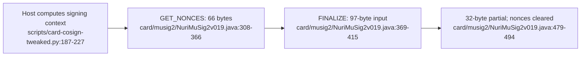

# MuSig2 card extension



## Implemented Java Card interface

The source version is 1.12; an installed card's version is **UNVERIFIED** until read separately. The host adapter selects AID `4E5552494D554701`; it uses CLA `00`, while the applet dispatches on INS without validating CLA. [card/musig2/NuriMuSig2v019.java:32-40](../card/musig2/NuriMuSig2v019.java#L32-L40), [card/musig2/NuriMuSig2v019.java:178-203](../card/musig2/NuriMuSig2v019.java#L178-L203), [scripts/card-cosign-tweaked.py:30](../scripts/card-cosign-tweaked.py#L30), [scripts/card-cosign-tweaked.py:146-164](../scripts/card-cosign-tweaked.py#L146-L164)

| INS | Operation | Response / behavior | Source |
| --- | --- | --- | --- |
| `01` | GET_VERSION | 7 bytes: version, capability byte, `KGEN` tag | [card/musig2/NuriMuSig2v019.java:205-215](../card/musig2/NuriMuSig2v019.java#L205-L215) |
| `03` | GET_PUBKEY | 33-byte compressed public key; `6986` if uninitialized | [card/musig2/NuriMuSig2v019.java:280-305](../card/musig2/NuriMuSig2v019.java#L280-L305) |
| `04` | KEYGEN | On-card random scalar; 33-byte public key; `6989` if already generated | [card/musig2/NuriMuSig2v019.java:217-277](../card/musig2/NuriMuSig2v019.java#L217-L277) |
| `40` | GET_NONCES | Fresh nonce pair; 66-byte public nonce `K1 || K2` | [card/musig2/NuriMuSig2v019.java:308-366](../card/musig2/NuriMuSig2v019.java#L308-L366) |
| `41` | FINALIZE | Exactly `a_i(32) || b(32) || parity(1) || e(32)`; 32-byte partial | [card/musig2/NuriMuSig2v019.java:369-415](../card/musig2/NuriMuSig2v019.java#L369-L415), [card/musig2/NuriMuSig2v019.java:471-494](../card/musig2/NuriMuSig2v019.java#L471-L494) |

## Session and trust boundary

- Nonces and readiness/finalization flags use `CLEAR_ON_RESET`. FINALIZE rejects absent, previously finalized or all-zero nonce state, checks input length, then clears secret nonces after signing. GET_NONCES replaces the active pair; this applet has no session-ID field. [card/musig2/NuriMuSig2v019.java:158-163](../card/musig2/NuriMuSig2v019.java#L158-L163), [card/musig2/NuriMuSig2v019.java:308-392](../card/musig2/NuriMuSig2v019.java#L308-L392), [card/musig2/NuriMuSig2v019.java:479-494](../card/musig2/NuriMuSig2v019.java#L479-L494)
- The dispatch, nonce and finalize paths contain no PIN, fingerprint or fresh physical-UP gate. FIDO2 PIN verification in another applet does not add such a check here. [card/musig2/NuriMuSig2v019.java:178-203](../card/musig2/NuriMuSig2v019.java#L178-L203), [card/musig2/NuriMuSig2v019.java:308-392](../card/musig2/NuriMuSig2v019.java#L308-L392)
- The host supplies coefficients and challenge, not a human-readable transaction. The card computes a partial from those values; it does not independently validate amount, recipient or transcript construction. [card/musig2/NuriMuSig2v019.java:389-475](../card/musig2/NuriMuSig2v019.java#L389-L475), [scripts/card-cosign-tweaked.py:187-227](../scripts/card-cosign-tweaked.py#L187-L227)
- The higher-level APDU simulator is a **different interface**: INS `10/20/30/40` with session IDs, not this Java Card contract. Do not send its frames to the applet. [src/musig2/apdu-sim.js:3-24](../src/musig2/apdu-sim.js#L3-L24), [card/musig2/NuriMuSig2v019.java:35-40](../card/musig2/NuriMuSig2v019.java#L35-L40)

## Offline compatibility checks

Requires the declared Node dependencies to be installed. [package.json:86-94](../package.json#L86-L94)

```bash
npm test
node scripts/arkade-card-signer-proof.mjs --json
```

The test command runs Node tests; the proof constructs local software/simulated signers and covers untweaked and x-only tweaked sessions. Neither is hardware evidence. [package.json:11](../package.json#L11), [scripts/arkade-card-signer-proof.mjs:58-85](../scripts/arkade-card-signer-proof.mjs#L58-L85)

Historical evidence: [Arkade signer record](proofs/arkade-card-signer-proof.md), [Signet record](proofs/real-card-signet-proof.md). **UNVERIFIED:** current installed CAP, physical-device acceptance and independent security review.
