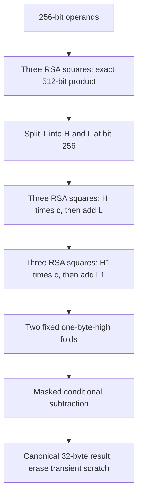

# Coprocessor modular multiplication (applet 1.17)

MIT implementation in `card/musig2/RsaMultiply.java`, independently written from
`2ab = (a+b)^2 - a^2 - b^2`. No copied Satochip/GPL implementation.
APDU framing and signing hardening are unchanged. Released in v1.2.0 as AID3
applet 1.17 (`nuri-musig2-v20-keygen-aid3.cap`, hash in `dist/SHA256SUMS`).

Result on card `87E5470B`, v1.17: FINALIZE about 2.0 s, down from 5.19 s (operator timing). The 1 s target is not reached.

## Baseline supplied by the hardware profiling run

Card `87E5470B`; per operation, APDU overhead subtracted:

| Operation | ms |
|---|---:|
| RSA init | 0.26 |
| 768-bit RSA square including init | 0.66 |
| multiply mod n | 303 |
| old fold-only mod n | 265 |
| multiply mod p | 189 |
| old fold-only mod p | 152 |
| native ECDH scalar-one | 45 |
| validatePoint | 727 |
| SHA256 / RNG 32 bytes | <0.3 |

Baseline FINALIZE was 5.19 s. The target is 10–30 ms/multiply and FINALIZE
below 1 s; neither target is established by simulator timing.

## Pipeline and bounds

Let B=2^256 and m=B-c. The constants are c_n=B-n (129 bits) and
c_p=2^32+977 (33 bits). Inputs may span all 256 bits, not merely canonical
residues. Each fold replaces H*B+L with H*c+L, preserving the residue.

* T<B^2 and H<B. After fold one, T1<B*c+B<2^385+2^256.
* H1<c+1<2^129+1. After fold two,
  T2<c*(c+1)+B<2^258+2^256+2^129, hence H2<=5.
* A fixed 32-byte multiply-add by that one-byte H2 gives T3<B+5c.
  Its high word is at most one. If it overflows, its low word is <5c;
  the next one-byte fold is <6c<B. Otherwise the next fold adds zero.
* The result is below B. Both moduli exceed B/2, so exactly one masked
  conditional subtraction makes it canonical.

Every product operand is <B, including all fold high words and c. The square
input sum is <2B=2^257; its square is <2^514, far below 2^768-1. This is
stronger than the required <2^384 input bound. No square wraps modulo the RSA
modulus. The three-square difference is nonnegative and even; subtracting
both component squares in one byte pass then shifting 64 bytes recovers the
exact product. Borrow may be 0, 1, or 2 and is extracted accordingly.

There are **nine RSA squares and one init per modular multiply**, identical
for n and p. Reduction uses six of those squares; the two tiny folds use only
64 fixed byte multiply-add iterations, rather than the old nested fold loops.
All working buffers are transient CLEAR_ON_DESELECT and explicitly cleared
in finally; provider-internal copies are outside the explicit erasure claim.
Loops and buffer addresses do not depend on operand values. This is source
constant-time style, not a hardware timing/power-resistance certification.

## Fail-closed and test gates

Installation probes 3^2=9 with the installed provider; unsupported
RSA-768/exponent-two/no-padding providers abort installation. Since 1.17 the
(m-1)^2 mod m=1 known-answer tests for n and p run on the first multiply, not at
INSTALL, where they returned 6985 on the real card. A failure throws 6F31 and
the tests run again on the next call. The pass flag is persistent and is set
before the tests run, so a power loss during that first run leaves it set and
later calls skip the tests (`card/musig2/RsaMultiply.java:23,104-111`). Nine consecutive doFinal calls rely on the JavaCard Cipher
post-doFinal initialized-state contract; the bench is the hardware gate.

`scripts/test-musig2-jcardsim.sh` includes 5,000 deterministic random pairs per
modulus, full-width edges, all-FF byte patterns, carry-heavy inputs, aliasing,
canonical outputs, input preservation and scratch erasure. Existing Scalar256,
BIP327 fixture, nonce-lifetime and PIN-hardening suites remain enabled.

Simulator run on the build host (no reader/card): RSA oracle passed 6,659 pairs
per modulus, 10,706,159 assertions. Scalar256 passed 31,861,426 assertions,
32,307 multiplies and six BIP327 fixture cases. Nonce-lifetime passed and
PIN hardening passed 1,127 checks. A separate test-only instrumented source
copy incremented a short at every square and asserted exactly nine in each
multiply's finally block; all four simulator suites passed again. The counter
is not in release source. Node tests passed 79/79 after npm ci; README is
193 lines. These are deterministic software checks, not real-card measurements.

`scripts/build-musig2-bench.sh` builds the same current reducer under temporary
AID4. Its fold-only command now measures the new two-RSA-product reducer plus
canonicalization and scratch erasure; old fold-only measurements are not an
identical instruction workload. The bench CAP is never a release artifact.
