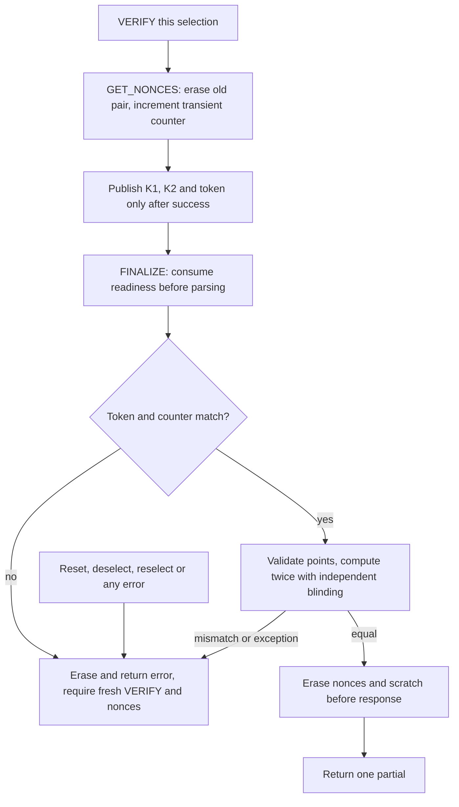

# MuSig2 nonce lifetime (current APDU 1.14)



The v1.12 fix aligned the two readiness flags with reset-transient secret nonces
and rejected either zero nonce. W20 retains both defenses and strengthens them:
PIN validation is selection-scoped; deselection erases nonces explicitly; every
error burns the session; GET_NONCES invalidates the previous pair before RNG/EC
work; FINALIZE consumes readiness before parsing and requires the last pair's
four-byte token. No replay, reset, replacement or malformed frame permits a
second partial. Sources: `card/musig2/NuriMuSig2v019.java:234-299,426-458,528-580`.

The four-byte token is a transient counter snapshot, seeded at selection. It
identifies the latest pair, not a MAC or a secure-channel peer identity. Host
serialization and trusted PIN entry remain required. The card does not derive
host-provided a/b/e from an entire transaction transcript.

| Condition | Current result |
|---|---|
| PIN mandatory but unset/not verified | `6982` |
| No ready nonces, replay, stale token or counter mismatch | `6984` |
| Either secret nonce zero while ready | `6988` |
| Malformed FINALIZE length (must be 231 bytes) | `6700`, session and validation burned |
| Invalid curve point or parity | `6A80`, session and validation burned |
| Two independently blinded results differ | `6988`, no partial, session burned |
| Successful FINALIZE | Nonces/scratch/temp EC key erased before one 32-byte partial |

GET_NONCES now returns **70 bytes** (compressed K1/K2 plus token). FINALIZE takes
**231 bytes**, adding token and two uncompressed aggregate points to the previous
97 scalar/parity bytes. See [PIN and hardening](musig2-pin-and-hardening.md) for the
full current protocol, install policy, clean-room math and host integration.

```sh
scripts/test-musig2-jcardsim.sh
```

The simulator runner compiles the current applet and scalar implementation,
checks the pinned jCardSim jar, and runs Scalar256Test, NonceLifetimeTest and
PinHardeningTest. Current success markers:

```text
SCALAR256_OK
MUSIG2_JCARDSIM_NONCE_LIFETIME_OK
MUSIG2_JCARDSIM_PIN_HARDENING_OK checks=1127
```

The old reset-extraction negative fixture still rejects output after reset;
it re-verifies first to reach the nonce guard independently of the PIN guard.
Each zero-nonce fixture leaves readiness true to reach that defense independently.
The new tests add PIN retry/logout, replay/replacement/error cleanup, point
validation, blinding/fault mismatch and transaction-boundary coverage.

Reinstallation destroys the old instance/key. Never reinstall on the sole SSH
key card or treat this as an in-place key-preserving upgrade. Physical reset,
transaction tear behavior, leakage and target-chip support remain **UNVERIFIED**;
all new evidence here is simulator/fake-only, with no reader access.
