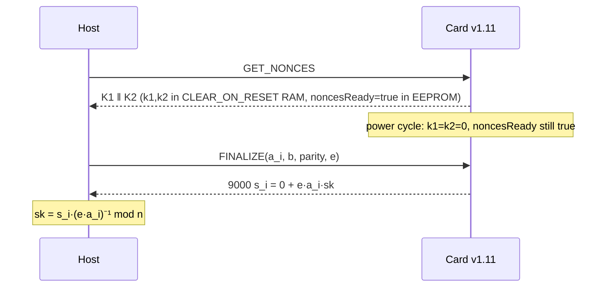
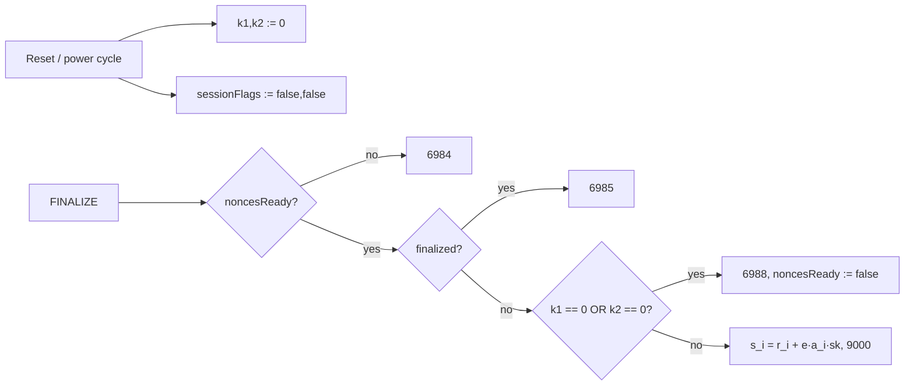

# MuSig2 applet: nonce-lifetime fix (audit finding A1, applet v1.12)

## Bug

`card/musig2/NuriMuSig2v019.java` (v1.11, `dist` CAP
`a9b2eea825561f31da708836927290fd92b430c5084cdc614020fd5da3648126`) kept the
secret nonces `nonceK1`/`nonceK2` in `CLEAR_ON_RESET` transient memory
(`NuriMuSig2v019.java:148-151` at `892fa8a`) but the session flags
`noncesReady`/`finalized` were plain persistent fields
(`NuriMuSig2v019.java:96-97`).

A power cycle (NFC drop, reader re-insert, tear) between `GET_NONCES` (INS 40)
and `FINALIZE` (INS 41) therefore left the card with `noncesReady == true` and
both nonces zeroed. `FINALIZE` happily computed

```text
s_i = r_i + e·a_i·sk   with r_i = k1 + b·k2 = 0
    = e·a_i·sk (mod n)
```

and returned it with `9000`. The host picks `e` and `a_i`, so
`sk = s_i · (e·a_i)⁻¹ mod n`: one tap after a lost-power session extracts the
long-term private key.



## Fix (v1.12, `APPLET_VERSION = 01 0C`)

`card/musig2/NuriMuSig2v019.java`:

1. `noncesReady`/`finalized` replaced by
   `sessionFlags = JCSystem.makeTransientBooleanArray((short)2, JCSystem.CLEAR_ON_RESET)`
   — the same clearing event as the nonce arrays, so flags and nonces can never
   disagree after a reset.
2. `doFinalize` additionally refuses with `SW_INVALID_NONCE` (`6988`) if either
   secret nonce is all-zero. `isZeroCT` ORs every byte with no early exit and
   both checks are evaluated with a non-short-circuit `|`, so the refusal does
   not depend on where the first non-zero byte is.
3. Version byte bumped to `1.12`; `KGEN` build tag unchanged.



No APDU format change. `GET_NONCES` → `FINALIZE` within one session behaves
exactly as before; hosts already handle `6984`/`6988`.

## Regression test (jCardSim, simulator only)

`test/musig2-jcardsim/NonceLifetimeTest.java`, run by
`scripts/test-musig2-jcardsim.sh` (`npm run card:musig2:test:sim`, also wired
into `scripts/test-card-v1-virtual.sh`). It compiles the applet source
against `com.klinec:jcardsim:3.0.5.11` (the same artifact the vendored FIDO2
tests already use, `third_party/fido2-applet/build.gradle:29`; SHA-256
`f6c3b6b8140401a47cf39d7b9dbfc052e381474c6c3b22018051024be1fca97c`, pinned in
the script) and drives it over APDUs:

| Step | Expectation |
| --- | --- |
| `GET_VERSION` | `01 0C` |
| `KEYGEN`, `GET_NONCES`, `FINALIZE` | `9000`, and `s_i·G == K1 + b·K2 + e·a_i·P` verified with BouncyCastle |
| `GET_NONCES`, `Simulator.reset()` (zeroes `CLEAR_ON_RESET`), re-select, `FINALIZE` | SW ≠ `9000`, SW ∈ {`6984`,`6988`}, zero data bytes |
| reset then fresh `GET_NONCES` + `FINALIZE` | `9000` (card still usable) |
| second `FINALIZE` on same nonces | refused |

Run against the **pre-fix** source (v1.11 from `892fa8a`) the same test
reports `sw=9000`, a 32-byte `s`, and recovers the private key:

```text
FAIL FINALIZE after power cycle is refused (SW != 9000) :: sw=9000 data=02e9128b4224f59c84c4acf1f6e12693896850e4a66ba559945661ba736dcf7f
FAIL private key NOT recoverable from FINALIZE output :: sk leaked: 6c5544797a91115dc3330ebd003851d239a706ff2aa2ab70039c5510ddf06420
MUSIG2_JCARDSIM_NONCE_LIFETIME_FAILED failures=5
```

(That key was generated inside the simulator for this run and never existed
on a card.)

Harness note: jCardSim 3.0.5.11's `RSAPublicKey` from `KeyPair.genKeyPair()`
ignores `setExponent(2)` inside its cipher, which breaks Satochip's
`mult_rsa_trick` in the simulator only. The test re-keys that multiplier with
an explicit `(modulus, e=2)` key before use (`fixJcardsimRsaMultiplier`). The
applet source is untouched by this; real cards honour `setExponent` and the
v1.11 applet has produced valid mainnet partials.

## Artifacts

- `dist/nuri-musig2-v20-keygen.cap` rebuilt with
  `scripts/build-card-v1-release.sh` (JDK 8 `1.8.0_452`, `jc304_kit`,
  `tools/ant-javacard-proven.jar`); converter and verifier: 0 errors.
- New SHA-256:
  `77a5a7bb1d6321927db0af736ecddfa2412d7bd441601e903080b8083cacc96c`
  (was `a9b2eea825561f31da708836927290fd92b430c5084cdc614020fd5da3648126`).
- `FIDO2.cap`, `FIDO2-up.cap`, `nuri-oath-totp.cap`, `nuri-eth-signer.cap`
  reproduced byte-identical to the existing `dist/` hashes in the same build.

## Deploying to a card

The package AID `4E5552494D5547` is unchanged, so the old package must be
deleted first. **Deleting the applet destroys the on-card MuSig2 key**
(KEYGEN is one-shot and the key is not exportable). Any funds locked to a
`musig2(client, card)` address of an existing card must be moved before
upgrading that card. For a new blank card:

```sh
MUSIG2_REINSTALL=YES GP_READER=<n> npm run card:musig2:install
# then, once:  KEYGEN via scripts/real-card-cosign-proof.py (no --use-existing-card-key)
```

Not hardware tested in this change; simulator only.
