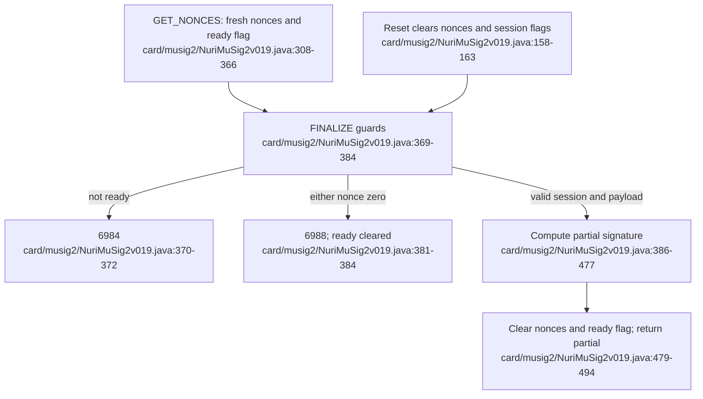

# MuSig2 nonce lifetime



## Current invariant

The applet reports version **1.12**. Both secret nonce arrays, both public nonce
arrays and the two session flags are allocated with `CLEAR_ON_RESET`. Sources:
[card/musig2/NuriMuSig2v019.java:33,158-163](../card/musig2/NuriMuSig2v019.java#L158-L163),
[card/musig2/NuriMuSig2v019.java:205-214](../card/musig2/NuriMuSig2v019.java#L205-L214).

`GET_NONCES` generates nonzero secret scalars and sets ready=true,
finalized=false before returning the public nonces. `FINALIZE` checks ready,
then finalized, then both nonce arrays before accepting its 97-byte payload.
Sources: [card/musig2/NuriMuSig2v019.java:308-366](../card/musig2/NuriMuSig2v019.java#L308-L366),
[card/musig2/NuriMuSig2v019.java:369-415](../card/musig2/NuriMuSig2v019.java#L369-L415).

| Condition | Result | Source |
|---|---|---|
| Not ready, including after reset | `6984` | [card/musig2/NuriMuSig2v019.java:43,370-372](../card/musig2/NuriMuSig2v019.java#L370-L372) |
| Finalized flag set while ready | `6985` | [card/musig2/NuriMuSig2v019.java:44,374-376](../card/musig2/NuriMuSig2v019.java#L374-L376) |
| Either secret nonce all-zero while ready | Clear ready, return `6988` | [card/musig2/NuriMuSig2v019.java:46,381-384](../card/musig2/NuriMuSig2v019.java#L381-L384) |
| Successful finalization | Clear secret nonces and scratch buffers, set finalized=true and ready=false, return 32-byte partial | [card/musig2/NuriMuSig2v019.java:479-494](../card/musig2/NuriMuSig2v019.java#L479-L494) |

The zero test visits every byte and both checks are evaluated with non-short-circuit
`|`. This is a source-level property, not a constant-time hardware claim. Sources:
[card/musig2/NuriMuSig2v019.java:381,501-506](../card/musig2/NuriMuSig2v019.java#L501-L506).

## Why lifetime alignment matters

The regression test resets the simulator between nonce generation and finalization,
then requires an error status and zero response bytes. If a 32-byte partial were
returned, the test attempts to derive a candidate private key from the supplied
coefficients and compares its public key. This documents the zero-nonce failure
condition without treating an old prose report as proof of a previous build.
Source: [test/musig2-jcardsim/NonceLifetimeTest.java:84-114](../test/musig2-jcardsim/NonceLifetimeTest.java#L84-L114).

## Run the simulator regression

```sh
scripts/test-musig2-jcardsim.sh
```

The runner checks a pinned jCardSim dependency, compiles the current applet and
executes the harness. `JAVA17_HOME`, `JCARDSIM_JAR` and `CARD_BUILD_ROOT` override
its Java, dependency and build locations. Source:
[scripts/test-musig2-jcardsim.sh:10-62](../scripts/test-musig2-jcardsim.sh#L10-L62).

The harness checks a normal partial signature, rejection after reset, a fresh round
after reset, and rejection of replayed finalization. Success prints
`MUSIG2_JCARDSIM_NONCE_LIFETIME_OK`. It replaces the simulator's RSA multiplier
key as a harness adjustment. Sources:
[test/musig2-jcardsim/NonceLifetimeTest.java:39-48,54-143](../test/musig2-jcardsim/NonceLifetimeTest.java#L39-L143),
[test/musig2-jcardsim/NonceLifetimeTest.java:160-191](../test/musig2-jcardsim/NonceLifetimeTest.java#L160-L191).

## Upgrade boundary

The reinstall script's `MUSIG2_REINSTALL=YES` path deletes the existing applet and
package before creating a new applet instance. The master key belongs to that
instance and key generation is one-shot. Treat reinstall as destructive key
replacement, not an in-place nonce-state update. Sources:
[scripts/install-musig2-card.sh:17-36](../scripts/install-musig2-card.sh#L17-L36),
[card/musig2/NuriMuSig2v019.java:121-128,217-261](../card/musig2/NuriMuSig2v019.java#L217-L261).

**UNVERIFIED:** physical-card reset/tear behavior, installed firmware and any
hardware deployment are outside this simulator regression's evidence.
