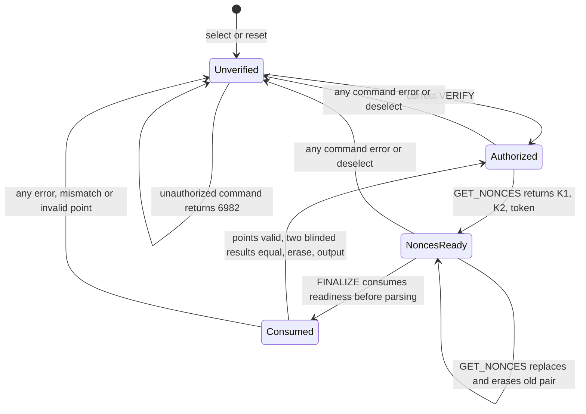

# MuSig2 PIN and hardening — W20



## Scope and status

The applet reports **1.14 (`010E`), build `PIN2`**, package version **2.1**.
The compatibility filename remains `dist/nuri-musig2-v20-keygen.cap`.
W20 implements the requested source/simulator portion of W13 gate 2/R4 and
R12/R13; it does **not** certify silicon, physical leakage or a secure channel.
No real reader, card, server or network transaction was used for verification.

The implementation is clean-room from secp256k1/BIP327 mathematics and the
provided Satochip v0.16 lessons, not from Satochip/Keycard source. No new runtime
dependency was added. See [Scalar256 provenance](scalar256.md).

## Owner PIN

`OwnerPIN(5,12)` protects KEYGEN, GET_NONCES and FINALIZE. PINs are 4–12 ASCII
digits. PIN protection is **mandatory by default**, including installation with
no application data. An unpersonalized applet cannot generate a key or sign.
GET_VERSION, GET_PUBKEY and PIN_STATUS are public; no private-key export exists.
Sources: `card/musig2/NuriMuSig2v019.java:192-199,249-299,321-349`.

- `VERIFY` succeeds only with the set PIN. Wrong attempts return `63C4`, `63C3`,
  `63C2`, `63C1`, then `6983`; blocking survives reset. A successful verification
  restores the five-try counter. No unblock/recovery command is provided.
- `SET_PIN` personalizes once, only before key generation, and does not validate
  the session. A separate VERIFY is required. PIN update and the persistent
  `pinSet` flag are in one Java Card transaction.
- Validation is reset explicitly in both `select()` and `deselect()`. Reset
  requires a new selection/VERIFY. Only the basic logical channel (CLA `00`) is
  accepted; nonzero P1/P2 are refused.
- Every command error invalidates PIN validation **and** pending nonces,
  including unrelated unsupported commands, malformed FINALIZE, incorrect PIN,
  RNG/EC exceptions and output-delivery failure. Re-VERIFY does not revive the
  old pair. Successful repeat VERIFY leaves the current nonce pair intact.
  Sources: `NuriMuSig2v019.java:234-293,528-580`.

### Installation data

The installer strictly parses the GP layout `Li|AID|Lc|control|La|application`.
Every length must fit and the full buffer must be consumed. Empty application
bytes choose mandatory/unset PIN, not demo mode. Supported application bytes:

| Bytes | Policy |
|---|---|
| empty | Mandatory PIN; provision once using SET_PIN before KEYGEN |
| `00, pinLength, PIN` | Mandatory, install-time personalized PIN (4–12 digits) |
| `01 00` | Explicit optional-PIN public demo card; no PIN initially set |

Any other mode/length is rejected. Optional policy is immutable and only chosen
at installation, never by a signing APDU. If a demo applet gets a PIN before
KEYGEN, that PIN gates signing too. Source: `NuriMuSig2v019.java:206-232`.
Use the trusted terminal SET_PIN flow rather than putting a PIN in a GP command
line. Blank-card personalization must occur in a trusted provisioning context:
SET_PIN deliberately has no previous owner credential to authenticate against.

## APDU 1.14 protocol (CLA/P1/P2 all zero)

| INS | Data | Response |
|---|---|---|
| `01` GET_VERSION | none | `01 0E caps 50 49 4E 32` (7 bytes) |
| `03` GET_PUBKEY | none | compressed 33-byte public key |
| `04` KEYGEN | none, PIN verified | compressed 33-byte public key; later calls `6989` |
| `20` VERIFY | raw PIN digits | status only |
| `21` SET_PIN | raw PIN digits | status only |
| `22` PIN_STATUS | none | required flag, set flag, tries (3 bytes) |
| `40` GET_NONCES | none, PIN verified | K1(33) + K2(33) + token(4) = **70 bytes** |
| `41` FINALIZE | a(32) + b(32) + parity(1) + e(32) + token(4) + Ragg(65) + Pagg(65) = **231 bytes** | partial s(32) |

Capabilities: bit 0 signing, bit 1 one-shot keygen, bit 2 mandatory PIN policy,
bit 3 PIN set. Ragg and Pagg must be finite uncompressed SEC1 secp256k1 points
(`04|x32|y32`); Ragg is the aggregate nonce **before** parity negation. Its y
parity must equal the explicit parity byte. Pagg is the actual aggregate signing
key, including Taproot tweaking when used. FINALIZE supports short-APDU input
arriving in multiple chunks. Legacy 97-byte frames are rejected, not guessed.
Sources: `NuriMuSig2v019.java:307-319,351-366,437-458,528-560`.

### Binding and erasure

A reset-transient four-byte counter is randomly seeded on each selection and
incremented for every GET_NONCES. Its exact snapshot accompanies the latest
nonce pair. FINALIZE compares both the supplied token and that snapshot against
the current counter, with full-byte scans. GET_NONCES erases old state **before**
RNG/EC work and publishes readiness only after both points and the token exist.
FINALIZE consumes readiness before input parsing. No stale token, second
FINALIZE, reselect, reset or error can reuse the pair.
Sources: `NuriMuSig2v019.java:234-247,426-458,528-580`.

The counter is a correlation identifier, **not** a MAC, caller identity or
cryptographic authenticated channel. It does not independently prove that a/b/e
were derived from the supplied points/message. Host-wide serialization and a
trusted PIN entry boundary remain required. The card enforces one currently
selected session, not individual identities of multiple local PC/SC processes.
This distinction prevents interpreting this patch as closure of every broader
W13 secure-channel/consumer-launch claim.

`tempPrivKey` prefers `TYPE_EC_FP_PRIVATE_TRANSIENT_DESELECT`, with explicit
`clearKey()` on every normal/exceptional APDU exit and select/deselect; unsupported
cards may use a persistent object but still explicitly clear it. EC parameters
are restored before reuse because clearKey can clear them too. All master-scalar
copies, masks, computed partials and Scalar256 scratch are transient and wiped.
Secret nonces remain only while a successful pending GET_NONCES session is live.
They are erased before partial output delivery, on any error, and on deselect.
PIN input bytes are erased; successful outgoing buffers are not changed after
`setOutgoingAndSend`. Physical tear-time erasure of a fallback persistent EC
object remains **UNVERIFIED**. Sources: `NuriMuSig2v019.java:136-160,281-293,368-394,566-580`.

## Scalar blinding and fault check

For each secret product, independently draw nonzero `r` modulo n and compute:

```text
c*x = c*(x+r) - c*r (mod n)
s = parity_adjust(k1 + blinded_mul(b,k2)) + blinded_mul(e*a,sk) (mod n)
```

Additive splitting randomizes the secret input **before** it enters the
fixed-iteration multiplier. Merely adding and subtracting r from the final
unblinded s would not mask secret multiplication. Both k2 and sk products are
blinded. The complete chain, including e*a and the nonce term, runs twice with
fresh independent masks (four masks total), then a constant-iteration 32-byte
comparison must succeed before any partial bytes are copied for output. A
mismatch returns `6988`, burns the session and emits no partial. Sources:
`NuriMuSig2v019.java:500-560`; fixed-iteration engine: `Scalar256.java:101-130`.

This is software hardening, not a guarantee against all side-channel/fault
attacks. Correlated faults, bypassing the comparison, higher-order leakage,
malicious RNG/OS behavior and physical timing/EM/power resistance are
**UNVERIFIED**. Review and physical evaluation are still release requirements.

## Point validation: why native validation alone was insufficient

The simulator's native ECDH accepted an off-curve input when the private scalar
was one. A negative point fixture returned **9000** before the independent curve
check was added. The applet therefore checks canonical x/y bounds and
`y² = x³ + 7 mod p` using the independently authored fixed-width field engine,
then also checks that native full-XY multiplication by one reproduces the exact
input. The validator uses only a public scalar one, never the master/nonce key.
secp256k1 has cofactor one, so a finite on-curve point is in the target group.
Unsupported full-XY engines fail closed rather than inventing Y parity.
Sources: `NuriMuSig2v019.java:469-498`; `Scalar256.java:133-151,172-201`.

## Tear-safe one-shot key generation

All candidate generation, public-key computation, supported-output checks and
even-Y normalization happen with the temporary key first. Only then does one
`JCSystem.beginTransaction()` surround `masterKey.setS`, the persistent 33-byte
public-key cache copy, and `keyGenerated=true`, followed by commit. Java Card
key-provider writes are not assumed to roll back: setS happens **before** the
transactional cache/flag publication, and every signing/read path checks the
committed flag. An interrupted uncommitted scalar is therefore unusable and not
advertised. Any exception aborts an open transaction; once committed, delivery
failure does not unlock KEYGEN. The simulator test proves order, transaction
depth and the public-read guard, not key-provider rollback.

GET_PUBKEY returns only the committed cache and never repeats a native EC product
with the master scalar. An independent bounded source review identified the old
unlimited public-read master-secret multiplication path; this follow-up removes
it. A simulator test substitutes an unsupported EC engine and still obtains the
same cached public key. Scalar readback for signing must return exactly 32 bytes
or FINALIZE fails closed, preventing stale point bytes from entering arithmetic.
One successful VERIFY authorizes repeated fresh nonce/signing rounds until an
error, deselect or reset; it is not fresh owner consent per signature.
Source: `NuriMuSig2v019.java:396-424`.

jCardSim verifies that a forced exception in the key setter happens at transaction
depth one, leaves flag=false and transaction depth zero, refuses public-key
readout, then allows a complete retry and enforces permanent one-shot locking.
This is not a physical power-cut test or proof of the target OS/key-provider
transaction implementation or commit-buffer capacity.

## Host callers and secret handling

`scripts/nuri_musig2_card.py` centralizes version negotiation, PIN_STATUS,
VERIFY, token capture and the new FINALIZE frame. `real-card-cosign-proof.py`,
`card-cosign-tweaked.py`, Arkade proof and claim signer pass real aggregate points.
The two Node servers inherit the PIN into their signing child via environment,
not argv. PIN input is only `NURI_CARD_PIN` or a trusted terminal `getpass`
prompt. It is never read from a URL/dApp payload, logged or included in APDU
error strings. FIDO subprocess PIN argv handling in the local server was also
changed to environment transport. A process-local cache avoids repeat prompts;
Python consumes/removes its PIN env variable, but servers retain theirs to
start fresh signing children. Environment/cache exposure to the same OS user
is outside on-card custody guarantees.

Every new selection re-verifies when a PIN is set. Any error invalidates the
host's cached validation/token, including an already-keyed `6989` probe, so the
next signing round verifies again. Applets below 1.14 retain a labeled
`legacy-pre-1.14` demo compatibility path; a 1.14 applet is never downgraded on a
short response or error. Consumer policy must separately prohibit legacy/demo
applets; compatibility is not owner authorization.

## Verification (simulator/fakes only)

```sh
npm run card:musig2:test:sim
/opt/homebrew/bin/python3.13 scripts/test-musig2-hardening-negative.py
PYTHONDONTWRITEBYTECODE=1 /Users/eminmahrt/Developer/nuri-card-wt/_launch/venv/bin/python \
  -m unittest discover -s test -p test_musig2_host_pin.py -v
npm test
```

Three consecutive complete runs on macOS, Zulu JDK 17, pinned jCardSim 3.0.5.11:

```text
SCALAR256_OK assertions=15376024 ... bip327=6 ...
MUSIG2_JCARDSIM_NONCE_LIFETIME_OK
MUSIG2_JCARDSIM_PIN_HARDENING_OK checks=1127
Ran 15 tests ... OK
Node: tests 39, pass 39, fail 0, skipped 0
MUSIG2_HARDENING_NEGATIVE_CONTROLS_OK red=5 candidate=green
```

The suite covers mandatory/unset/default/demo install policy and malformed install
data, five wrong-PIN attempts/block persistence, no nonce/finalize without VERIFY,
reset/reselect logout, finalize without nonces, stale/replaced/replayed token,
consumption after errors, invalid/off-curve/noncanonical points, parity mismatch,
RNG/unsupported-engine exceptions, explicit temp-key/scratch erasure, exact
blinded scalar equivalence, forced mismatch suppression and key-set interruption.
The existing six official BIP327 scalar-chain vectors remain green; this is not
all official parser/error-vector coverage. Five isolated source mutations
(removing PIN, token, double-result, curve or transaction guards) each failed the
intended assertion, not compilation. The unchanged candidate then passed.

The initial nested cleanup exception table passed host Java but failed the Java
Card 3.0.4 verifier's handler-order check. Moving cleanup into a separate helper
fixed it; the final CAP converted and verified successfully. Package 2.1 produces
the expected missing-previous-minor-export converter warning (0 errors, 1 warning);
verifier: **0 warnings, 0 errors**. Two independent builds normalized byte-identically.
Only the applet and Scalar256 classes are present, and integer support is FALSE.

```text
CAP SHA256 98d8d8e2d19532d5779ce041f7302f46be45d3538f692066340e2e458f27e811
```

SDK ref: `e2df471e04d86f33de69a947f44766fbef1d9d69`, JC 3.0.4, Zulu 8
`1.8.0_452`, pinned ant-javacard tool as documented in `scalar256.md`. Full local
run logs are retained privately in `_launch/out/W20-{simulator,node,host}-{1,2,3}.log`.
All `.build` and downloaded worktree toolchains are removed after final checks.

## Exact parent spare-card acceptance commands — NOT executed here

Do not delete/reinstall the owner's sole SSH card. This is a new applet instance
with a new key, not an in-place upgrade. Select a **blank, explicitly approved
spare** and verify both reader variables refer to it. With this worktree as cwd:

```sh
GP_READER="${SPARE_READER_INDEX:?choose approved blank spare}" \
MUSIG2_CAP="$PWD/dist/nuri-musig2-v20-keygen.cap" scripts/install-musig2-card.sh
NURI_READER="${SPARE_READER_NAME:?choose approved blank spare}" \
  scripts/run-card-python.sh scripts/nuri_musig2_card.py set-pin
# SET_PIN prompts without echo. Provide NURI_CARD_PIN securely in environment,
# or let the proof prompt on a trusted terminal; never put a PIN in argv.
NURI_READER="$SPARE_READER_NAME" \
  scripts/run-card-python.sh scripts/nuri_musig2_card.py pin-status
NURI_READER="$SPARE_READER_NAME" \
  scripts/run-card-python.sh scripts/real-card-cosign-proof.py \
  --message 'W20 PIN2 approved spare acceptance'
NURI_READER="$SPARE_READER_NAME" \
  scripts/run-card-python.sh scripts/card-cosign-tweaked.py
```

Require version 1.14, mandatory/set policy, `card_protocol=pin-1.14`,
`card_pin_verified=true`, and both partial verifications plus final signature
verification true. Measure latency/timeouts, memory, EC support and repeatability
on every target batch. Physical reset/tear/fault/side-channel evaluation requires
a parent-controlled device harness; no unimplemented hardware test command is
claimed. This change alone does not authorize consumer distribution.
