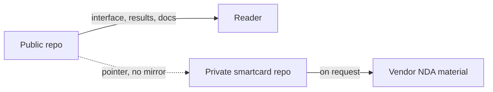

# Private assets and how to request them

This repository publishes our own interfaces and results. Some material cannot be
published, and one class of it is only available on request.

| Item | Where | Why |
|---|---|---|
| IDEX TrustedBio UV applets (CAPs + source), enrol/verify console, per-card logs | Private repo [`eminogrande/nuri-card-private-smartcard`](https://github.com/eminogrande/nuri-card-private-smartcard) | The card vendor's biometric API is under NDA; redistributing it would republish the SDK. Our interface and measured results are public in [fingerprint](fingerprint.md). |
| FEITIAN BioCARD demo-applet driver | Not committed anywhere; local tool only | Same NDA, different vendor API. |
| Attestation CA private key, personalisation-station material | Offline operator custody | It is the trust root. Anyone holding it can certify an emulator. See [attestation](attestation.md). |
| Per-card PINs, PUKs, GP transport keys, PRF output, recovery material | Owner custody | Secrets. [SECURITY.md](../SECURITY.md). |

## Requesting access

Ask `@eminogrande` for read access to `nuri-card-private-smartcard`. Say which
card, which reader and what you need; the answer states whether the material is
NDA-bound or merely internal. Access is per person, not per organisation. Do not
mirror, fork or paste the contents into a public issue, a PR or an LLM prompt.

## What stays out of both repositories

- Customer data, reader serials of other people, hostnames.
- Anything from a vendor SDK that is not already published by that vendor.
- Unverified claims. A missing document is better than a confident wrong one.
