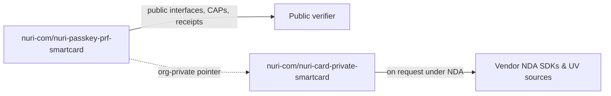

# Private assets and how to request them

This repository (`nuri-com/nuri-passkey-prf-smartcard`) publishes all Nuri-authored
protocols, applets, host scripts, and sanitized hardware receipts. Vendor-NDA
material lives in the `nuri-com` organization's private smartcard repository.

| Item | Where | Why |
|---|---|---|
| IDEX TrustedBio UV applets (`MuSig2-UV`, `ETH2-UV` CAPs + source), enrol/verify console, per-card logs | Private org repo [`nuri-com/nuri-card-private-smartcard`](https://github.com/nuri-com/nuri-card-private-smartcard) (and archive [`nuri-com/0502-nuri-idex`](https://github.com/nuri-com/0502-nuri-idex)) | The card vendor's biometric Shareable Interface API (`A00000090501000101`) is under NDA; redistributing it would republish the vendor SDK. Our vendor-independent APDU interface and live card results are public in [fingerprint](fingerprint.md). |
| FEITIAN BioCARD demo-applet driver | Private/local under vendor NDA | Same NDA boundary, separate biometric API. |
| Attestation CA private key, personalisation-station material | Offline operator custody | Trust root: anyone holding it could certify an emulator. See [attestation](attestation.md). |
| Per-card PINs, PUKs, GP keys, PRF output, recovery material | Owner custody (1Password / offline) | Secrets. See [SECURITY.md](../SECURITY.md). |

## Requesting access

Request read access to `nuri-com/nuri-card-private-smartcard` through the `nuri-com`
maintainers (`SECURITY.md`), stating which card, reader, and integration you are
verifying. Access is granted per reviewer/engineer and subject to vendor NDA rules:
do not mirror, fork publicly, or paste vendor SDK headers into public issues or PRs.

## What stays out of both repositories

- Customer data, third-party serials, unredacted hostnames.
- Per-card PINs, PUKs, rotated GlobalPlatform SCP02/SCP03 keys, or recovery seeds.
- Unverified hardware claims.
