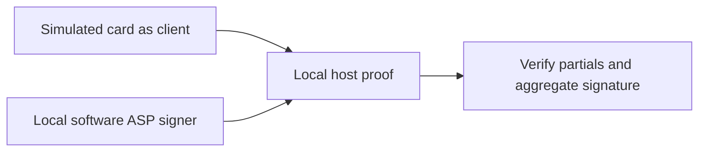

# Arkade client-signer proof: source boundaries

**UNVERIFIED — fresh hardware, chain state, deployed app integration and payment settlement.** This note records source inspection, not a new signing run.

## Code-backed scope

- The JavaScript proof assigns the client role to a simulated card and creates the second signer from a local software ASP secret; it does not contact a deployed ASP (`src/musig2/arkade-client-signer.js:193-207,224-256`).
- The signer interface provides `getClientPk33`, `beginSign` and `partialSign`; the simulator tracks an active session and marks it used before returning a partial (`src/musig2/arkade-client-signer.js:144-190`).
- The host verifies the ASP partial, client partial and final aggregate signature, throwing on failure (`src/musig2/arkade-client-signer.js:239-256`).
- The CLI constructs software/simulated signers and includes untweaked and script-root-tweaked cases (`scripts/arkade-card-signer-proof.mjs:58-86`). Tests assert successful signing and rejection of message, nonce, tweak, nonce-reuse and participant-key errors; these are test definitions, not fresh test results (`test/arkade-client-signer.test.js:44-198`).

The diagram describes that local proof only (`src/musig2/arkade-client-signer.js:193-256`).

## PC/SC adapter boundary

- The Python adapter reads a card public key and supplies a local software ASP key; it selects untweaked/tweaked cases and closes the card connection afterward (`scripts/real-card-arkade-signer-proof.py:214-246`).
- Its call path obtains public nonces and submits `FINALIZE(a_i, b, parity, e)`; the helper serializes those values into APDUs (`scripts/real-card-arkade-signer-proof.py:125-150`; `scripts/card-cosign-tweaked.py:159-164`).
- It computes both partial-verification results and the final BIP340 result locally; output labels such as `real_card` are generated by code, not independent evidence of an executed run (`scripts/real-card-arkade-signer-proof.py:153-210`).
- The JavaScript result carries a proof/dev-only caveat pending PIN/UV-gated nonce/sign APDUs; this is a returned caveat, not an enforced deployment gate (`src/musig2/arkade-client-signer.js:258-288`).

**UNVERIFIED — key non-exportability, user authorization, deployed feature flags and production readiness.** Neither this source inventory nor the separate [historical Signet record](real-card-signet-proof.md) establishes those properties for an Arkade deployment.
