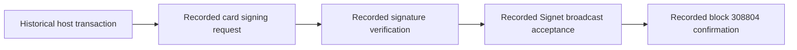

# Historical Nuri card-wallet proof report

**UNVERIFIED — fresh hardware or chain verification.** This is a summary of repository records dated 2026-06-14, not a new test, broadcast or explorer query (historical `docs/logs/real-card-live-broadcast-proof-2026-06-14.md:1,79-106`).

Historical `file:line` citations in this report refer to commit `d73309562ab219648fc8948cbeb33316f34d717f`, not subsequently edited working-tree lines. **UNVERIFIED — present balances, confirmation status, hardware identity, key custody and production readiness.**

## Recorded evidence

- The broadcast transcript (deleted historical log; see the pinned source commit) records a physical-card signing request, `card_partial_verified: true`, `final_signature_verified: true`, broadcast acceptance and a later confirmed result at Signet block `308804` (historical `docs/logs/real-card-live-broadcast-proof-2026-06-14.md:84-106,121-134`).
- The earlier non-broadcast transcript (deleted historical log; see the pinned source commit) records a signed transaction with `broadcasted: false`, plus a separate status lookup reporting the first spend confirmed at block `308802`; the dry run itself is not broadcast evidence (historical `docs/logs/real-card-live-proof-2026-06-14.md:154-161,172-183`).
- The original report identifies a Feitian FT-JCOS BioCARD sample, OMNIKEY 5422 reader, FIDO2 AID `A0000006472F0001` and MuSig2 AID `4E5552494D554701`; these are historical inventory assertions, not fresh device identification (historical `docs/nuri-card-wallet-proof-report.md:42-56`).

The diagram summarizes the recorded broadcast sequence, not a current service guarantee (historical `docs/logs/real-card-live-broadcast-proof-2026-06-14.md:82-106`).

## Historical public identifiers

| Record | Full transaction ID | Recorded block | Historical source at the commit above |
| --- | --- | --- | --- |
| Funding | `1b7e759fe7f8e9c0bdd0e13867dddafbe44cf130683747eae19c09ac2a989523` | `308801` | `docs/real-card-signet-proof.md:75-85` |
| First spend | `d9ecca378bd015f2bd39d3113d3dadc65e6b6f29b72c1d1e6a7d73f246994c38` | `308802` | `docs/logs/real-card-live-proof-2026-06-14.md:172-183` |
| Broadcast run | `c85a73fab75f8649852123d1fff336df2f098792554086a290433ce0999c3e81` | `308804` | `docs/logs/real-card-live-broadcast-proof-2026-06-14.md:125-134` |

The recorded address is `tb1pywzzgk3p7a5zhhkpqn548pm0xpqqfvzl4jylev522glcjy5npc4sckt9fa` (historical `docs/logs/real-card-live-broadcast-proof-2026-06-14.md:19-24`). Full public keys, first-spend raw bytes and unique historical signatures are retained in the [Signet evidence record](real-card-signet-proof.md); the broadcast raw transaction and witness signature are preserved in the transcript (historical `docs/logs/real-card-live-broadcast-proof-2026-06-14.md:121-127`).

## Limits

**UNVERIFIED — current onchain status and attribution of a chain signature to particular hardware independently of the host transcript.** These are historical host-reported results, not fresh chain or hardware attestations.

**UNVERIFIED — Arkade production integration, mobile NFC signing, PIN/UV or fingerprint approval, independent security review, and resistance to a compromised host.** The separate [Arkade source inventory](arkade-card-signer-proof.md) distinguishes local adapter/simulator code from deployment evidence.
