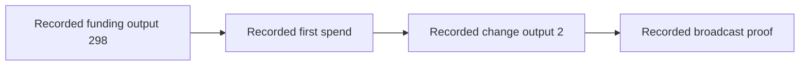

# Historical real-card Signet evidence



**UNVERIFIED — fresh hardware and chain verification.** This record preserves public values from the repository's 2026-06-14 reports and transcripts; it is not a reproduction run (historical `docs/logs/real-card-live-proof-2026-06-14.md:1,124-183`; `docs/logs/real-card-live-broadcast-proof-2026-06-14.md:1,72-136`).

Historical `file:line` citations below refer to commit `d73309562ab219648fc8948cbeb33316f34d717f`, including citations to this file's pre-cleanup version. **UNVERIFIED — current balances, confirmation state, hardware custody or security properties.**

## Public identity recorded in the transcripts

Source for every field below: historical `docs/logs/real-card-live-broadcast-proof-2026-06-14.md:19-24`.

```text
network           = signet
address           = tb1pywzzgk3p7a5zhhkpqn548pm0xpqqfvzl4jylev522glcjy5npc4sckt9fa
card_pk33         = 02b9f7051445e003e60809f888ccca2057dba6609e5c5541eee64acef41ddbf034
client_pk33       = 022fd92f3a844f11bfa474e884f88630447a223e7d2705efb4100b0b96065aa064
aggregate_xonly32 = 2384245a21f7682bdec104e953876f304004b05fac89fcb28a523f8912930e2b
scriptPubKey      = 51202384245a21f7682bdec104e953876f304004b05fac89fcb28a523f8912930e2b
```

## Historical transaction chain

The diagram depicts the recorded outpoint chain, not a new chain lookup (historical `docs/real-card-signet-proof.md:75-103,119-132`; `docs/logs/real-card-live-broadcast-proof-2026-06-14.md:112-120`).

| Role | Full transaction ID | Recorded details | Historical source at the commit above |
| --- | --- | --- | --- |
| Funding | `1b7e759fe7f8e9c0bdd0e13867dddafbe44cf130683747eae19c09ac2a989523` | Output `298`: `204012` sats; block `308801`; hash `0000000759359116ad7075625bf1f1c7bb8b619d7eeb9a1d06f6b5548e4bcf10` | `docs/real-card-signet-proof.md:75-85` |
| First spend | `d9ecca378bd015f2bd39d3113d3dadc65e6b6f29b72c1d1e6a7d73f246994c38` | Block `308802`; hash `000000130e5278bfe9045681c1cbc23fe3a23dc78d2d570b271730c7ba84ad29`; time `1781425293`; `500` sats fee; `173` vbytes | `docs/real-card-signet-proof.md:110-117`; `docs/logs/real-card-live-proof-2026-06-14.md:172-183` |
| Broadcast proof | `c85a73fab75f8649852123d1fff336df2f098792554086a290433ce0999c3e81` | Spent first spend output `2`: `202175` sats; block `308804`; hash `0000000907df521415ccfb7a1df66f2d45651fff6c0ba7b122a27e2298c957df`; time `1781427956` | `docs/logs/real-card-live-broadcast-proof-2026-06-14.md:112-134` |

The first spend's recorded outputs were `1337` sats to the address above, OP_RETURN `Nuri.com`, and `202175` sats change; the broadcast run recorded `1337` sats, the same OP_RETURN, `200338` sats change and a `500` sats fee (historical `docs/real-card-signet-proof.md:128-132`; `docs/logs/real-card-live-broadcast-proof-2026-06-14.md:117-120`).

## Unique first-spend evidence retained from the original report

The following values are historical report assertions, not newly calculated or independently chain-verified values (historical `docs/real-card-signet-proof.md:134-152`):

```text
taproot_sighash32 = 6fd10ef21a5c8cfde2c59788731b86720ad45619b951407d6c534b216f66c28f
card_partial_verified = true
final_signature_verified = true
witness_signature64 = bcb4c993055d2dce0f71ade5ac46043a01b03a7fb95fdb404c96777ad443dd4da5989272e01382c801f8ee3495ba70c19da7f96302af52a6619aba8bc2e11b58
raw_tx_hex = 020000000001012395982aac099ce1ea47376830f14ce4fbdadd6738e1d0bdc0e9f8e79f757e1b2a01000000ffffffff0339050000000000002251202384245a21f7682bdec104e953876f304004b05fac89fcb28a523f8912930e2b00000000000000000a6a084e7572692e636f6dbf150300000000002251202384245a21f7682bdec104e953876f304004b05fac89fcb28a523f8912930e2b0140bcb4c993055d2dce0f71ade5ac46043a01b03a7fb95fdb404c96777ad443dd4da5989272e01382c801f8ee3495ba70c19da7f96302af52a6619aba8bc2e11b5800000000
```

## Distinguishing dry-run and broadcast signatures

The original `08:39` non-broadcast excerpt records the following signature and transaction ID; its signature is not the later broadcast witness (historical `docs/real-card-signet-proof.md:221-235`; `docs/logs/real-card-live-broadcast-proof-2026-06-14.md:124-127`):

```text
taproot_sighash32 = 4af7aeeefdb03aeb637d463d6f5147bb339cf98becfc4c4f68bdb3af5cce5212
final_signature64 = aa3590a0a89239a4074e31140906f2078750b468b67cb677413a304818da7b2ce457959b5cf6e10950c5b491a9239c8ea9488f34fe244859c5090785c785d879
txid = c85a73fab75f8649852123d1fff336df2f098792554086a290433ce0999c3e81
```

The later `08:54` dry run records `broadcasted: false` and another signature, while the `09:02` broadcast run records acceptance and subsequent confirmation; their full raw transactions and signatures remain in the linked historical transcripts (historical `docs/logs/real-card-live-proof-2026-06-14.md:131-161`; `docs/logs/real-card-live-broadcast-proof-2026-06-14.md:79-134`).

## Source records

- Non-broadcast transcript (deleted historical log; see the pinned source commit): public identity, dry-run signature and first-spend status (historical `docs/logs/real-card-live-proof-2026-06-14.md:70-77,154-161,172-183`).
- Broadcast transcript (deleted historical log; see the pinned source commit): witness signature, raw transaction, acceptance and confirmation fields (historical `docs/logs/real-card-live-broadcast-proof-2026-06-14.md:85-106,121-134`).
- [Short proof report](nuri-card-wallet-proof-report.md): historical summary; **UNVERIFIED — fresh hardware or chain validation**.

**UNVERIFIED — independent attribution of these signatures to particular hardware, non-exportability, user approval, mainnet safety or production Arkade integration.** Recorded host booleans and chain identifiers do not constitute fresh hardware attestation.
