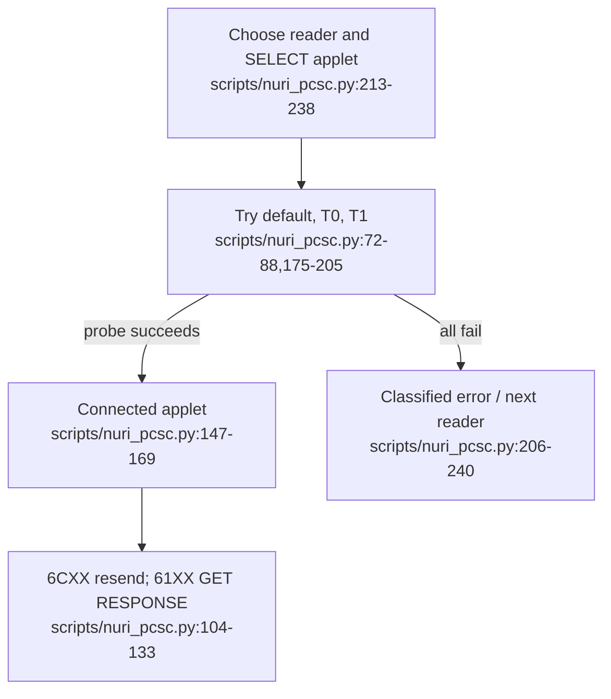

# Reader compatibility (PC/SC)



This page records software transport coverage and the exact physical-card runs
below, not a certified reader list. Other card/reader/OS combinations and
manufacturer/product certification remain **UNVERIFIED**.

## Connection behavior

`open_applet(aid)` filters available readers, tries each reader with the configured protocol sequence, and returns the first successful SELECT. The returned object provides `reader_name`, `protocol`, `transmit` and `close`. Sources: [scripts/nuri_pcsc.py:147-169](../scripts/nuri_pcsc.py#L147-L169), [scripts/nuri_pcsc.py:213-240](../scripts/nuri_pcsc.py#L213-L240).

| Setting | Implemented behavior |
|---|---|
| `NURI_READER` | Case-sensitive reader-name substring for `open_applet`; its explicit `reader=` argument takes precedence. [scripts/nuri_pcsc.py:65-69](../scripts/nuri_pcsc.py#L65-L69) |
| `NURI_PCSC_PROTOCOL=auto` | Default connect → T=0 → T=1; stops when the probe succeeds. [scripts/nuri_pcsc.py:32-33](../scripts/nuri_pcsc.py#L32-L33), [scripts/nuri_pcsc.py:72-88](../scripts/nuri_pcsc.py#L72-L88), [scripts/nuri_pcsc.py:188-205](../scripts/nuri_pcsc.py#L188-L205) |
| `T0`, `T1`, `default` | Pin exactly one connection mode; invalid values raise `ValueError`. [scripts/nuri_pcsc.py:72-80](../scripts/nuri_pcsc.py#L72-L80) |

The FIDO2 patch replaces `CtapPcscDevice.connect` with the same protocol ladder and then calls the device's `_select`. It does **not** apply `NURI_READER` itself; the SSH helper instead selects from discovered FIDO2 devices by index. Sources: [scripts/nuri_pcsc.py:246-271](../scripts/nuri_pcsc.py#L246-L271), [scripts/ssh-pcsc-sk-helper.py:34-42](../scripts/ssh-pcsc-sk-helper.py#L34-L42).

## APDU responses and failures

- `6C XX`: resend with corrected `Le`; `61 XX`: fetch and append GET RESPONSE data. Each loop is bounded to 64 iterations. Other status words are returned for the caller to interpret. [scripts/nuri_pcsc.py:38](../scripts/nuri_pcsc.py#L38), [scripts/nuri_pcsc.py:104-133](../scripts/nuri_pcsc.py#L104-L133).
- `NO_READER`: no reader, or no reader matches the filter. [scripts/nuri_pcsc.py:216-222](../scripts/nuri_pcsc.py#L216-L222).
- `NO_CARD`: all connection attempts report no card; `TRANSPORT`: non-no-card connection failures; `NO_APPLET`: a connection succeeds but all probes fail. Across readers, `NO_APPLET` outranks `TRANSPORT`, which outranks `NO_CARD`. These classify the helper's observations, not an independently established hardware diagnosis. [scripts/nuri_pcsc.py:98-101](../scripts/nuri_pcsc.py#L98-L101), [scripts/nuri_pcsc.py:175-240](../scripts/nuri_pcsc.py#L175-L240).

For integrations running with `scripts` on the Python import path, use the context manager to disconnect automatically. The interface is implemented at [scripts/nuri_pcsc.py:156-169](../scripts/nuri_pcsc.py#L156-L169):

```python
import nuri_pcsc

with nuri_pcsc.open_applet("4E55524945544801") as applet:
    print(applet.reader_name, applet.protocol)
    data, sw = applet.transmit(bytes.fromhex("8001000000"))
    print(data.hex(), f"{sw:04X}")
```

This example selects the legacy ETH applet and requests its version; it does not generate a key. Sources: [scripts/pkcs11-helper.py:81-86](../scripts/pkcs11-helper.py#L81-L86), [card/eth/NuriEcdsaSigner.java:151-171](../card/eth/NuriEcdsaSigner.java#L151-L171). Execution on your reader: **UNVERIFIED**.

## Software coverage, not hardware proof

| Fake-reader profile | Modeled behavior | Executable evidence |
|---|---|---|
| OMNIKEY-shaped | Default connection succeeds | [test/test_nuri_pcsc.py:147-148](../test/test_nuri_pcsc.py#L147-L148), [test/test_nuri_pcsc.py:181-191](../test/test_nuri_pcsc.py#L181-L191) |
| Realtek-shaped | Default raises `0x80100066`, T=1 raises `0x8010000F`; T=0 succeeds | [test/test_nuri_pcsc.py:151-161](../test/test_nuri_pcsc.py#L151-L161), [test/test_nuri_pcsc.py:193-211](../test/test_nuri_pcsc.py#L193-L211) |
| FIDO2 stand-in | Patch discovers the T=0-only fake; repeated patching is idempotent | [test/test_nuri_pcsc.py:359-436](../test/test_nuri_pcsc.py#L359-L436) |

Run the fake-reader suite without contacting a card:

```sh
PYTHONDONTWRITEBYTECODE=1 python3 -m unittest discover -s test -p test_nuri_pcsc.py -v
```

The suite injects fake readers and a stand-in FIDO2 module; its import check also compiles Python scripts. Sources: [test/test_nuri_pcsc.py:164-177](../test/test_nuri_pcsc.py#L164-L177), [test/test_nuri_pcsc.py:362-399](../test/test_nuri_pcsc.py#L362-L399), [test/test_nuri_pcsc.py:533-546](../test/test_nuri_pcsc.py#L533-L546). These tests do not establish real-reader, contactless or operating-system compatibility (**UNVERIFIED**).

## Hardware runs (parent, physical card)

Each row is one run on the public demo card (CPLC fabricator 4090, OS id 86aa) with the stated reader. Rows record what ran, not a certified reader list.

| Reader (USB id / ATR) | Date | Protocol `nuri_pcsc` chose | Paths that passed |
|---|---|---|---|
| HID Global OMNIKEY 5422, contact slot | 2026-10-18 | `default` | SSH login (operator-controlled test server), FIDO2 PIN status, ETH v1 sign verified with python-ecdsa, PKCS#11 `pkcs11-tool --sign` verified, native host `info`/`sign_hash`, card-secrets `put`/`run`/`rm` |
| Generic Realtek `0bda:0165`, ATR `3b119580` | 2026-10-17/18 | `T0` (default connect: `0x80100066`, T=1: `0x8010000F`) | SSH login, FIDO2 PIN status, ETH SELECT/version/pubkey |
| ACS ACR39U ICC Reader | 2026-10-18 | `T0` | SSH login, FIDO2 PIN status, ETH v1 sign verified, PKCS#11 sign verified, native host `info`/`sign_hash` (as Chrome launches it), card-secrets `put`/`run`/`rm` |
