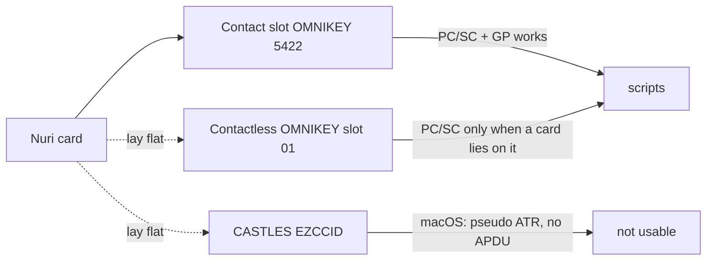

# Card readers: which one works, and how the scripts pick one



Any CCID reader that PC/SC lists works. There is no reader-specific code path:
`scripts/nuri_pcsc.py` walks every reader and every protocol (T=1, T=0, library
default) until SELECT answers `9000`, and ignores readers without a card.

## See what is where (read only)

```sh
python3 scripts/card-readers.py
python3 scripts/card-readers.py --json
```

Prints every PC/SC reader, the ATR, the CPLC serial, the chip and which Nuri
applets answer. Sends only SELECT and GET DATA, never a PIN, never a write.

## Pin one reader for everything

```sh
export NURI_READER="HID Global OMNIKEY 5422 Smartcard Reader"   # substring match
export GP_READER="$NURI_READER"                                  # for gp only
```

`card-setup.sh` picks the reader itself when exactly one reader holds a card.
With several cards it lists each card serial and asks for a number.

## Measured on macOS 15.5, 2026-11-03

| Reader | Slot | Result |
|---|---|---|
| HID OMNIKEY 5422 | contact | works. Used for every proof in this repo (NXP 87E5470B, Infineon 01086187, IDEX B2183751). |
| HID OMNIKEY 5422, name suffix `01` | contactless | PC/SC shows it only when a card lies on it. Same card, no PIN pad. |
| CASTLES EZCCID | contactless | **does not work on this Mac.** Reports pseudo ATR `3B119580` and every APDU fails with `SCARD_E_NOT_TRANSACTED` (0x80100016), including the reader's own GET_UID escape. Reader driver issue, not a card issue. |

Two readers with cards at once is fine. The scripts read all of them; `gp`
needs `-r`/`GP_READER` or `GP_READER_IGNORE` because it otherwise prints
"several readers, specify one". `card-setup.sh` sets that ignore list itself.

## Cheap readers

The cards in `docs/hardware.md` are plain JCOP over T=1 or T=0. A reader that
only speaks T=0 works too, the protocol ladder handles it. If a reader fails,
run `python3 scripts/card-readers.py`: a pseudo ATR with zero applets means the
reader driver, not the card.
