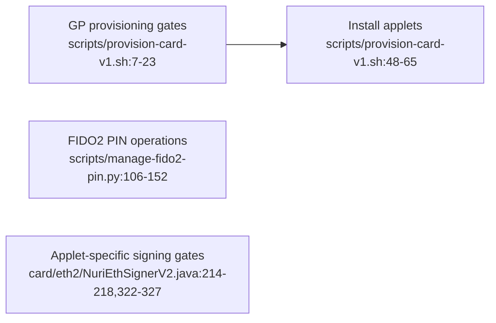

# Real-card key handling

## Separate the access domains

GP key inputs belong to the provisioning/install path; FIDO2 PIN management calls CTAP `ClientPin` separately. Do not assume a FIDO2 PIN protects every installed applet. [scripts/provision-card-v1.sh:16-23](../scripts/provision-card-v1.sh#L16-L23), [scripts/provision-card-v1.sh:41-46](../scripts/provision-card-v1.sh#L41-L46), [scripts/manage-fido2-pin.py:106-152](../scripts/manage-fido2-pin.py#L106-L152)

| Operation / source | Implemented gate |
| --- | --- |
| Blank-card provisioning | Requires `CARD_PROVISION_CONFIRM=YES`, an explicit GP reader, and `GP_KEY` or a complete ENC/MAC/DEK set (including `SCP03_*` aliases). Checks release hashes and rejects a registry containing any of its four target applet AIDs before installation. [scripts/provision-card-v1.sh:7-23](../scripts/provision-card-v1.sh#L7-L23), [scripts/provision-card-v1.sh:30-65](../scripts/provision-card-v1.sh#L30-L65) |
| FIDO2 install / reinstall | Both forward optional GP keys and default to `FIDO2-up.cap`. Install has no confirmation gate; reinstall requires `FIDO2_REINSTALL_CONFIRM=YES` and conditionally deletes matching packages. Neither wrapper requires keys to be supplied. [scripts/install-fido2-card.sh:4-48](../scripts/install-fido2-card.sh#L4-L48), [scripts/reinstall-fido2-card.sh:4-67](../scripts/reinstall-fido2-card.sh#L4-L67) |
| FIDO2 PIN | Set/change/verify use CTAP `ClientPin`; PINs are read with `getpass`, and verification obtains a PIN token. These paths do not call GP. [scripts/manage-fido2-pin.py:91-152](../scripts/manage-fido2-pin.py#L91-L152) |
| ETH v1 signing | Dispatches directly to `sign`; signing checks an initialized key and exactly 32 input bytes, with no PIN or physical-UP authorization gate. [card/eth/NuriEcdsaSigner.java:151-161](../card/eth/NuriEcdsaSigner.java), [card/eth/NuriEcdsaSigner.java:204-208](../card/eth/NuriEcdsaSigner.java) |
| ETH v2 signing | Mandatory PIN by default: unconfigured or unvalidated SIGN/KEYGEN refuses. Explicit install-time demo mode is the exception. Reselection/deselect/reset clears validation. See [current ETH2 contract](eth-applet-v2.md). [card/eth2/NuriEthSignerV2.java:188-218](../card/eth2/NuriEthSignerV2.java), [card/eth2/NuriEthSignerV2.java:322-327](../card/eth2/NuriEthSignerV2.java) |
| MuSig2 signing | Current source has mandatory-default PIN plus a nonce-session token; older/demo instances can be unprotected. Nonce/session checks do not establish physical touch or transaction-intent approval. See [current MuSig2 contract](musig2-pin-and-hardening.md). [card/musig2/NuriMuSig2v019.java:178-203](../card/musig2/NuriMuSig2v019.java), [card/musig2/NuriMuSig2v019.java:369-392](../card/musig2/NuriMuSig2v019.java) |
| TOTP | First PUT establishes its own admin PIN; later PUT checks that PIN. CALC requires provisioning and an 8-byte counter but no PIN validation. [card/totp/NuriOathTotp.java:142-157](../card/totp/NuriOathTotp.java), [card/totp/NuriOathTotp.java:171-209](../card/totp/NuriOathTotp.java) |

## Handle lifecycle changes explicitly

ETH v1 and MuSig2 source key generation is one-shot: each rejects a second generation once its `keyGenerated` flag is set. This source behavior is not proof of the version installed on a particular card. [card/eth/NuriEcdsaSigner.java:174-192](../card/eth/NuriEcdsaSigner.java), [card/musig2/NuriMuSig2v019.java:217-277](../card/musig2/NuriMuSig2v019.java)

The FIDO2 reset wrapper requires `FIDO2_RESET_CONFIRM=YES` and invokes CTAP reset, not GP reinstall. On successful reset, the applet replaces resident credential storage, clears PIN state and regenerates wrapping keys: this is a destructive lifecycle operation. [scripts/reset-real-fido2-card.sh:6-13](../scripts/reset-real-fido2-card.sh#L6-L13), [scripts/reset-real-fido2-card.py:34-51](../scripts/reset-real-fido2-card.py#L34-L51), [third_party/fido2-applet/src/main/java/us/q3q/fido2/FIDO2Applet.java:5465-5504](../third_party/fido2-applet/src/main/java/us/q3q/fido2/FIDO2Applet.java#L5465-L5504), [third_party/fido2-applet/src/main/java/us/q3q/fido2/FIDO2Applet.java:5525-5531](../third_party/fido2-applet/src/main/java/us/q3q/fido2/FIDO2Applet.java#L5525-L5531)

Do not assume all installers share provisioning's guardrails: MuSig2 and TOTP wrappers default `GP_READER` to `2`, invoke `gp` directly without explicit key forwarding, and allow deletion of an existing instance when their respective reinstall variable is `YES`. [scripts/install-musig2-card.sh:4-37](../scripts/install-musig2-card.sh#L4-L37), [scripts/install-totp-card.sh:4-36](../scripts/install-totp-card.sh#L4-L36)

## Secret-handling boundary

Keep management keys, PINs and private-key exports out of versioned files. The ignore rules cover environment files, secret directories and common key containers, but the GP wrappers still pass supplied keys as command arguments; ignore rules do not sanitize command output. The ETH2 dry-run output also expands its GP argument array. [.gitignore:15-27](../.gitignore#L15-L27), [scripts/install-fido2-card.sh:25-48](../scripts/install-fido2-card.sh#L25-L48), [scripts/install-eth2-card.sh:69-71](../scripts/install-eth2-card.sh#L69-L71)

**UNVERIFIED:** a physical card's installed versions, management key values/SCP policy, fingerprint integration, model compatibility and fresh hardware acceptance. No vendor key or preset PIN is supplied by this guide. For the source-level UP limitation, see [FIDO2 user presence](fido2-user-presence.md).
