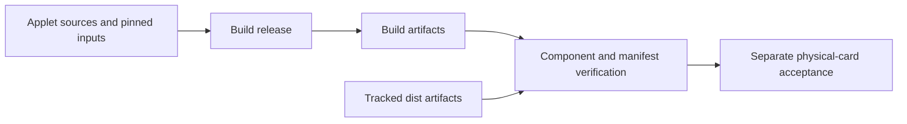

# Applet release verification



## Build and compare

```sh
npm ci
npm run card:release:verify
```

The verifier invokes `scripts/build-card-v1-release.sh` unless
`CARD_SKIP_BUILD=YES`, validates `dist/SHA256SUMS`, compares CAP components,
and compares the generated CAP manifest.
Source: [scripts/verify-card-v1-release.sh:4–25](../scripts/verify-card-v1-release.sh#L4-L25).

`CARD_BUILD_ROOT` changes the build workspace and `CARD_RELEASE_OUT` changes the
comparison-artifact path. `CARD_SKIP_BUILD=YES` is not a clean rebuild; use it only
when deliberately checking pre-existing artifacts from a known build.

Success marker: `CARD_V1_RELEASE_VERIFIED`. This is a build/component verification
marker, not an applet install or hardware-security certificate.

## AID3 in v1.2.0

The release build and comparison lists include
`nuri-musig2-v20-keygen-aid3.cap`, package `4E5552494D554733`, applet
`4E5552494D55473301`, applet version 1.17. Its standalone builder normalizes ZIP
metadata and does not modify tracked Java sources. The CAP and its hash are in
`dist/SHA256SUMS`; CI job `card-release` reproduced it from main
`f95d77ce9cffd776c866002a8b0fad3c2350fe3d` with `CARD_V1_RELEASE_VERIFIED`.
Hardware evidence is the live mainnet cosign [receipt](proofs/e2e-proof.json);
the about 2.0 s FINALIZE is operator-reported, without a timing receipt.
[Scalar release boundary](scalar256.md#v120-aid3-release-boundary).

## Inputs and scope

Use [reproduction](reproducing.md) for the toolchain and test entrypoints.
The pinned Java Card build tool has corresponding source:
[tools/README.md](../tools/README.md). Source and component licence obligations
remain governed by [THIRD_PARTY_NOTICES.md](../THIRD_PARTY_NOTICES.md), not by a
successful build.

The verifier's file list is implementation-defined, not a promise that every
included historical artifact should be installed. The bundle provisioner installs
ETH v1, whereas ETH v2 has a separate installer. Sources:
[scripts/verify-card-v1-release.sh:17–20](../scripts/verify-card-v1-release.sh#L17-L20),
[scripts/provision-card-v1.sh:56–63](../scripts/provision-card-v1.sh#L56-L63).

Before publishing artifacts, run from a clean checkout and save the exact source
commit, toolchain, output and hashes. Complete [physical acceptance](acceptance.md)
separately. **UNVERIFIED:** fresh reproducibility and hardware behavior until the
corresponding checks complete on the target revision.

## Evaluation receipt — source baseline 2026-10-18

Documentation started from source commit
`f6b31406fd472d976b403a91f63aa300970c5f92`. The documentation change does not
install/rebuild CAPs or change signing/PIN logic. Current distributed CAP hashes,
versions and licence scope are in the [artifact inventory](../dist/README.md) and
[checksum manifest](../dist/SHA256SUMS); build inputs are listed there as well.
A final release must record its **own final source SHA**, clean-build provenance
and matching hashes, not reuse the baseline as if these docs had already shipped.

The physical demo card is a different target: CPLC fabricator `4090`, OS `86aa`,
OS date `5134` (2025-05-14), FIDO2 AID `A0000006472F0001`, ETH1 AID
`4E55524945544801`, MuSig2 AID `4E5552494D554701`, TOTP AID
`4E555249544F5450`. Exact commercial model and product certification are
UNVERIFIED. Its ETH1 key and older MuSig2 installation do not qualify current
ETH2/PIN/attestation/vault CAPs. The [reader table](reader-compatibility.md#hardware-runs-parent-physical-card)
bounds what was actually exercised. New applets and GP escrow/lock are simulator only.

GP escrow tooling **does not change lifecycle state** or prove the demo card is
sealed. Each release-card receipt must record installed applet versions, CAP
hashes, PIN policy/readback, certificate trust anchor and seal state, ISD keyset
and lifecycle, hardware/reader/protocol, and exact physical acceptance outputs.
No management secrets or card identifiers needed only for private administration
belong in the public receipt. Applet CA certificates authenticate enrollment to a
configured CA, not manufacturer silicon or certification.

Remaining gates are explicit: full Chrome interaction/transaction receipt,
new-app physical acceptance, exact-batch capability/timing/fault assessment,
independent recovery if promised, external audit and historical-publication review.
Passing a documentation or simulator check alone closes none of those gates.
