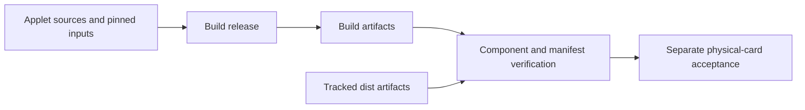

# Applet release verification



## Build and compare

```sh
npm ci
npm run card:release:verify
```

The verifier invokes `scripts/build-card-v1-release.sh` unless
`CARD_SKIP_BUILD=YES`, validates `dist/SHA256SUMS`, compares CAP components,
and compares the generated CAP manifest.
Source: [scripts/verify-card-v1-release.sh:4–25](../scripts/verify-card-v1-release.sh#L4-L25).

`CARD_BUILD_ROOT` changes the build workspace and `CARD_RELEASE_OUT` changes the
comparison-artifact path. `CARD_SKIP_BUILD=YES` is not a clean rebuild; use it only
when deliberately checking pre-existing artifacts from a known build.

Success marker: `CARD_V1_RELEASE_VERIFIED`. This is a build/component verification
marker, not an applet install or hardware-security certificate.

## Inputs and scope

Use [reproduction](reproducing.md) for the toolchain and test entrypoints.
The pinned Java Card build tool has corresponding source:
[tools/README.md](../tools/README.md). Source and component licence obligations
remain governed by [THIRD_PARTY_NOTICES.md](../THIRD_PARTY_NOTICES.md), not by a
successful build.

The verifier's file list is implementation-defined, not a promise that every
included historical artifact should be installed. The bundle provisioner installs
ETH v1, whereas ETH v2 has a separate installer. Sources:
[scripts/verify-card-v1-release.sh:17–20](../scripts/verify-card-v1-release.sh#L17-L20),
[scripts/provision-card-v1.sh:56–63](../scripts/provision-card-v1.sh#L56-L63).

Before publishing artifacts, run from a clean checkout and save the exact source
commit, toolchain, output and hashes. Complete [physical acceptance](acceptance.md)
separately. **UNVERIFIED:** fresh reproducibility and hardware behavior until the
corresponding checks complete on the target revision.
