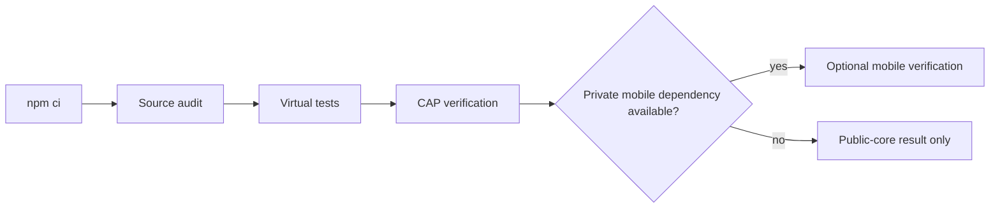

# Reproduce the public core



## Entrypoints

Requires Node/npm, Python, Java and the toolchains requested by the called build
scripts. Those scripts are the authoritative version checks; do not infer a
hardware result from a successful virtual test.

```sh
# From the repository root; skips the restricted mobile dependency.
REPRODUCE_EXPO=NO npm run reproduce:v1
```

This runs clean dependency installation, source audit, virtual tests and release
verification. `JAVA17_HOME` can select the Java home for the virtual suite.
Source: [scripts/reproduce-v1.sh:7–14](../scripts/reproduce-v1.sh#L7-L14).

Default `npm run reproduce:v1` also runs mobile verification and needs access to
the private design system. With `REPRODUCE_EXPO=NO`, the success marker is
`NURI_CARD_V1_PUBLIC_CORE_REPRODUCED`, **not** the full-source marker.
Source: [scripts/reproduce-v1.sh:16–22](../scripts/reproduce-v1.sh#L16-L22).

## Narrower checks

```sh
npm ci
npm test
npm run test:pcsc
npm run test:helper-auth
npm run card:eth2:test:sim
npm run card:totp:test:sim
npm run test:virtual
npm run card:release:verify
```

Entrypoints: [package.json:11–13](../package.json#L11-L13),
[33–46](../package.json#L33-L46), [66–76](../package.json#L66-L76).
Python wrappers may create ignored environments and simulator/build commands may
fetch external inputs. Inspect scripts before running in an offline environment.

## What a pass establishes

- Node tests: software behavior under those fixtures.
- Fake PC/SC and helper-auth checks: mocked transports and local access controls.
- Java Card simulator: selected applet behavior, not target silicon algorithms.
- CAP verification: build/component and checksum agreement, not installation.
- Mobile checks: only the exercised build/fixture path; not merchant settlement.

See [release verification](release.md), [acceptance](acceptance.md),
[mobile source](../mobile/expo-nfc-prf-probe/README.md) and [security model](security-model.md).
