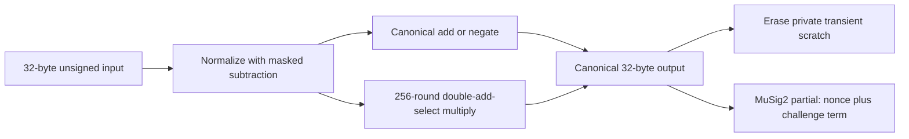

# MuSig2 Scalar256 — W16 clean-room arithmetic



## Scope and provenance

`card/musig2/Scalar256.java` is independently written for the narrow W14 §5.2
call contract: unsigned 256-bit compare/zero, reduce, add, negate and multiply
modulo the secp256k1 group order. The implementer and test author did not open,
copy or transliterate `Biginteger.java`, `BigIntegerWrapper.java`,
`BigIntegerMod.java`, Satochip implementation source or Keycard arithmetic.
The inherited three MuSig2 math files are deleted, not relabelled. Existing
applet protocol/EC/APDU logic was read only to replace the specified calls.
This statement concerns the new scalar file, not an assertion that all other
repository files or historical CAPs are MIT-only.

Independent mathematical references (not implementation sources):

- [BIP327 specification](https://github.com/bitcoin/bips/blob/master/bip-0327.mediawiki):
  `s_i = (k1 + b*k2) + e*a_i*sk (mod n)`, with the prescribed parity negations.
- [BIP340 specification](https://github.com/bitcoin/bips/blob/master/bip-0340.mediawiki):
  secp256k1 order, x-only/even-Y convention and Schnorr verification equation.
- [Official BIP327 sign/verify numeric fixtures](https://github.com/bitcoin/bips/blob/master/bip-0327/vectors/sign_verify_vectors.json):
  all six valid cases, including aggregate infinity and variable message length,
  are embedded offline in `test/musig2-jcardsim/Scalar256Test.java:266-333`.
  The test reconstructs coefficients/challenges from those fixtures independently;
  no upstream reference implementation is included. This is scalar-chain coverage,
  not all BIP327 parser/error-vector coverage.

The new file's header records MIT SPDX, the existing root copyright spelling
(`Emin Grande and contributors`), this independent origin and the limitations.
No new dependency is introduced; host tests use the existing pinned jCardSim
3.0.5.11 and its shaded point implementation. External SDK/tool licences remain
unchanged.

## Representation and invariants

- The order is `FFFFFFFFFFFFFFFFFFFFFFFFFFFFFFFEBAAEDCE6AF48A03BBFD25E8CD0364141`
  (`Scalar256.java:28-36`). All scalars are exactly 32-byte big-endian windows.
  Callers must supply non-null arrays with valid, non-negative short offsets and
  at least 32 accessible bytes. The object is non-reentrant.
- Every 256-bit input is below `2*n`, so normalization requires precisely one
  32-byte subtraction and mask selection; equality to `n` becomes zero.
  Each arithmetic input is staged and normalized (`Scalar256.java:68-103,125-128`).
  Host inputs are not rejected merely for being noncanonical.
- Addition computes a 257-bit sum using byte digits and a short carry. For
  canonical operands the sum is below `2*n`. Subtraction is selected if the high
  carry is set or the low sum did not borrow from `n`. This handles wraparound,
  not merely a comparison of the truncated low sum (`Scalar256.java:130-161`).
- Negation computes `n-a` after normalization, masking all bytes to zero when
  `a=0`, so zero never produces the noncanonical representation `n`
  (`Scalar256.java:74-90`). Compare and zero tests scan every byte
  (`Scalar256.java:45-65`).
- Multiplication evaluates the second operand's bits from MSB to LSB. In each
  of exactly 256 rounds: double the accumulator modulo `n`; unconditionally
  compute accumulator plus the first operand; select by the current bit. Each
  round has two canonical additions. No secret-indexed lookup or secret-dependent
  loop/branch is used in the scalar methods (`Scalar256.java:101-123`).
- The private 160-byte transient array contains normalized A/B, accumulator R,
  candidate T and subtraction D (five 32-byte slots). It is allocated only in the
  constructor with `CLEAR_ON_DESELECT`, then explicitly wiped after each successful
  operation (`Scalar256.java:22-42,170-174`). This is not an exceptional-exit
  erasure guarantee for invalid array arguments, nor a claim about JIT/card power
  behavior. Current applet calls supply fixed valid windows.
- Both operands are staged before output is written. Exact or partial output
  overlap with either/both inputs is therefore supported. In particular the third
  signing multiply writes over its second operand, `e*(a_i*sk)`
  (`NuriMuSig2v019.java:449-454`). Input windows themselves can overlap too.
- The existing nonce readiness flags and nonce arrays retain `CLEAR_ON_RESET`;
  the all-zero guard and one-shot finalize behavior are unchanged
  (`NuriMuSig2v019.java:152-160,362-377,473-475`). Native EC point multiplication
  stays on the Java Card key-agreement API; there is no RSA scalar accelerator.

## Verification and reproducible build

Run simulator only:

```sh
npm run card:musig2:test:sim
npm test
```

The scalar suite uses `java.math.BigInteger` only on the host as an independent
oracle. It exercises `0,1,n-1,n,n+1,2^256-1`, every bit position, all boundary
pairs, deterministic random cases including forced noncanonical values, carry
and borrow, exact/partial aliases, nonzero offsets, unchanged guard bytes, scalar
scratch erasure and six official BIP327 valid scalar chains. The APDU suite
verifies partials for canonical/random inputs and all six boundary host inputs
under both parities; retains reset/fresh-nonce/replay tests; and injects each zero
nonce independently while readiness flags remain true to reach the zero guard.

Actual simulator output on this worktree (macOS, Zulu JDK 17):

```text
SCALAR256_OK assertions=15376024 compare=4830 isZero=710 reduce=3479 negate=3721 add=15143 multiply=15411 chains=268 bip327=6 scratchArrays=1 scratchChecks=37756 seed=5343414c41523256
MUSIG2_JCARDSIM_NONCE_LIFETIME_OK
```

Build the two-source CAP with an externally installed Java Card 3.0.4 SDK and
Zulu JDK 8, then normalize its ZIP metadata:

```sh
export JAVA_HOME=/Library/Java/JavaVirtualMachines/zulu-8.jdk/Contents/Home
export PATH="$JAVA_HOME/bin:$PATH"
export ANT_OPTS=-Djava.io.tmpdir=/Users/eminmahrt/.hermes/cache/scratch
ant -f card/musig2/build.xml -Djckit.path="$JC304_KIT" \
  -Dcap.output="$PWD/.build/card-v1/musig2-raw.cap" build
/opt/homebrew/bin/python3.13 scripts/normalize-cap.py \
  .build/card-v1/musig2-raw.cap dist/nuri-musig2-v20-keygen.cap
shasum -a 256 dist/nuri-musig2-v20-keygen.cap
```

Actual converter/verifier output: conversion completed with **0 errors and
0 warnings**; verification completed with **0 warnings and 0 errors**;
`BUILD SUCCESSFUL`. The pinned ant tool SHA256 was verified as
`def557393fd20dbe478a4581c3273222805b9e494836aa8465dfbe0fb9d64cf2`.
The older ant tool accepts only single-digit package components, so the new CAP
package version is **2.0**, while the APDU version is **1.13** (`010D`), both
separate from the retained compatibility filename (`build.xml:3,9,13` and
`NuriMuSig2v019.java:29-30`). CAP SHA256 is
`0fb0b08bfd728b38c57e137fd54c4a3f5f9bfd80fda1fa1d7acc818e17e1a89a`.

## Review and remaining boundaries

Independent source review found no scalar arithmetic blocker. Follow-up findings
outside the narrow arithmetic replacement: `tempPrivKey` retains the last nonce
copy after nonce generation (`NuriMuSig2v019.java:124-125,318-339`); applet byte
cleanup only occurs on successful finalize (`NuriMuSig2v019.java:438-475`). Those
pre-existing key-object/exception-lifecycle boundaries are not solved by erasing
Scalar256's own scratch. Physical exploitability is UNVERIFIED. Do not interpret
this task as a complete applet secret-erasure or side-channel audit.

Hardware latency, reader timeouts, transient memory availability, timing/power
resistance, fault resistance and real reset behavior remain **UNVERIFIED**.
No reader, hardware key, card install or server was touched. The fixed-iteration
software multiply may be slower than hardware RSA; parent must measure on a
supported spare card before any production migration.

## Exact parent real-card commands (not executed by W16)

Do not delete/reinstall the only SSH-key card. Installation of this CAP requires
an explicitly chosen **blank spare/test card**; the installer will not overwrite
an existing applet unless separately armed (`scripts/install-musig2-card.sh:15-26`).
For a parent-approved blank spare, after selecting its reader explicitly:

```sh
GP_READER="$SPARE_READER_INDEX" \
MUSIG2_CAP="$PWD/dist/nuri-musig2-v20-keygen.cap" \
  scripts/install-musig2-card.sh
# Blank spare only: one-shot on-card keygen, then partial and aggregate proof.
NURI_READER="$SPARE_READER_NAME" \
  scripts/run-card-python.sh scripts/real-card-cosign-proof.py \
  --message 'W16 Scalar256 spare-card keygen acceptance'
# Existing keyed test card: no KEYGEN, no key replacement, no network transaction.
NURI_READER="$SPARE_READER_NAME" npm run card:musig2:test
```

PC/SC proof reader selection uses `NURI_READER` as a name substring
(`scripts/nuri_pcsc.py:65-69`); verify that it names
the intended spare before executing any proof. Capture APDU version `010D`,
`card_partial_verified=true`, `client_partial_verified=true` and
`final_signature_verified=true` from the JSON output. The existing proof is not
an on-card official BIP327 vector or reset-injection harness; it uses the legacy
host session-construction path (`scripts/real-card-cosign-proof.py:337-362`).
Hardware reset/nonce-lifetime and latency acceptance require a separate
parent-controlled APDU harness; no nonexistent command is claimed here.
