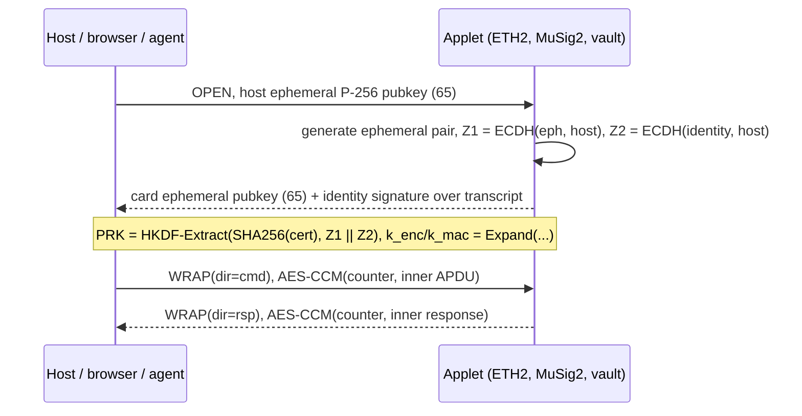

# Application secure channel (design only, not implemented)

## Status

**Nothing in this document is implemented.** Today every applet receives plaintext
APDUs, and a PIN sent with `VERIFY` crosses the reader, the USB bus and any process
holding the PC/SC context in the clear. Signed responses come back in the clear too.
See [security model](security-model.md) and the consent section of the
[README](../README.md).

This page exists so the gap is designed once, reviewed before code, and not
improvised per applet. Treat every field, tag length and status word as a proposal.

## Threat it closes, and what it does not

| Closed | Not closed |
|---|---|
| Passive reading of the PIN and of signatures on NFC or a shared USB bus | A compromised host that is allowed to ask for signatures anyway |
| Active modification of an APDU in flight (tag failure aborts) | Replay of a whole completed session (counter and ephemeral key prevent it; a relayed live session is not prevented) |
| An impostor applet or card answering instead of yours (identity signature over the transcript) | A cloned card holding a stolen identity key and PIN |
| PIN entry through an untrusted reader or middleware | Blind signing: the card still cannot show what it signs |

An application channel does not create per-transaction consent, a display, or
firmware attestation. Those stay separate.

## Primitives already on the card

- **P-256 ECDH.** MuSig2 already requires `KeyAgreement.ALG_EC_SVDP_DH_PLAIN_XY`
  ([hardware requirements](hardware.md)).
- **A non-exportable P-256 identity key per applet instance,** generated at install,
  with a CA-signed certificate and a fresh challenge
  ([attestation](attestation.md)). This is the channel's trust anchor: the same key
  signs the handshake transcript, so a channel cannot be pinned to an emulator
  without a CA-signed identity.
- **SHA-256 and HMAC-SHA-256** for HKDF.
- **AES-CCM is not yet probed on the target.** `Cipher.ALG_AES_CCM_16_128` is the
  intended mode; the CAPS byte already reports native ECDSA, native keygen and XY
  ECDH, but not AES. Probe before promising it, and fall back to
  AES-CBC + HMAC-SHA-256 if CCM is absent. Do not ship a software AES.

Reference for the framing ideas: Keycard `SecureChannelV2` is **Apache-2.0**. We have
not imported it; if we do, keep its `NOTICE` and do not claim wire compatibility.
Satochip's channel is LGPL and is not a source for this design.

## Proposed wire contract (NURI-SC v1)

All multi-byte integers are big-endian. `||` is concatenation.

| Step | APDU | Body | Response |
|---|---|---|---|
| OPEN | `CLA 80, INS 10, P1 01, P2 00` | host ephemeral public key, 65 bytes | card ephemeral public key 65, signature 64 (raw r‖s) |
| WRAP | `CLA 80, INS 11, P1 dir, P2 00` | `counter32 ‖ ciphertext ‖ tag` | same shape |
| CLOSE | `CLA 80, INS 12` | empty | `9000` |

- `dir` = `00` command, `01` response.
- Transcript = `SHA256("NURI-SC-V1" ‖ AID ‖ host_eph65 ‖ card_eph65)`.
- The identity signature covers the transcript, so the host verifies the pinned CA
  certificate first and then the transcript signature.
- `PRK = HKDF-Extract(salt = SHA256(cert), ikm = Z1 ‖ Z2)`; `k_enc = HKDF-Expand(PRK,
  "nuri-sc-v1/enc", 16)`; `k_mac` likewise. With AES-CCM, `k_mac` is unused and the
  tag comes from CCM; with the CBC fallback it is the HMAC key.
- CCM nonce = `dir ‖ counter32 ‖ salt64`, where `salt64` is the low 8 bytes of the
  transcript hash, fixed for the session.
- AAD = `SHA256(CLA ‖ INS ‖ P1 ‖ P2 ‖ counter32)`.
- Tag 16 bytes. Inner frame is the complete APDU including `Le`, so the card's
  existing `61xx`/`6Cxx` handling applies inside the tunnel.

Status words: `6988` tag or counter failure (channel closed, PIN flag cleared),
`6985` WRAP before OPEN, `6A88` unsupported primitive, `6A81` channel already open.

## State and failure rules

1. One channel per selection. `select`, `deselect`, card reset and any tag failure
   close it.
2. Counters are per direction, 32-bit, incremented before use, stored in EEPROM so a
   power cut cannot rewind them. A repeated counter is rejected, not ignored.
3. Any error inside the tunnel still closes the channel - the same fail-closed rule
   the MuSig2 nonce session already uses ([MuSig2 policy](musig2-pin-and-hardening.md)).
4. Once a channel exists, unwrapped `VERIFY`, `SIGN`, `FINALIZE` and vault `REVEAL`
   return `6982` when the applet is built with `SC_REQUIRED`. The public demo install
   keeps plaintext for compatibility and says so.
5. No PIN, PUK or key material may be accepted in a plaintext APDU on a
   `SC_REQUIRED` build, including the first-personalisation path; personalisation
   happens in a physically trusted station over the same tunnel.

## Work plan

| Step | Output | Gate |
|---|---|---|
| 1 | `scripts/nuri_sc.py` reference implementation + fixed vectors | Independent host and Python implementations agree byte for byte |
| 2 | Java Card class shared by ETH2, MuSig2 and vault CAPs | AES-CCM or CBC+HMAC probe result recorded per card model |
| 3 | jCardSim tests: handshake, replay, bit flip in every frame field, counter rollback across reset | Every negative case fails closed |
| 4 | One physical card, one reader | Plaintext `VERIFY`/`SIGN` refused; tag failure clears the PIN flag; no measurable signing-path slowdown |
| 5 | Per-CAP acceptance receipt | Commit, CAP hashes, reader, ATR, full output |

Step 1 is the only step that needs no card. Steps 2-5 must not be claimed as
"secure messaging" until step 5 exists.

## Honest limits

- A reader-attached card still signs whatever the host builds. A channel protects
  transport, not intent.
- The channel does not add anti-rollback. GP lifecycle stays as described in
  [card lock](card-lock.md).
- Fingerprint authorization
  ([fingerprint](fingerprint.md)) is independent of this channel and does not
  replace it.
- No part of this design has been reviewed by an external party.
