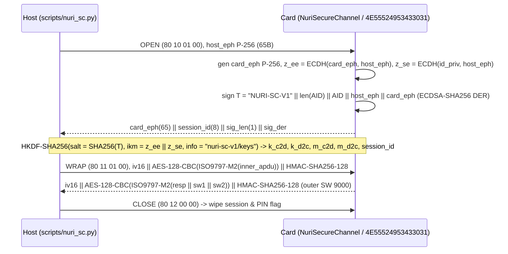

# Application secure channel (NURI-SC v1)

Status 2026-11-18: **implemented in Java Card 3.0.4 Classic + Python host and proven live on physical smartcard `87E5470B`** ([receipt](proofs/real-card-87E5470B-secure-channel.json)).



## Implementation and artifacts

| Component | Path | Notes |
|---|---|---|
| Reusable Java Card 3.0.4 channel class | [`card/sc/NuriSecureChannel.java`](../card/sc/NuriSecureChannel.java) | Clean-room MIT; `CLEAR_ON_DESELECT` RAM session keys & counters |
| Reference `SC_REQUIRED` applet (`4E55524953433031`) | [`card/sc/NuriSecureChannelApplet.java`](../card/sc/NuriSecureChannelApplet.java) | Rejects plaintext PIN/secret APDUs (`0x6985`); encrypts inner `ISOException` status words |
| Reproducible CAP binary | [`dist/nuri-sc.cap`](../dist/nuri-sc.cap) | Package `4E555249534330`, verified by `npm run card:release:verify` |
| Python host & PC/SC session client | [`scripts/nuri_sc.py`](../scripts/nuri_sc.py) | `HostChannel`, `SimCard`, `ScCardSession` (`pinned_pubkey` required by default) |
| Simulator & cross-language E2E tests | [`test/sc/NuriScSimTest.java`](../test/sc/NuriScSimTest.java), [`test/test_nuri_sc.py`](../test/test_nuri_sc.py) | Run via `npm run card:sc:test:sim` |
| Live physical-card acceptance proof | [`scripts/real-card-sc-proof.py`](../scripts/real-card-sc-proof.py), [`docs/proofs/real-card-87E5470B-secure-channel.json`](proofs/real-card-87E5470B-secure-channel.json) | Infineon card `87E5470B` on `ACS ACR39U` (`T=0`), handshake `412 ms` |

Existing standalone applets already deployed on cards (`ETH2`, `MuSig2`, `Vault`, `TOTP`) remain backward-compatible until rebuilt against `NuriSecureChannel`. `NuriSecureChannelApplet` (`4E55524953433031`) proves the full `SC_REQUIRED` contract on hardware today and `NuriSecureChannel` is the shared class for applet v2/v3 builds.

## Threat boundaries

| Closed by NURI-SC v1 | Still outside NURI-SC v1 |
|---|---|
| Passive or active snooping of PINs, secrets, commands, responses, and inner status words (`63Cx`) across NFC, USB, or shared PC/SC middleware | A compromised host process that already holds the user's PIN and is authorized to request signatures |
| In-flight APDU tampering, truncation, reordering, replay, or direction reflection (`0x6988` + immediate session & `OwnerPIN` wipe) | Blind signing: a headless card without a display still signs the digest the host constructs |
| Impostor applet or relay substitution when the host pins the card's CA-attested or paired `identity_pubkey` (`pinned_pubkey`) | Unauthenticated TOFU (`allow_tofu=True`) on an untrusted bus without a CA certificate or out-of-band key check |

## Wire specification (NURI-SC v1)

All multi-byte integers are big-endian. `||` is concatenation.

| Command | Outer APDU | Request body | Response (`9000`) |
|---|---|---|---|
| `STATUS` | `80 01 00 00 00` | empty | `ver(0x01) \|\| ecdh_mode \|\| open(0/1) \|\| pin_set(0/1) \|\| pin_tries` (5B) |
| `GET_PUBKEY` | `80 02 00 00 00` | empty | Uncompressed P-256 `identity_pub` (`04 \|\| X \|\| Y`, 65B) |
| `OPEN` | `80 10 01 00 41` | `host_eph` (`04 \|\| X \|\| Y`, 65B) | `card_eph(65) \|\| session_id(8) \|\| sig_len(1) \|\| sig_der` |
| `WRAP` | `80 11 01 00 Lc` | `iv16 \|\| ct(16..208) \|\| tag16` | `iv16 \|\| ct \|\| tag16` |
| `CLOSE` | `80 12 00 00` | empty | empty (`9000`) |

### Handshake and key schedule

1. **ECDH (forward secrecy + static binding):**
   - `z_ee = ECDH_X(card_eph_priv, host_eph)` (32 bytes, left-padded with `0x00` when `ALG_EC_SVDP_DH_PLAIN` `0x03` strips leading zeros; auto-falls back to `ALG_EC_SVDP_DH_PLAIN_XY` `0x06` taking `inner[1..33)`).
   - `z_se = ECDH_X(identity_priv, host_eph)` (32 bytes).
   - `card_eph_priv` is cleared immediately after `z_ee` is computed.
2. **Transcript & authentication:**
   - `T = "NURI-SC-V1" || len(AID) || AID || host_eph(65) || card_eph(65)`.
   - Card signs `T` with `Signature.ALG_ECDSA_SHA_256` (`identity_priv`, ASN.1 DER).
   - Host verifies `sig_der` against its pinned `identity_pub` **before** deriving or trusting session keys (`ScCardSession.open(pinned_pubkey=...)`).
3. **HKDF-SHA256 (RFC 5869):**
   - `salt = SHA256(T)` (32 bytes), `ikm = z_ee || z_se` (64 bytes), `info = "nuri-sc-v1/keys"`, `L = 104` bytes:
   - `OKM = k_c2d(16) || k_d2c(16) || m_c2d(32) || m_d2c(32) || session_id(8)`.
   - Host verifies `hmac.compare_digest(session_id, sid_wire)`.

### Record layer (`INS_WRAP`)

- **Cipher:** `Cipher.ALG_AES_BLOCK_128_CBC_NOPAD` with fresh 16-byte `RandomData.ALG_SECURE_RANDOM` IV per frame and ISO/IEC 9797-1 Method 2 padding (`0x80` followed by `0x00` to 16-byte boundary).
- **MAC (Encrypt-then-MAC):** Clean-room RFC 2104 HMAC-SHA256 built strictly over `MessageDigest.ALG_SHA_256` (so cards lacking `Signature.ALG_HMAC_SHA_256` work identically), truncated to 128 bits (`16` bytes):
  `tag16 = HMAC-SHA256(m_dir, "NURI-SC-V1" || dir || session_id(8) || counter32_be(4) || iv16 || ct)[0..16]`
  where `dir = 0x01` (C2D) or `0x02` (D2C), and `counter32_be` starts at `1` per direction and rejects `0xFFFFFFFF` overflow.
- **Constant-time fail-closed verification:** 16-byte XOR-OR tag check executes before CBC decryption; constant-scan ISO 9797-1 M2 unpadding executes after decryption. Any MAC, length, padding, P1/P2, or counter error wipes all transient session keys/buffers, resets `OwnerPIN` validation, and returns outer `0x6988`.
- **Status-word confidentiality:** Inner `ISOException` status words (such as `0x63C4` wrong PIN or `0x6982` unauthenticated) are encrypted inside the D2C payload `resp_data || sw1 || sw2` while the outer PC/SC status word remains `0x9000`.

## Reproduce

```sh
# Simulator + Python cross-language suite (no card required)
npm run card:sc:test:sim

# Reproducible CAP build
npm run card:sc:build

# Physical card acceptance proof (requires NuriSecureChannelApplet on reader)
PYTHON_BIN=/opt/homebrew/bin/python3 scripts/run-card-python.sh \
  scripts/real-card-sc-proof.py --reader "OMNIKEY" \
  --out docs/proofs/real-card-sc.json
```
