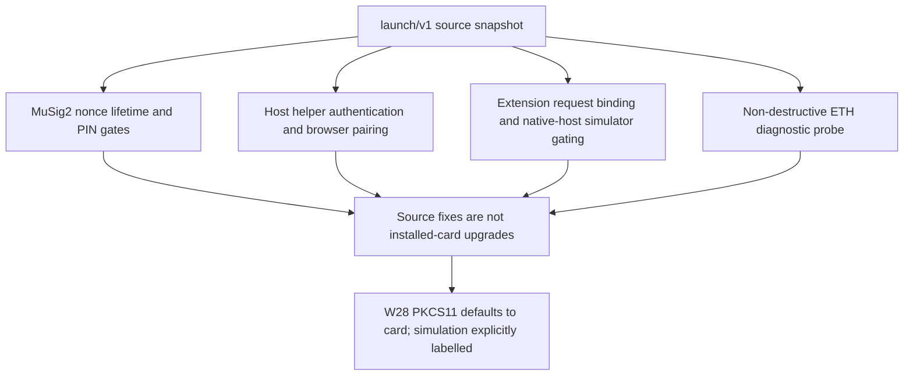

# Security advisories



## Reading this register

**Register date: 2026-10-18.** These seven project advisories describe launch-review
findings and source remediation, not assigned CVEs or published GHSAs. Severity is
a qualitative project assessment, not a calculated CVSS score. Dates below are the
advisory/source-fix dates, not claims about first discovery or exploitation.

The original evidence snapshot is `launch/v1` at
`00fe2e508d4126e1b15ab2a30e1b37a6ef58b806`. Historical remediation SHAs were checked
with `git cat-file -t` and `git merge-base --is-ancestor` against that snapshot.
Historical line anchors remain pinned to it. The separately identified W28 fix
is verified against its full commit SHA on the W28 task branch (merge and
publication are separate), with newly executed fake/simulator regressions in
[the signer policy report](fail-closed-signers.md). No physical-card testing was
performed for W28. Deployed or installed versions must be checked separately.
Report new findings using [SECURITY.md](../SECURITY.md).

| Advisory | Date | Severity | Component | Source remediation |
| --- | --- | --- | --- | --- |
| [NURI-2026-001](#nuri-2026-001--musig2-nonce-lifetime-after-power-loss) | 2026-10-18 | Critical | MuSig2 applet; W7/W16 | Nonce lifetime fixed; retained through scalar replacement. |
| [NURI-2026-002](#nuri-2026-002--unauthenticated-helper-signing) | 2026-10-18 | High | HTTP/MCP host helpers; W9 | Request guards added; later hardened by W22. |
| [NURI-2026-003](#nuri-2026-003--eth-keygen-probe-rotates-an-existing-key) | 2026-10-18 | High | ETH diagnostic helper | Probe skipped for applets older than 1.4. |
| [NURI-2026-004](#nuri-2026-004--bearer-token-served-in-html) | 2026-10-18 | High | Browser-facing HTTP helpers; R1/W22 | Credential bootstrap replaced with pairing. |
| [NURI-2026-005](#nuri-2026-005--popup-request-binding) | 2026-10-18 | High | Chrome extension; R7/W21 | Approval bound to live popup and displayed request. |
| [NURI-2026-006](#nuri-2026-006--silent-simulator-key-selection) | 2026-10-18 | High | Native messaging host and extension; R8/W21 | Native-host path fixed; W28 fixes PKCS#11 default-sim selection. |
| [NURI-2026-007](#nuri-2026-007--musig2-finalize-without-a-pin-gate) | 2026-10-18 | High | MuSig2 applet; gate 2/W20 | PIN checks added to signing commands in v1.14. |

## NURI-2026-001 — MuSig2 nonce lifetime after power loss

- **Date:** 2026-10-18
- **Severity:** Critical — possible disclosure of the long-term signing scalar.
- **Component:** MuSig2 applet; W7 nonce-lifetime fix, W16 scalar replacement and regressions.
- **Affected scope:** The pre-v1.12 implementation, including v1.11, kept
  `noncesReady`/`finalized` in persistent fields but secret nonces in reset-transient
  memory. A reset between nonce generation and FINALIZE could leave authorization
  ready with zero secret nonces. This is the power-loss/nonce-reuse finding; the
  reproduced failure is specifically **signing with cleared nonces**, not evidence
  that the RNG repeated a nonzero nonce. The scalar term was no longer masked by
  a secret nonce contribution.
- **Verified fix SHAs:**
  - `08c123babc3f11e7645921af02c19722ec751eb1` — v1.12 places flags in the same
    reset-transient lifetime and rejects either all-zero secret nonce.
  - `00ce5b211de1ec2ba34e9540b0423f6193f3d8b5` — W16/v1.13 replaces scalar
    arithmetic while retaining the v1.12 guards; this is not the original
    power-loss fix.
- **Source evidence:** [`card/musig2/NuriMuSig2v019.java:178–183`](../card/musig2/NuriMuSig2v019.java#L178-L183)
  allocates nonces and flags together;
  [`:530–561`](../card/musig2/NuriMuSig2v019.java#L530-L561) rejects cleared nonces,
  consumes finalization state before parsing/math, and burns nonces before output
  in the v1.14 snapshot.
  [`test/musig2-jcardsim/NonceLifetimeTest.java:85–108`](../test/musig2-jcardsim/NonceLifetimeTest.java#L85-L108)
  checks reset refusal and no returned scalar;
  [`:178–194`](../test/musig2-jcardsim/NonceLifetimeTest.java#L178-L194) independently
  exercises the zero-nonce guard.
- **Action and limits:** Do not use affected applets for value-bearing signing.
  Updating host source alone does not patch a card. Coordinate a key-preserving
  migration to reviewed applet code; do not assume an applet reinstall preserves
  keys. This register does not establish whether any production key was exposed.

## NURI-2026-002 — Unauthenticated helper signing

- **Date:** 2026-10-18
- **Severity:** High — an unauthorized caller could invoke card-backed signing.
- **Component:** `card-mcp-server.mjs`, `local-card-cosign-server.mjs`, and
  `card-dashboard-server.py`; W9.
- **Affected scope:** Before W9, the helper request boundaries lacked the bearer,
  Host/Origin, and content-type checks later added to signing endpoints. Depending
  on the helper's bind/tunnel configuration and browser request path, an attacker
  could drive a signing operation without the intended local authorization.
- **Verified fix SHA:** `0fe19f35fd8b2d2305ea418abb775b17cc06d45b` — adds helper
  authentication, default loopback binding, Host/Origin checks, JSON-only POSTs,
  and dashboard KEYGEN gating. W9 initially retained an explicit remote-bind
  override and embedded the bearer in HTML; **do not use W9 alone as the final
  security boundary**. The latter defect is NURI-2026-004.
- **Source evidence:** In the snapshot, Node guards and their caller are
  [`scripts/helper-auth.mjs:131–146`](../scripts/helper-auth.mjs#L131-L146) and
  [`scripts/card-mcp-server.mjs:269–274`](../scripts/card-mcp-server.mjs#L269-L274).
  The Python guard is
  [`scripts/nuri_helper_auth.py:341–381`](../scripts/nuri_helper_auth.py#L341-L381),
  called by [`scripts/card-dashboard-server.py:262–265`](../scripts/card-dashboard-server.py#L262-L265).
- **Action and limits:** Update all helper services through the W22 fixes below;
  restrict them to loopback, stop public tunnels, and protect scoped service
  tokens. Request authentication is not a trusted transaction display or a
  per-operation physical confirmation, and does not retrofit PIN protection into
  legacy card applets.

## NURI-2026-003 — ETH KEYGEN probe rotates an existing key

- **Date:** 2026-10-18
- **Severity:** High — irreversible replacement of a private key can strand funds
  or invalidate an identity.
- **Component:** `scripts/card-eth-test.py`, interacting with ETH applets older
  than 1.4.
- **Affected scope:** The diagnostic sent KEYGEN to an already-keyed card to test
  the one-shot guard without first checking its version. Older ETH applets do
  not have that guard, so the probe replaced the existing ETH key. The launch
  incident record reports an actual diagnostic-induced key rotation on
  2026-10-18; no broader loss or exploitation is established here.
- **Verified fix SHA:** `3f51a4e7f4d4297742a8c445d4a440cf9e224265` — only probes
  the keyed-card guard when the applet reports version 1.4 or later; skips it for
  earlier versions.
- **Source evidence:** [`scripts/card-eth-test.py:104–124`](../scripts/card-eth-test.py#L104-L124)
  separates explicit regeneration from the version-gated diagnostic probe. The
  incident is recorded in the fix commit and the source comment at lines 115–117;
  this documentation task did not reproduce it on hardware.
- **Action and limits:** Update the diagnostic before using it on any existing
  key. Never send KEYGEN to an older keyed applet as a probe. The explicit
  `--regenerate` path remains destructive on older applets; this helper fix does
  not change their firmware or recover an overwritten key.

## NURI-2026-004 — Bearer token served in HTML

- **Date:** 2026-10-18
- **Severity:** High — a client able to read the helper page could acquire a
  reusable signing credential.
- **Component:** Browser-facing cosign and Python dashboard helpers; R1/W22.
- **Affected scope:** The W9 fetch shim embedded the service bearer in served HTML
  to bootstrap browser API requests. Fetching an unauthenticated page through an
  accepted Host/Origin context could disclose the token; header checks did not
  make the credential private. This is distinct from the missing request guards
  in NURI-2026-002.
- **Verified fix SHAs:**
  - `1018c6dc068dc1952d2d044115cd36145cf8eaab` — Node helpers remove bearer
    bootstrap, introduce one-time terminal-code pairing for browser sessions,
    scope service tokens, and remove remote-bind overrides.
  - `f2577a20654e14f88dd1c213cd191a1699ede539` — Python dashboard independently
    implements credential-free HTML, one-time pairing, scoped service tokens,
    and bounded HTTP framing.
- **Source evidence:** [`scripts/helper-auth.mjs:101–148`](../scripts/helper-auth.mjs#L101-L148)
  exchanges a one-time code for a session cookie and injects only the pairing
  script;
  [`scripts/local-card-cosign-server.mjs:287–289`](../scripts/local-card-cosign-server.mjs#L287-L289)
  serves HTML using that script, and
  [`:1383–1395`](../scripts/local-card-cosign-server.mjs#L1383-L1395) handles pairing.
  [`scripts/card-dashboard-server.py:547–552`](../scripts/card-dashboard-server.py#L547-L552)
  serves credential-free HTML and pairing JavaScript;
  [`scripts/nuri_helper_auth.py:286–325`](../scripts/nuri_helper_auth.py#L286-L325)
  burns the code and creates an HttpOnly, SameSite=Strict, `/api/`-scoped cookie.
  Same-origin session checks are at
  [`:341–381`](../scripts/nuri_helper_auth.py#L341-L381). MCP remains a scoped-bearer
  API, not a browser-cookie pairing endpoint
  ([`scripts/card-mcp-server.mjs:269–274`](../scripts/card-mcp-server.mjs#L269-L274)).
- **Action and limits:** Stop old helpers, replace any bearer previously exposed
  through HTML, and start the updated services with separate scoped tokens. Pair
  browsers using the terminal code. Pairing authorizes a browser session; it does
  not provide per-transaction user verification or protection against a compromised
  same-origin page or local account.

## NURI-2026-005 — Popup request binding

- **Date:** 2026-10-18
- **Severity:** High — an approval could authorize the wrong pending request.
- **Component:** Chrome extension approval routing; R7/W21.
- **Affected scope:** Before W21, an approval response was settled from a
  predictable request ID and boolean without authenticating the live popup
  document or binding it to the displayed request/hash. A forged or stale
  extension-message response could cross the intended approval boundary.
- **Verified fix SHA:** `dbb50bb7d86a7ed0ba95d1b4f2045d93810408fd` — random
  in-memory approval IDs, immutable request digest, exact extension URL/ID and
  Chrome document/live-window checks, displayed-hash confirmation, single-use
  settlement, timeout/cancellation, and orphan cleanup.
- **Source evidence:** [`extension/background.js:110–202`](../extension/background.js#L110-L202)
  creates and validates the binding before invoking the approved signing action;
  [`:397–403`](../extension/background.js#L397-L403) routes approval messages through
  that validation. Negative regressions are at
  [`extension/test/background.test.js:48–91`](../extension/test/background.test.js#L48-L91).
- **Action and limits:** Update/reload the extension and close old approval
  windows. The binding protects the extension's request/approval boundary, not a
  hardware trusted display; it does not establish that a compromised browser or
  host cannot misrepresent a transaction.

## NURI-2026-006 — Silent simulator key selection

- **Date:** 2026-10-18
- **Severity:** High — software test signing may be mistaken for protected
  card-backed signing; a public deterministic key is not suitable for funds.
- **Component:** Native messaging host/installer and extension; R8/W21.
- **Affected scope:** Ambiguous simulator opt-in and absent live-mode binding
  could let callers use or display simulator signing without establishing that
  the active connection was intentionally using the public software key.
- **Verified fix SHAs:**
  - `33e5e66e7925c33a2439798d15f51b86b0d8c699` — native-host signing requires
    explicit `NURI_CARD_SIM=1` and a prior successful simulator `info` in the same
    process; `--sim` alone is insufficient. A normal installed launcher unsets
    inherited simulator configuration.
  - `dbb50bb7d86a7ed0ba95d1b4f2045d93810408fd` — extension requires a declared
    `card`/`sim` mode on the live native connection and displays a `SIM` badge.
- **Source evidence:** [`host/nuri_card_host.py:417–449`](../host/nuri_card_host.py#L417-L449)
  resolves mode and enforces acknowledgment before signing;
  [`:517–524`](../host/nuri_card_host.py#L517-L524) establishes that acknowledgment
  from `info`; [`:550–566`](../host/nuri_card_host.py#L550-L566) applies the signer
  guard to signing handlers.
  [`host/install-macos.sh:50–58`](../host/install-macos.sh#L50-L58) separates normal
  and explicit simulator launchers;
  [`extension/background.js:69–88`](../extension/background.js#L69-L88) checks mode
  and marks simulation.
- **W28 PKCS#11 default-simulator fix:**
  **Verified fix SHA:** `3e56c445dc63ae11ec51d35119af7daadda9ced3`. The native
  module and Python helper now default to the physical card; only exact
  `NURI_PKCS11_MODE=sim` enables the deterministic software key. Unknown modes
  reject before invoking a signer. The simulator token and every object label
  contain `SIMULATOR`, and helper responses identify `mode: sim`.
  ETH2 is preferred; ambiguous transport/SELECT failures never select ETH1.
  Legacy ETH1 requires exact `NURI_ALLOW_ETH1_DEMO=1` and prints a warning.
  ETH2 signing remains fail-closed in this PKCS#11 bridge because it has no
  persistent authenticated PIN session; this is not a claim of ETH2 OpenSSL support.
- **Regression evidence:** `scripts/test-pkcs11-failclosed.py` exercises native
  dispatch, labels, helper errors, unknown-mode rejection, ETH2 preference and
  no downgrade using fakes. The rebuilt artifact is pinned in `dist/SHA256SUMS`.
  No physical reader was used for W28.
- **Physical-card acceptance (2026-10-18, parent, `9c227c7`):** on the ETH1-only
  demo card in a HID OMNIKEY 5422: `pkcs11-tool -L` without the demo opt-in was
  refused; with `NURI_ALLOW_ETH1_DEMO=1`, `scripts/test-pkcs11-e2e.py` printed
  `ALL TESTS PASSED` and `scripts/hsm-openssl-selftest.sh --card` printed
  `HSM_OPENSSL_SELFTEST_OK mode=card`. The run found one fail-closed bug that the
  fakes missed: the reader's idle contactless slot ("no card" on every protocol)
  blocked the confirmed 6A82 from the contact slot, so the demo card was refused
  even with the opt-in. `9c227c7` treats a slot with no card as holding no applet;
  no card answering anywhere still refuses (regressions in
  `scripts/test-pkcs11-failclosed.py` and `host/test_host.py`).
- **Status:** The PKCS#11 default-simulator item is **fixed in source and rebuilt
  artifact**. This closes that specific R8 item, not every OpenSSL/TLS/PIN
  integration concern described by R8.
- **Action and limits:** Replace the native module and helper together, verify
  the pinned artifact and independently check the card public key. Do not fund
  any simulator address. Parent-only card acceptance commands are in `docs/hsm.md`.

## NURI-2026-007 — MuSig2 FINALIZE without a PIN gate

- **Date:** 2026-10-18
- **Severity:** High — a caller with card/APDU access could obtain a partial
  signature without the intended PIN authorization.
- **Component:** MuSig2 applet signing dispatch; launch gate 2/W20.
- **Affected scope:** The pre-v1.14 implementation did not apply a PIN check to
  FINALIZE (or nonce generation). Host/browser approval is not a replacement for
  an applet-side authorization gate. This is a Nuri finding; it is not a claim
  that Nuri shipped the same implementation as a third-party MuSig2 advisory.
- **Verified fix SHA:** `95e2d4301013ab5be5685da7d301825e7ea0cf9e` — v1.14 adds
  PIN session checks to KEYGEN, GET_NONCES, and FINALIZE, and invalidates
  authorization/nonce state on session boundaries and terminal errors.
- **Source evidence:** [`card/musig2/NuriMuSig2v019.java:193–195`](../card/musig2/NuriMuSig2v019.java#L193-L195)
  defaults to mandatory PIN;
  [`:236–277`](../card/musig2/NuriMuSig2v019.java#L236-L277) resets session state
  and gates all three commands;
  [`:297–299`](../card/musig2/NuriMuSig2v019.java#L297-L299) requires a configured,
  validated PIN when PIN protection is required or set.
- **Action and limits:** Migrate affected cards to the PIN-protected applet and
  compatible host protocol, with a recovery plan before altering an installed
  applet. v1.14 deliberately supports an **explicit public-demo no-PIN install**
  ([`:204–230`](../card/musig2/NuriMuSig2v019.java#L204-L230)); that configuration
  is not PIN-protected. The fix is not a claim that every installed MuSig2 applet
  or legacy ETH applet now requires a PIN, nor proof of physical fault resistance.

## Rechecking provenance without touching a card

Use a checkout containing `launch/v1`; these commands only inspect Git objects:

```sh
git cat-file -t <full-fix-SHA>
git merge-base --is-ancestor <full-fix-SHA> launch/v1
git show <full-fix-SHA> -- <affected-source-path>
```

The W26 documentation review used the pinned snapshot above. A commit's existence
and ancestry establish source provenance, not publication, deployment, installation,
external-audit completion, or remediation of every related attack surface.
