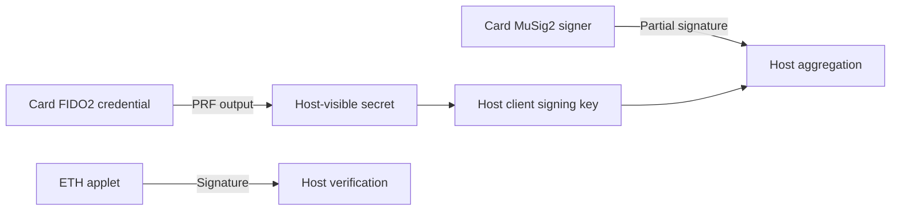

# Security model

## Trust boundaries

This model describes software interfaces, not certified physical resistance.
The PRF wallet derives a private client key in host memory and combines it with
a MuSig2 card partial. It is incorrect to say that no private spend key reaches
the host, or that a same-card arrangement is two independent devices.
Sources: [scripts/nuri-card-wallet.mjs:109–127](../scripts/nuri-card-wallet.mjs#L109-L127),
[scripts/nuri-card-wallet.mjs:173–185](../scripts/nuri-card-wallet.mjs#L173-L185),
[scripts/card-arkade-identity.mjs:55–72](../scripts/card-arkade-identity.mjs#L55-L72).

MuSig2 consumes its nonce state during signing; this does not authorize the user
or decode the transaction. The host supplies coefficients and challenge.
Source: [card/musig2/NuriMuSig2v019.java:369–415](../card/musig2/NuriMuSig2v019.java#L369-L415).
See [nonce lifetime](musig2-nonce-lifetime-fix.md).

## Authorization is not shared between applets

| Interface | Actual boundary | Source |
|---|---|---|
| FIDO2 | Client-PIN/UV is specific to FIDO2; UP signaling is not fresh physical consent | [FIDO2Applet.java:2343–2346](../third_party/fido2-applet/src/main/java/us/q3q/fido2/FIDO2Applet.java#L2343-L2346), [4648–4654](../third_party/fido2-applet/src/main/java/us/q3q/fido2/FIDO2Applet.java#L4648-L4654) |
| MuSig2 | No PIN/fresh-UP gate in the APDU dispatch/signing path | [NuriMuSig2v019.java:178–203](../card/musig2/NuriMuSig2v019.java#L178-L203), [369–415](../card/musig2/NuriMuSig2v019.java#L369-L415) |
| ETH v1 | Initialized key and exact hash length, not PIN approval | [NuriEcdsaSigner.java:204–218](../card/eth/NuriEcdsaSigner.java#L204-L218) |
| ETH v2 | Optional PIN after configuration; validation resets on deselect | [NuriEthSignerV2.java:188–218](../card/eth2/NuriEthSignerV2.java#L188-L218), [322–343](../card/eth2/NuriEthSignerV2.java#L322-L343) |
| TOTP | Admin PIN protects replacement, not code calculation | [NuriOathTotp.java:142–157](../card/totp/NuriOathTotp.java#L142-L157), [171–209](../card/totp/NuriOathTotp.java#L171-L209) |

Remove the card when it should not be usable. A host-side popup does not prevent
a local attacker from calling a card interface. The extension's native host has
no PIN-unlock operation: [host/nuri_card_host.py:325–349](../host/nuri_card_host.py#L325-L349).

## What is not established

- **UNVERIFIED:** independent audit, constant-time software bignum, tamper resistance,
  product-level EAL/FIPS/FIDO certification and biometric gating.
- No on-card recipient/amount display or transaction-intent verification is shown
  by hash/partial-signature interfaces. Blind signing remains.
- A retained historical transaction does not qualify a fresh source/CAP revision.
- PRF output and caller-supplied seeds are secrets even when card credential
  private keys are not exported.
- A recovery path is not universal loss protection. The standalone wallet's
  client recovery key is itself derived from or supplied to the host; inspect
  [scripts/nuri-card-wallet.mjs:109–127](../scripts/nuri-card-wallet.mjs#L109-L127)
  before relying on it after losing the card.

See [signing architecture](signing-architecture.md), [secret handling](hsm.md),
[helper security](helper-servers-security.md) and [applet key operations](real-card-key-handling.md).
