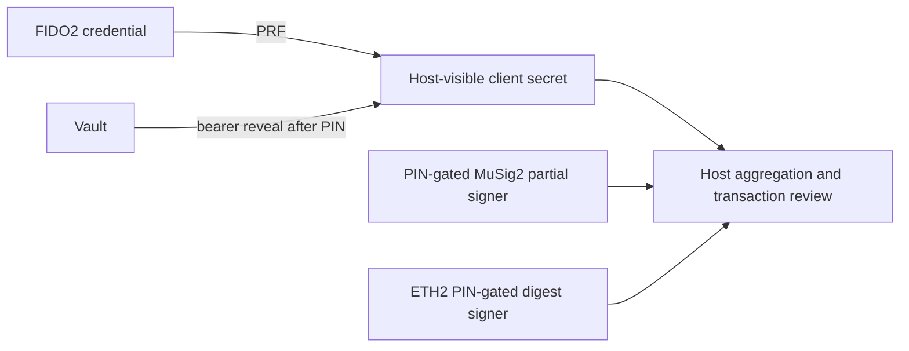

# Security model

## Release boundary

Research-grade, not externally audited and not a certified hardware wallet.
Blind signing and no screen: the card does not show or independently approve
recipient, amount, chain or host-built transaction context. See
[SECURITY.md](../SECURITY.md), [advisories](security-advisories.md) and the
[feature evidence table](../README.md#feature-status).

## Authorization is applet-specific

| Interface | Actual boundary |
|---|---|
| FIDO2 | UP is assumed true, not physical touch. CTAP2 response UP follows request options; selection succeeds directly. PIN/UV depends on credential/options and applet policy. |
| SSH bridge | FIDO2 `ecdsa-sk`; no PIN authentication implemented by this bridge. A connected card is not fresh consent. |
| Current MuSig2 | Mandatory PIN by default; session token binds nonce/finalize operations. Explicit public-demo install policy exists. New revision is simulator only. |
| ETH v1 demo | No PIN/UP authorization; any process with reader access can request signing. |
| ETH v2 | Mandatory PIN by default; explicit install-time demo exception. Validation clears on reselection/deselect/reset, not per signature. Simulator only. |
| Vault applet | Own five-try PIN; HMAC keys have no reveal command, bearer keys deliberately reach broker RAM. Simulator only. |
| TOTP | Admin PIN protects replacement, not CALC. Reader access permits code calculation. |
| GP lock | Reversible management-key rotation with encrypted escrow; not signing authorization or lifecycle CARD_LOCKED. Simulator only. |

Sources: [FIDO2 UP](fido2-user-presence.md), [SSH](ssh-smartcard.md),
[MuSig2 policy](musig2-pin-and-hardening.md), [ETH2](eth-applet-v2.md),
[vault](card-vault-applet.md), [TOTP](totp-applet.md), [GP lock](card-lock.md).
The [native host](../host/nuri_card_host.py) supports same-connection PIN+hash
signing; browser approval remains host-side, not a trusted card display.

## Host and recovery assumptions

PRF-derived client keys exist in host memory. A same-card PRF + MuSig2 wallet is
not independent two-device custody. Sources:
[wallet derivation](../scripts/nuri-card-wallet.mjs) and
[PRF identity adapter](../scripts/card-arkade-identity.mjs).

**Losing the card can mean losing funds or access.** The standalone CSV recovery
leaf requires its private client key and retained transaction metadata; a countdown
does not recover that key from a lost FIDO2 credential. Independent lost-card
recovery is planned, not proven. Keep independently enrolled SSH credentials and
test any wallet-specific recovery arrangement before reliance. GP escrow backs up
management keys only, never wallet or FIDO2 keys.

Reader/host compromise can capture plaintext custom-applet PIN APDUs and
host-visible secrets. No secure messaging, biometric authorization, independent
physical side-channel qualification or general memory-zeroization guarantee is
established. Remove cards when not in use; restrict local processes and agent
brokers. Pairing and PINs do not protect an already compromised host.

See [signing architecture](signing-architecture.md), [vault boundaries](card-secrets.md),
[helper security](helper-servers-security.md) and [key lifecycle](real-card-key-handling.md).
