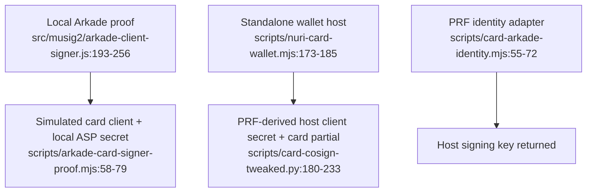

# Signing architecture

## Key locations are path-specific

| Path | Card role | Host / second signer | Evidence |
| --- | --- | --- | --- |
| Arkade client-signer simulator | Simulated client signer | Local software ASP secret; not a live ASP | [src/musig2/arkade-client-signer.js:193-256](../src/musig2/arkade-client-signer.js#L193-L256) |
| PC/SC Arkade proof adapter | MuSig2 client key and partial | Local software signer simulates ASP | [scripts/real-card-arkade-signer-proof.py:214-246](../scripts/real-card-arkade-signer-proof.py#L214-L246) |
| Standalone wallet | MuSig2 cosigner key, separate from FIDO2 credential | Host obtains PRF-derived client secret (or caller-supplied seed), builds transaction and requests both partials | [scripts/nuri-card-wallet.mjs:109-127](../scripts/nuri-card-wallet.mjs#L109-L127), [scripts/nuri-card-wallet.mjs:173-185](../scripts/nuri-card-wallet.mjs#L173-L185), [scripts/card-cosign-tweaked.py:180-233](../scripts/card-cosign-tweaked.py#L180-L233) |
| PRF identity compatibility | FIDO2 PRF source | HKDF/BIP86 key is derived in host memory; `getSigningKey()` returns the private key | [scripts/card-arkade-identity.mjs:32-72](../scripts/card-arkade-identity.mjs#L32-L72) |
| ETH v1 | ECDSA signer | Host supplies 32-byte hash; card returns `r || s || v` | [card/eth/NuriEcdsaSigner.java:204-218](../card/eth/NuriEcdsaSigner.java#L204-L218), [card/eth/NuriEcdsaSigner.java:264-276](../card/eth/NuriEcdsaSigner.java#L264-L276) |
| ETH v2 | Separate ECDSA signer | Host supplies hash; card returns `r || low-S s || pubkey65` | [card/eth2/NuriEthSignerV2.java:322-343](../card/eth2/NuriEthSignerV2.java#L322-L343) |

“No private spend key reaches the host” is **not** true of every path: the PRF adapters deliberately return/forward a client secret. Likewise, “the phone holds no secrets” is not established by a MuSig2 protocol proof. [scripts/card-arkade-identity.mjs:55-72](../scripts/card-arkade-identity.mjs#L55-L72), [scripts/nuri-card-wallet.mjs:173-175](../scripts/nuri-card-wallet.mjs#L173-L175)

## Authorization is applet-specific

- MuSig2 has nonce-integrity checks but no PIN or fresh physical-UP gate. The host supplies its signing transcript. [card/musig2/NuriMuSig2v019.java:178-203](../card/musig2/NuriMuSig2v019.java#L178-L203), [card/musig2/NuriMuSig2v019.java:369-415](../card/musig2/NuriMuSig2v019.java#L369-L415)
- ETH v1 signing checks initialization and input length, not a PIN. ETH v2 enforces its own PIN only **after one is configured**; deselection resets validation. Neither inherits the FIDO2 PIN. [card/eth/NuriEcdsaSigner.java:151-161](../card/eth/NuriEcdsaSigner.java#L151-L161), [card/eth/NuriEcdsaSigner.java:204-208](../card/eth/NuriEcdsaSigner.java#L204-L208), [card/eth2/NuriEthSignerV2.java:188-218](../card/eth2/NuriEthSignerV2.java#L188-L218), [card/eth2/NuriEthSignerV2.java:322-327](../card/eth2/NuriEthSignerV2.java#L322-L327)
- FIDO2 UP signaling is not fresh consent: CTAP2 sets UP from request options; authenticatorSelection succeeds without a presence check. A compromised host with access to a connected card must not be treated as unable to request signatures. [third_party/fido2-applet/src/main/java/us/q3q/fido2/FIDO2Applet.java:2343-2346](../third_party/fido2-applet/src/main/java/us/q3q/fido2/FIDO2Applet.java#L2343-L2346), [third_party/fido2-applet/src/main/java/us/q3q/fido2/FIDO2Applet.java:4648-4654](../third_party/fido2-applet/src/main/java/us/q3q/fido2/FIDO2Applet.java#L4648-L4654), [card/musig2/NuriMuSig2v019.java:178-203](../card/musig2/NuriMuSig2v019.java#L178-L203)
- TOTP CALC is not PIN-gated; its admin PIN protects replacement of a provisioned secret. [card/totp/NuriOathTotp.java:142-157](../card/totp/NuriOathTotp.java#L142-L157), [card/totp/NuriOathTotp.java:171-209](../card/totp/NuriOathTotp.java#L171-L209)

## Proof boundary

The local Arkade proof verifies both partials and the aggregate BIP340 signature. This establishes the exercised signing transcript, not live ASP policy, account recovery, merchant settlement or hardware installation. [src/musig2/arkade-client-signer.js:239-256](../src/musig2/arkade-client-signer.js#L239-L256)

See [MuSig2 interface](musig2-card-extension.md), [Arkade integration boundaries](arkade-lightning.md), [key handling](real-card-key-handling.md) and [historical Signet evidence](proofs/real-card-signet-proof.md). **UNVERIFIED:** current remote-service policy, deployed account mappings, complete Lightning settlement and hardware certification.
