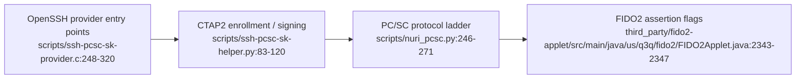

# SSH with the Nuri smartcard



The bridge implements ECDSA security-key enrollment and signing: the Python helper requests ES256 credentials and returns a public key plus credential ID; signing uses that ID in `getAssertion`. Sources: [scripts/ssh-pcsc-sk-provider.c:248-320](../scripts/ssh-pcsc-sk-provider.c#L248-L320), [scripts/ssh-pcsc-sk-helper.py:83-120](../scripts/ssh-pcsc-sk-helper.py#L83-L120).

## Security boundary

- **Card availability is not human approval.** The helper maps OpenSSH's UP flag to CTAP options, but the applet sets assertion UP from the requested option, not a touch measurement. A touch prompt is not proof of a physical action. Remove the card when it must not be used. Sources: [scripts/ssh-pcsc-sk-helper.py:45-51](../scripts/ssh-pcsc-sk-helper.py#L45-L51), [FIDO2Applet.java:2343-2347](../third_party/fido2-applet/src/main/java/us/q3q/fido2/FIDO2Applet.java#L2343-L2347), [FIDO2Applet.java:4648-4654](../third_party/fido2-applet/src/main/java/us/q3q/fido2/FIDO2Applet.java#L4648-L4654).
- **No PIN guarantee through this bridge.** The C provider discards the supplied PIN; the helper does not perform CTAP PIN authentication. Requesting `uv` is not a PIN implementation. Sources: [scripts/ssh-pcsc-sk-provider.c:248-262](../scripts/ssh-pcsc-sk-provider.c#L248-L262), [scripts/ssh-pcsc-sk-provider.c:289-296](../scripts/ssh-pcsc-sk-provider.c#L289-L296), [scripts/ssh-pcsc-sk-helper.py:45-51](../scripts/ssh-pcsc-sk-helper.py#L45-L51).
- **Keep the credential handle.** The helper returns it at enrollment and requires it to sign. It is not merely a reference to a resident slot: the applet's non-resident path packages the private scalar into an encrypted, authenticated credential ID. Do not describe this as “no key material ever leaves the chip”; plaintext private-key export is different from a wrapped credential. Sources: [scripts/ssh-pcsc-sk-helper.py:92-99](../scripts/ssh-pcsc-sk-helper.py#L92-L99), [scripts/ssh-pcsc-sk-helper.py:104-111](../scripts/ssh-pcsc-sk-helper.py#L104-L111), [FIDO2Applet.java:1120-1126](../third_party/fido2-applet/src/main/java/us/q3q/fido2/FIDO2Applet.java#L1120-L1126), [FIDO2Applet.java:1794-1822](../third_party/fido2-applet/src/main/java/us/q3q/fido2/FIDO2Applet.java#L1794-L1822).

## Setup

The installer builds a dynamic library, prepares a pinned Python environment, and replaces its managed SSH configuration block. It does **not** enroll a credential or authorize a server. Its compiler invocation uses macOS `-dynamiclib`; Linux installation with this script is **UNVERIFIED**. Sources: [scripts/install-ssh-card-host.sh:29-58](../scripts/install-ssh-card-host.sh#L29-L58), [scripts/install-ssh-card-host.sh:61-120](../scripts/install-ssh-card-host.sh#L61-L120).

Run from the repository root on your own host; use an OpenSSH build supporting `ecdsa-sk`. These are setup instructions, not a hardware acceptance receipt (**UNVERIFIED** on your setup):

```sh
bash scripts/install-ssh-card-host.sh
PROVIDER="$PWD/dist/nuri-pcsc-sk-provider.so"
ssh-keygen -t ecdsa-sk -w "$PROVIDER" \
  -f "$HOME/.ssh/id_nuri_pcsc_sk" -C nuri-card
```

The enrollment interface above is the one emitted by [scripts/install-ssh-card-host.sh:112-119](../scripts/install-ssh-card-host.sh#L112-L119). The Python launcher requires Python 3.10+ and installs the pinned requirements when its environment is missing or stale: [scripts/run-card-python.sh:4-30](../scripts/run-card-python.sh#L4-L30).

Add the generated `.pub` key to the intended account's `authorized_keys` using your existing administrative access. Edit the installer's `nuri-card-host` block to set your server and account; it supplies `IdentityFile`, `SecurityKeyProvider` and `IdentitiesOnly`. Remote login remains **UNVERIFIED** until you test your own server. Configuration source: [scripts/install-ssh-card-host.sh:84-99](../scripts/install-ssh-card-host.sh#L84-L99).

```sh
ssh nuri-card-host
```

## Recovery and troubleshooting

| Situation | Action and evidence |
|---|---|
| No device | Check card/reader availability; the helper reports `NO_DEVICE` when discovery is empty. [scripts/ssh-pcsc-sk-helper.py:37-42](../scripts/ssh-pcsc-sk-helper.py#L37-L42) |
| Multiple discovered devices | `FIDO2_PCSC_INDEX` selects the zero-based discovered-device index, falling back to `FIDO2_DEVICE_INDEX`, then `0`. [scripts/ssh-pcsc-sk-helper.py:37-42](../scripts/ssh-pcsc-sk-helper.py#L37-L42) |
| Protocol negotiation fails | See [reader compatibility](reader-compatibility.md); this helper installs the shared FIDO2 connection patch. [scripts/ssh-pcsc-sk-helper.py:12-34](../scripts/ssh-pcsc-sk-helper.py#L12-L34) |
| Backup access | Enroll a separate credential on a second card with a different output filename; authorize and test it independently. This is a recovery procedure, not a cloning claim. Enrollment outputs: [scripts/ssh-pcsc-sk-helper.py:83-100](../scripts/ssh-pcsc-sk-helper.py#L83-L100). Recovery on your server: **UNVERIFIED**. |
| Resident-key recovery | Do not rely on provider discovery: `sk_load_resident_keys` returns an empty list. Preserve the enrollment files. [scripts/ssh-pcsc-sk-provider.c:323-329](../scripts/ssh-pcsc-sk-provider.c#L323-L329) |

Hardware login, reader qualification and physical extraction resistance are **UNVERIFIED** by this source-based guide; no private-server transcript is used as launch evidence.
