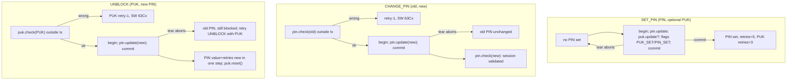

# ETH2 PIN/PUK tear safety (W29a)

Power-loss ("tear") consistency of the ETH2 applet's SET_PIN, CHANGE_PIN and
UNBLOCK commands. Scope: `card/eth2/NuriEthSignerV2.java` PIN/PUK paths and
their tests only; vault, MuSig2 and attestation are later stages.



## Java Card OwnerPIN semantics (authoritative)

From the [Oracle Java Card 3.2 `OwnerPIN` API](https://docs.oracle.com/en/java/javacard/3.2/jcapi/api_classic/javacard/framework/OwnerPIN.html),
class and method notes:

- Class note: even if a transaction is in progress, "update of internal
  state, such as the try counter, the validated flag, and the blocking state,
  shall not participate in the transaction during PIN presentation".
- `update(pin, off, len)`: "If a transaction is in progress, the new pin and
  try counter update must be conditional i.e the copy operation must use the
  transaction facility." It also "resets the PIN try counter to the value of
  the PIN try limit", i.e. update unblocks.
- Consequently: authentication (`check`) stays OUTSIDE transactions (retry
  state is deliberately non-transactional — an abort must never hand an
  attacker free retries), while value writes (`update`) are only guaranteed
  atomic when wrapped in a transaction.

jCardSim 3.0.5.11 matches the spec structurally (verified by disassembly of
the pinned jar): `update` uses `Util.arrayCopy` plus a conditional try-counter
store; `check`/`resetAndUnblock` maintain the try counter through
`Util.arrayFillNonAtomic`.

## Fix (commit e6db997)

All in `card/eth2/NuriEthSignerV2.java`:

- SET_PIN: `pin.update` + optional `puk.update` + both flags moved INSIDE one
  transaction. Previously the updates ran before `beginTransaction()`; the old
  comment claimed "OwnerPIN.update is atomic by itself", which the spec only
  guarantees inside a transaction. A tear now aborts to the no-PIN state.
- CHANGE_PIN: only `pin.update` wrapped in a transaction; the old-PIN check
  and the leave-validated check stay outside.
- UNBLOCK: the redundant pre-update `pin.resetAndUnblock()` was removed
  (update itself resets the try counter to the limit per spec) and
  `pin.update` wrapped. A tear aborts to the old PIN (still blocked) instead
  of the previous mixed state where the counter was already unblocked while
  the value was still the old one.

Commit-buffer capacity and implementation bookkeeping overhead remain
UNVERIFIED on the target card. ETH2 KEYGEN has not been accepted on physical
hardware either; its transaction is not evidence of available buffer capacity.

## What is proven where

| Claim | Evidence |
| --- | --- |
| Try counters decrement persistently on wrong PIN/PUK, not restored by later commands | Simulator APDU tests, this repo |
| UNBLOCK's update alone resets a blocked PIN's retry counter (no resetAndUnblock) | Simulator APDU test: wrong PIN after UNBLOCK -> 63C4, not 6983 |
| update/check transaction structure (begin/commit placement, checks outside) | Static code, `NuriEthSignerV2.java` |
| OwnerPIN spec semantics (conditional update, non-transactional presentation state) | Oracle Java Card 3.2 API javadoc (linked above) |
| Hardware tear actually rolls back the wrapped writes | UNVERIFIED — needs a physical-card power-cut test |

## Simulator limitations (explicit)

jCardSim's `SimulatorRuntime.abortTransaction()` only clears the transaction
depth flag and restores no state, and `Util.arrayFillNonAtomic` is a plain
store. The simulator therefore CANNOT model hardware transaction rollback:
`test/eth2/OwnerPinTearCapabilityTest.java` pins this as a documented probe
(Probe A: an update inside an aborted transaction still persists — sim-only;
Probe B: a wrong-PIN decrement inside an aborted transaction persists — also
required by the hardware spec). Throwing exceptions or `sim.reset()` inside a
test is not a substitute for a real tear. Until a physical card is
power-cycled mid-command, tear atomicity of SET_PIN/CHANGE_PIN/UNBLOCK is
UNVERIFIED; the observable-sim tests here prove retry-counter behaviour and
command status words, the static review proves the transaction structure.

## Reproduce

```
PYTHON_BIN=/opt/homebrew/bin/python3.13 scripts/test-eth2-sim.sh
```

covers `test/eth2/Eth2SimTest.java` (SW paths incl. the new retry-persistence
checks), `test/eth2/OwnerPinTearCapabilityTest.java` and the host suite.
