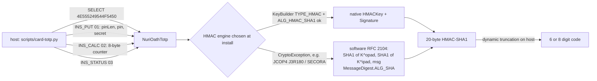
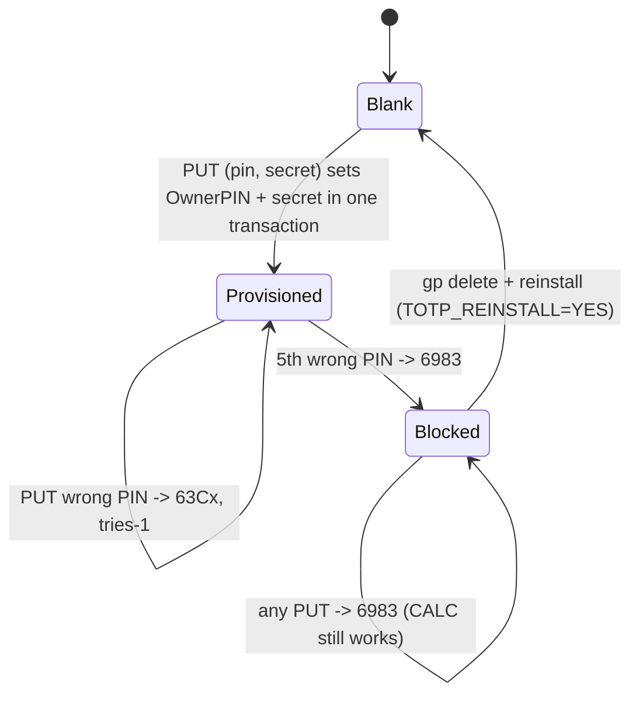

# OATH-TOTP applet (`card/totp/NuriOathTotp.java`)

CAP `dist/nuri-oath-totp.cap`, package AID `4E555249544F50`, applet AID
`4E555249544F5450` ("NURITOTP"), CAP version 1.1.

The card stores a TOTP shared secret and computes HMAC-SHA1(secret, counter).
The host sends the 8-byte time counter (`floor(unixtime / 30)`) and does the
public RFC 4226 truncation. The secret never leaves the card.



## Why two HMAC engines

JCAlgTest reports `KeyBuilder.TYPE_HMAC` and `Signature.ALG_HMAC_SHA1` as
unsupported on every NXP JCOP4 (J3R180/J3R200/P71), JCOP3 and Infineon SECORA
profile (`_launch/out/W4a-card-sourcing.md` section 2, audit finding A10 in
`_launch/out/W5-audit-and-eth-v2-design.md`). Applet 1.0 called both in its
constructor without a `try` block (`NuriOathTotp.java:36-37` in 1.0), so the
INSTALL would fail on the target production chip. Applet 1.1:

1. tries the native pair inside `try { … } catch (CryptoException)`;
2. on failure builds `MessageDigest.ALG_SHA` (yes on all profiles) and keeps
   the secret in a persistent 64-byte array, computing
   `SHA1((K ^ opad) || SHA1((K ^ ipad) || counter))` with K zero-padded to the
   64-byte block (RFC 2104). Secrets are capped at 64 bytes so no pre-hash of K
   is needed (RFC 4226 recommends 20).

The GP install parameter (application-specific data, first byte `0x01`) forces
the software engine; the jCardSim test uses it because the simulator supports
native HMAC. `INS_STATUS` reports which engine is active.

The Feitian card in use today (CPLC fabricator 4090) runs applet 1.0 with the
native engine. Whether its 1.1 install picks native or software is UNVERIFIED
until the parent runs `card-totp.py status` on it.

## APDUs

| INS | Data | Response | Status words |
|---|---|---|---|
| `01` PUT | `[pinLen][pin 4..16][secret 1..64]` | none | `9000`; `6700` bad lengths; `63Cx` wrong PIN, x tries left; `6983` PIN blocked |
| `02` CALC | 8-byte big-endian counter | 20-byte HMAC-SHA1 | `9000`; `6985` not provisioned; `6700` length != 8 |
| `03` STATUS | none | `[provisioned 0/1][engine 0=native 1=software][pin tries left]` | `9000` |

`INS_CALC`'s wire format is unchanged from 1.0, so an existing host keeps
reading codes. `INS_PUT` changed: 1.0 took the raw secret; 1.1 prefixes
`[pinLen][pin]`. `scripts/card-totp.py put` builds the new form and prompts
for the PIN (or reads `NURI_TOTP_PIN`).

## PUT protection (audit A10)



- The first PUT on a blank applet chooses the admin PIN (`OwnerPIN`, 5 tries,
  4..16 bytes) and stores the secret. There is no window where the secret is
  set and the PIN is not: both are written inside
  `JCSystem.beginTransaction()/commitTransaction()`.
- Every later PUT must present the PIN. Wrong PIN leaves the secret untouched.
  After 5 wrong tries PUT is blocked for the life of the instance; CALC keeps
  working so the owner is not locked out of their 2FA.
- CALC is deliberately not PIN-gated: the card is a possession factor for a
  panel login, and the host flow (`nuricard totp`) must stay one command. If
  "holding the card = reading codes" becomes unacceptable, gate `INS_CALC`
  with the same `pin.check` (one `if`).
- The PIN cannot be changed without reinstalling. Reinstall wipes the secret.

## Tests

`scripts/test-totp-sim.sh` (also `npm run card:totp:test:sim`, part of
`npm run test:virtual`) compiles the applet and
`test/totp/NuriOathTotpSimTest.java` against jCardSim 3.0.5.11 (sha256
`f6c3b6b8140401a47cf39d7b9dbfc052e381474c6c3b22018051024be1fca97c`, the same
artifact the FIDO2 sim tests pull through Gradle) and runs, on the native
engine and again with the software engine forced:

- RFC 6238 Appendix B SHA-1 vectors, secret `12345678901234567890`, 8 digits:
  T=59 → `94287082`, T=1111111109 → `07081804`, T=1111111111 → `14050471`,
  T=1234567890 → `89005924`, T=2000000000 → `69279037`,
  T=20000000000 → `65353130`;
- CALC before PUT `6985`, bad PUT shapes `6700`, CALC length `6700`,
  unknown INS `6D00`;
- re-PUT with wrong PIN `63C4` and secret unchanged, correct PIN replaces the
  secret and resets tries, five wrong PINs `63C4..63C1, 6983`, blocked PUT
  `6983` with CALC still returning the right code;
- state survives `CardSimulator.reset()`.

`scripts/card-totp.py --selfcheck` checks the same vectors host-side plus the
PUT APDU layout, with no card.

jCardSim does not model chips without `ALG_HMAC_SHA1`; the fallback is
exercised through the install flag, not through a real `CryptoException`.
Install on a J3R180 is UNVERIFIED until the parent flashes one.

## Parent real-card commands (not run here)

```bash
npm run card:release:verify                       # dist hashes vs rebuild
TOTP_REINSTALL=YES npm run card:totp:install      # deletes 1.0 instance + secret
scripts/run-card-python.sh scripts/card-totp.py status   # expect engine + pin_tries_left=5
scripts/run-card-python.sh scripts/card-totp.py put "GEZDGNBVGY3TQOJQGEZDGNBVGY3TQOJQ"  # RFC secret, PIN 1234
scripts/run-card-python.sh scripts/card-totp.py code     # compare with oathtool --totp -b ...
```
