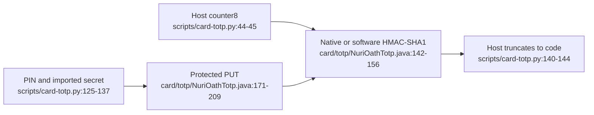

# TOTP applet



## Contract

CAP `dist/nuri-oath-totp.cap`, package AID `4E555249544F50`, applet AID `4E555249544F5450`, package version 1.1: [card/totp/build.xml:9-15](../card/totp/build.xml#L9-L15).

The host imports a Base32 shared secret; it therefore sees the plaintext during provisioning. The applet offers PUT/CALC/STATUS, not a secret-export command. CALC accepts a host-chosen counter and returns HMAC-SHA1; the host supplies time and performs truncation: [scripts/card-totp.py:38-55](../scripts/card-totp.py#L38-L55), [125-144](../scripts/card-totp.py#L125-L144), [card/totp/NuriOathTotp.java:130-169](../card/totp/NuriOathTotp.java#L130-L169).

Host APDUs use CLA `00`, P1/P2 `00`; the applet dispatches on INS without checking CLA/P1/P2: [scripts/card-totp.py:48-55](../scripts/card-totp.py#L48-L55), [113-115](../scripts/card-totp.py#L113-L115), [140-141](../scripts/card-totp.py#L140-L141), [card/totp/NuriOathTotp.java:130-169](../card/totp/NuriOathTotp.java#L130-L169).

| INS | Data | Response / errors | Source |
|---|---|---|---|
| `01` PUT | `pinLen || PIN(4–16 bytes) || secret(1–64 bytes)` | No response body; invalid shape `6700`; wrong PIN `63Cx`; exhausted `6983` | [card/totp/NuriOathTotp.java:171-209](../card/totp/NuriOathTotp.java#L171-L209) |
| `02` CALC | Eight-byte big-endian counter | HMAC-SHA1, 20 bytes; unprovisioned `6985`; bad length `6700` | [card/totp/NuriOathTotp.java:142-156](../card/totp/NuriOathTotp.java#L142-L156) |
| `03` STATUS | No data | `[provisioned][engine: 0 native / 1 software][PIN attempts left]` | [card/totp/NuriOathTotp.java:159-163](../card/totp/NuriOathTotp.java#L159-L163) |

## Access and engine limits

- The first PUT chooses the administrative PIN and stores the secret in a transaction. Later PUTs require that PIN; five failed attempts block replacement. There is no PIN-change/unblock command: [card/totp/NuriOathTotp.java:56-63](../card/totp/NuriOathTotp.java#L56-L63), [130-209](../card/totp/NuriOathTotp.java#L130-L209).
- **CALC is not PIN- or touch-gated**, including when PUT is blocked. Anyone able to communicate with the provisioned applet can request HMACs for arbitrary counters; this is not per-code user approval: [card/totp/NuriOathTotp.java:142-156](../card/totp/NuriOathTotp.java#L142-L156), [183-190](../card/totp/NuriOathTotp.java#L183-L190).
- Construction tries native `TYPE_HMAC`/`ALG_HMAC_SHA1`. If that throws `CryptoException`, software HMAC uses `MessageDigest.ALG_SHA` with a persistent secret array. Install application data byte `01` forces software mode: [card/totp/NuriOathTotp.java:79-127](../card/totp/NuriOathTotp.java#L79-L127), [198-205](../card/totp/NuriOathTotp.java#L198-L205), [213-232](../card/totp/NuriOathTotp.java#L213-L232).
- Particular chip support, power-loss guarantees and hardware tamper resistance are **UNVERIFIED** here. The simulator deliberately forces software mode; it does not demonstrate a physical card's unsupported-algorithm exception: [test/totp/NuriOathTotpSimTest.java:117-128](../test/totp/NuriOathTotpSimTest.java#L117-L128).

## Host use

```sh
# Offline: no reader access
python3 scripts/card-totp.py --selfcheck

# Card operations: run only with the intended card and reader
python3 scripts/card-totp.py status
python3 scripts/card-totp.py put '<BASE32_SECRET>'
python3 scripts/card-totp.py code
```

`put` prompts for the admin PIN (or reads `NURI_TOTP_PIN`). `code` defaults to a 30-second step and six digits; `--step` and `--digits` override them: [scripts/card-totp.py:71-88](../scripts/card-totp.py#L71-L88), [96-107](../scripts/card-totp.py#L96-L107), [125-144](../scripts/card-totp.py#L125-L144). Treat the positional secret as exposed to host command history/process inspection; this CLI accepts it as an argument: [scripts/card-totp.py:98-99](../scripts/card-totp.py#L98-L99), [125-130](../scripts/card-totp.py#L125-L130).

Reinstallation is destructive: `TOTP_REINSTALL=YES` enables deletion of the applet/package, discarding their stored state. Set `GP_READER` explicitly for the intended reader; the installer has a numeric default. Do not reinstall as a routine code-reading step: [scripts/install-totp-card.sh:4-7](../scripts/install-totp-card.sh#L4-L7), [15-35](../scripts/install-totp-card.sh#L15-L35).

## Offline verification

```sh
bash scripts/test-totp-sim.sh
```

The runner compiles and runs jCardSim without a reader: [scripts/test-totp-sim.sh:45-51](../scripts/test-totp-sim.sh#L45-L51). Tests cover both HMAC engines, RFC 6238 vectors, malformed requests, PIN-protected replacement, blocked PUT with CALC still working and simulated reset: [test/totp/NuriOathTotpSimTest.java:35-114](../test/totp/NuriOathTotpSimTest.java#L35-L114). `--selfcheck` checks host truncation and PUT layout only: [scripts/card-totp.py:58-68](../scripts/card-totp.py#L58-L68). Real-card acceptance remains **UNVERIFIED** here.
