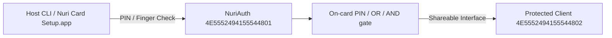

# NuriAuth: on-card PIN / fingerprint policy



Status 2026-11-20: **experimental protected-client bridge**, not yet wallet
signer integration. NuriAuth owns a separate PIN and transient verification
session. A second applet calls its Shareable Interface and cannot perform its
protected test operation until the configured policy is satisfied on-card.

| Policy | Value | Required in the same power session |
|---|---:|---|
| `pin` | 0 | NuriAuth PIN |
| `or` | 1 | PIN **or** registered fingerprint |
| `and` | 2 | PIN **and** registered fingerprint |

- NuriAuth AID `4E5552494155544801`; protected test client
  `4E5552494155544802`. They are additive and use a **separate PIN** from PIV,
  FIDO2, ETH2 and MuSig2.
- Five PIN tries; three fingerprint mismatches before fingerprint lockout. A
  correct PIN restores fingerprint tries. Sensor timeout does not consume a
  fingerprint try. Explicit logout or card reset clears both session flags.
- Policy is selected during initial PIN registration. The simulator also
  verifies authenticated runtime switching and downgrade rejection. **Feitian
  runtime switching/status is not working and is not claimed.** Reprovision the
  experimental bridge to choose another Feitian policy.
- The Mac app provides first-time registration plus one-connection PIN Check,
  Finger Check and PIN + Finger Check flows. PINs travel over stdin, never argv.

```sh
printf '%s\n' "$PIN" | scripts/run-card-python.sh scripts/nuri_uv.py \
  --reader 'ACS ACR39U ICC Reader' --set-pin-stdin --initial-policy and
printf '%s\n' "$PIN" | scripts/run-card-python.sh scripts/nuri_uv.py \
  --reader 'ACS ACR39U ICC Reader' --and-check-stdin
```

## Proof and boundaries

`scripts/test-uv-sim.sh` passes **86 checks**, including PIN, OR, AND, logout,
wrong-PIN/fingerprint retries, timeout accounting, authenticated policy changes
and downgrade rejection. On Feitian `87E5470B`, the real protected client
returned `OK` after PIN under OR; under AND, PIN alone returned `6982` and a
no-touch fingerprint returned `63E9`. See the [hardware
receipt](proofs/real-card-87E5470B-nuriauth.json).

A successful live MATCH/full AND success is **not yet proven**. ETH2/MuSig2 are
**not yet bound** to this bridge: the current protected client proves only the
authorization mechanism. The vendor demo's unauthenticated enrollment/deletion
also remains installed at the owner's no-delete requirement, so production-grade
template-injection resistance is not claimed. The public tree contains the
vendor-neutral policy and PIN-only matcher; the Feitian adapter/CAP and NDA
material remain in `nuri-com/nuri-card-private-smartcard`.
