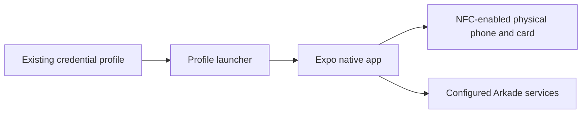

# Native NFC source reference



This is an Expo native development app with NFC and service-specific payment
flows, not a public standalone custody service. A source/build check is not
proof of a completed Lightning payment or merchant settlement.

## Restricted build dependency

A public clone alone cannot build this app. `@nuri/rn` and `@nuri/spec` reference
a private design-system checkout under `.build/`:
[package.json:25–26](package.json#L25-L26).
The preparation script pins its default revision to
`73c64a07e85cf086d750629a82af2b8a7527b43a` and checks it before use:
[../../scripts/prepare-expo-v1.sh:5–7](../../scripts/prepare-expo-v1.sh#L5-L7),
[19–36](../../scripts/prepare-expo-v1.sh#L19-L36).
Separate repository access is required; this README does not grant redistribution
rights to that dependency.

## Build entrypoints

From the repository root, set `NURI_DESIGN_SYSTEM_URL` to the UI dependency
repository you are authorized to use. No private repository URL is shipped:

```sh
npm run mobile:prepare:v1
npm run mobile:verify:v1
```

For development, from this app directory:

```sh
npm ci
npm run check:design-system
npm run typecheck
npm run android:profile
```

An existing card credential profile and configured endpoints are needed by the
profile launcher; inspect [../../scripts/run-expo-nfc-prf-probe.sh](../../scripts/run-expo-nfc-prf-probe.sh)
before using it. Keep credential material out of version control. The Android
and iOS native entrypoints are defined in [package.json:5–17](package.json#L5-L17).
NFC requires native/device testing; no phone compatibility is established by
TypeScript or Metro export.

## Security and evidence limits

- A UI PIN prompt does not add a PIN gate to unrelated card applets.
- PRF output and derived secrets are sensitive host/phone memory, not public data.
- Signing, broadcast, server completion and Lightning settlement are distinct
  outcomes; no fresh end-to-end settlement is claimed here.
- The default `merchant@example.com` is a non-payable placeholder, not recipient advice;
  choose an authorized recipient explicitly before sending.

See [signing architecture](../../docs/signing-architecture.md),
[Arkade boundaries](../../docs/arkade-lightning.md) and
[acceptance](../../docs/acceptance.md).
