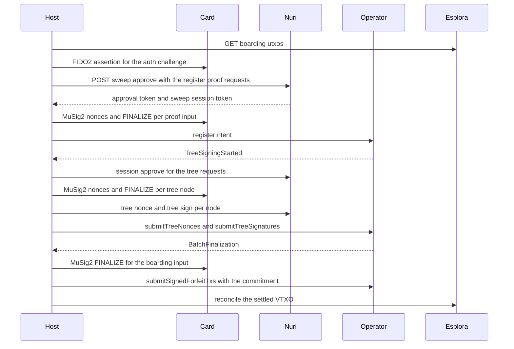

# Arkade card send

Last live run: 2026-10-28 19:13 UTC, 4/4 verified. [Receipt](../../docs/proofs/e2e-proof.json).

Reusable Node 22+ send tool for the existing card-linked Arkade SOURCE. All JS imports are repository-relative or normal root dependencies; no separate Expo checkout or home-directory harness is required. `bridge.py` reuses the repository PC/SC and MuSig2 modules, adds a public-only PRF proof and preserves exact-reader matching.

## End-to-end proof

Install Node dependencies with `npm ci`. For hardware only, use Python 3.11+ with `python -m pip install -r scripts/send/requirements.txt` in a dedicated environment. Set `PYTHON_BIN` to its interpreter. PIN is read only from `NURI_FIDO_PIN` or an owned mode-600 file at `~/.hermes/cache/scratch/.card_pin`, never CLI arguments.

```sh
node scripts/send/e2e-proof.mjs --dry-run
TO='ark1qzpq904am6clw3pgqwyh4p02708fy4xs0hcpwt7rwfdttuxsjameepfv6ed2mgaw4k2tdts49m4wkk3zqyrjv44sr2gcgxrm47gy7sqnlyjr3x'
NURI_SEND_CONFIRM="$TO-546" node scripts/send/e2e-proof.mjs --execute --to "$TO" --amount 546
```

Use the operator floor reported by dry-run if it exceeds 546. The script writes `docs/e2e-proof.md` and `docs/proofs/e2e-proof.json`. A default dry run uses only public GETs, no bridge process or card. Execute evaluates PRF twice, authenticates, verifies every MuSig2 partial and aggregate, finalizes and reads the exact output back. Empty balance stops with funding instructions before hardware. Receipts distinguish unrun hardware from verified stages. A failed or ambiguous submission must not be resent automatically.

## Dry run

```sh
node scripts/send/cli.mjs
node scripts/send/cli.mjs --dry-run --to @emino --amount 1000
node scripts/send/cli.mjs --to <ark1-address> --amount all
```

Default recipient is SOURCE (self); default amount is `max(546, operator floor)` sats. The floor respects both the operator's positive VTXO minimum and dust amount, including the SDK's zero-minimum sentinel. `all` explicitly sweeps the current spendable balance. Partial sends consume the selected source inputs and return the remainder to SOURCE; a remainder below the operator floor is rejected. An empty source returns `needs_funding` and `fund SOURCE >=N sats`, without opening a card, creating an intent or writing a receipt.

`@username` reads `<username>.nuri.eth` text `com.nuri.arkade`. The default ENS provider uses Etherscan's HTTPS GET proxy (`ETHERSCAN_API_KEY` if required) and allows only HTTPS GET-compatible CCIP gateways; resolver verification is retained. A gateway that only supports POST is rejected rather than violating dry-run semantics. Direct Ark addresses do not construct an ENS provider. No recipient/address normalization is performed: confirmation binds the supplied value exactly.

Dry runs use public GET reads only, derive and check SOURCE/script, validate the recipient's network/operator, check all indexed inputs and build the unsigned Ark/checkpoint transactions. They never instantiate the Python child or perform authentication/signing. Public plan/route logs may be written locally.

## Execute and current integration prerequisite

Execution requires both `--execute` and `NURI_SEND_CONFIRM=<to>-<amount>`; `<to>` is the original `@username` or Ark address, not its resolved replacement. For omitted amount use the resolved default reported by the dry run; for `--amount all` the suffix is literally `all`.

```sh
NURI_SEND_CONFIRM=@emino-1000 node scripts/send/cli.mjs --execute --to @emino --amount 1000
```

The Python bridge requires a syntactically valid send confirmation as a second execution boundary. JavaScript binds that confirmation to the exact recipient and requested amount before any card access. Hardware execution is reserved for the operator.

`PYTHON_BIN` selects the Python interpreter. The bridge owns PIN/card access and its existing configuration; do not place a PIN in command arguments or logs. The JS transport preserves `pubkey`, `nonces`, `finalize`, `assert` and `prf-proof` operations. No provisioning/key generation is added.

Execution creates an `ark_send` intent, prepares the PSBT, obtains the FIDO assertion and serializes card nonce sessions. It verifies server/card MuSig2 partials and aggregate BIP340 signatures before submitting through the SDK. Live recipient resolution, exact server/credential linkage, address derivation, operator information and spendable inputs must match the original snapshot before intent creation and again immediately before submission. It reconciles the exact recipient/change outputs and disappearance of consumed inputs, then completes the approval session. There is no automatic signing, submission or reconciliation retry.

## Reuse

```js
import { runSend, parseArgs, Bridge } from './scripts/send/cli.mjs';

const summaryOrReceipt = await runSend(parseArgs(argv), {
  bridge, // optional caller-owned bridge; runSend does not close it
  beforeExecute: async ({ bridge, summary }) => {
    // Parent may perform its PRF proof here, before intent creation/FIDO auth.
  },
});
```

Dependencies are lazy with respect to hardware. Optional dependency hooks include `env`, `request(path, body?)`, `fetch`, `operatorProvider`, `indexer`, `resolveRecipient`, `deriveAddresses`, `bridgeFactory`, `log`, `persistReceipt`, and `signAndSubmitOffchainTx`. Factory-created bridges are closed on success or failure. A custom `persistReceipt(receipt, {exclusive})` must durably persist before resolving and atomically reject an existing receipt when `exclusive` is true; it is responsible for the same replay semantics as the built-in filesystem journal.

## Receipt and failure handling

`NURI_RECEIPT_PATH` (or `options.receiptPath`) defaults to `_launch/out/send/receipt.json`. `NURI_SEND_LOG` (or `options.logPath`) selects the JSONL log, otherwise a timestamped log is created in the same output directory.

The first receipt is exclusively created before opening the bridge, so concurrent invocations sharing a receipt cannot both execute. Later updates use unique temporary files and atomic rename. File contents and the parent directory are synced before persistence returns. An existing or incomplete receipt blocks another operation; inspect it first rather than deleting it and retrying an uncertain send. A new receipt path is for a separately approved new operation, not permission to resend.

Before the operator submission, `submission_pending` contains unsigned transaction/checkpoint IDs, amounts, public signing transcripts and verified authentication-accepted metadata. Receipts/logs omit assertions, challenge/nonce tokens, PINs and private keys. Auth acceptance means the server returned a cryptographically verified cosign partial; it is not inferred merely from obtaining a local FIDO assertion. Submission/finalization/indexer/completion statuses are persisted separately. Provider errors are replaced with fixed failure stages rather than propagated with potentially token-bearing request bodies. An uncertain submission is `failed_unknown_outcome` / `DO NOT RESEND`; reconcile externally before any new operation.

## Dependencies and verification

Root packages are pinned and the lockfile is generated using `npm install --package-lock-only --ignore-scripts`. SDK `0.4.74`, ethers `6.17.0`, noble curves `2.0.0`, scure base `2.0.0`, bip32 `2.2.0`, and btc-signer `2.0.1` match the source Expo installed/locked versions. Boltz-swap `0.3.67` matches its installed version (no direct lock entry there). Existing eventsource `4.1.0` and qrcode-generator `2.0.4` pins are retained; the source has neither installed. Noble v2 requires the accompanying `.js` import/API compatibility updates in existing root consumers, including the local e2e harness.

The generalized software tests are included in `npm test` for cloud CI. They cover strict args/confirmation, amounts/floors/change, real software MuSig2 signatures and bad-partial rejection, empty/funded dry runs with no card/POST, snapshot changes, PRF hook order, receipt-before-submit, sanitized unknown outcomes, receipt reservation/concurrency, reconciliation and the Python transport shape. Run only in cloud CI:

```sh
npm ci
npm test
```

No local executable tests/builds or hardware access were performed for this port. Historical source-tool proof claims are not carried over as verification of this implementation.

## Boarding sweep (onboard)

Confirmed onchain boarding UTXOs sit outside the Arkade wallet until they are settled into a VTXO. `board.mjs` does that the way the app does it (`ramps.onboard` -> `wallet.settle`): one register-intent proof, one boarding-sweep approval, a batch tree signature, then the boarding input signature on the commitment transaction.



The default dry run reads only public endpoints. It prints the boarding UTXOs with height and confirmation state, the plan after operator intent fees, the card signature count, and the register proof requests the server will derive.

```sh
node scripts/send/board.mjs
node scripts/send/board.mjs --outpoint <txid>:<vout> --tree-limit 7
NURI_SEND_CONFIRM=board-7499 node scripts/send/board.mjs --execute
```

`--expect <bc1p...>` pins the derived boarding address. `--outpoint` sweeps one UTXO, otherwise every confirmed one. `--tree-limit` refuses a batch whose tree exceeds the affordable node count. As with a send, the PIN comes only from `NURI_FIDO_PIN` or the owned mode-600 file, and `NURI_SEND_CONFIRM=board-<sats>` is re-checked after the live re-read that precedes intent registration.

### Card cost of one sweep

The card signs sequentially, so the count is what matters, not the size of a signature:

| Step | Card sessions | Why |
| --- | --- | --- |
| register intent proof | 2 | BIP322 message input plus one input per boarding coin |
| delete intent proof | 2 | only signed lazily, when a registration has to be undone |
| boarding inputs | N | commitment transaction inputs, signed at finalization |
| vtxo tree nodes | T | every node this client is a cosigner of |

Measured on the physical card: `GET_NONCES` about 0.29 s, `FINALIZE` about 2.06 s, so roughly 2.4 s per session plus one HTTP round trip. The operator runs a single `sessionDuration` budget per round, split 1/6 for registration and then a third each for nonces, signatures and finalization (arkd `internal/core/application/round_timing.go`). With the operator's advertised 60 s that leaves about 16 s of signature phase, so the tree is the binding term: roughly six to seven nodes, everything else fits with room to spare. A larger batch is not lost, the round dies and the next attempt starts a fresh one.

The operator cannot take the tree over on its own. The tree leaves pay the `aggregate(client, server)` key and the Nuri server only holds half of it (`usesInnerAgg` in `src/ArkadeServer.js:4050`), so the two parties form one outer cosigner together. That is why the card signs the tree with the inner (client plus server) aggregate scaled into the outer session rather than a plain key path spend.

### Executing

Execution uses one passkey assertion. The sweep approval is bound to the selected outpoints, the total and every request key, then re-minted prompt-free from the returned `boarding_sweep_session_token` for the tree round and the commitment. Every server partial and every aggregate BIP340 signature is verified before it is applied. Receipts go to `_launch/out/board/receipt.json` (`NURI_BOARD_RECEIPT_PATH`), logs to `_launch/out/board/*.jsonl` (`NURI_BOARD_LOG`); receipts omit assertions, PINs, nonces and tokens.

A failed or ambiguous run must not be resent. The receipt records `failed_before_submission`, `failed_unknown_outcome` or `failed_completion_only`, and a leftover intent can block the same outpoint with a duplicated-input refusal until the operator clears the registration.
